---
legend:
  "Ridurre la distanza con l’utente": "Ridurre la distanza"
  "Cosa ho notato nel progetto": "Cosa ho notato"
---

## Il progetto

Agorà è un sistema di **bacheche intelligenti**, composto da un chiosco, un’app e un sito web, che ho progettato da solo per il corso di Prototyping Interactive Systems della mia laurea magistrale in Human-Computer Interaction, e che ho presentato a dicembre 2025. Essendo un progetto individuale, ogni passaggio è stato mio: definire il problema, esplorare e disegnare il chiosco, stabilire come le persone ci interagiscono e progettare le interfacce di tutti e tre i touchpoint.

## Definire il problema

Agorà è nato da una domanda che mi facevo spesso da studente: **come si costruisce una comunità all’università?** Dietro c’erano altre domande. Come si fanno conoscere gli eventi, e come si raggiungono davvero le persone? E perché la vita universitaria sembra così spesso “morta”, anche quando succedono tante cose? Un’università è piena di persone, iniziative e spazi, eppure le informazioni che potrebbero unirle spesso non arrivano a chi sono destinate.

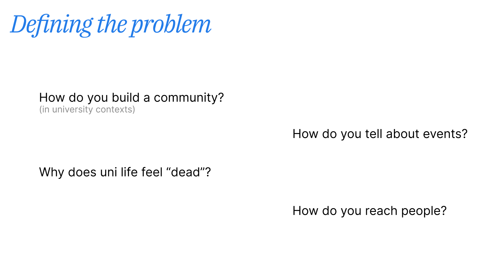

## Come l’ho affrontato

Ho guardato al problema attraverso tre lenti che si alimentano a vicenda: il **senso di comunità**, gli **spazi fisici** che le persone condividono e il modo in cui le informazioni vengono **comunicate**. Nel punto in cui si incontrano c’è un oggetto che ogni università ha già e che quasi nessuno guarda: la bacheca. Sta in uno spazio fisico condiviso, il suo unico scopo è comunicare e, in teoria, è il luogo in cui una comunità mostra quello che fa. Per questo era il punto di partenza naturale.

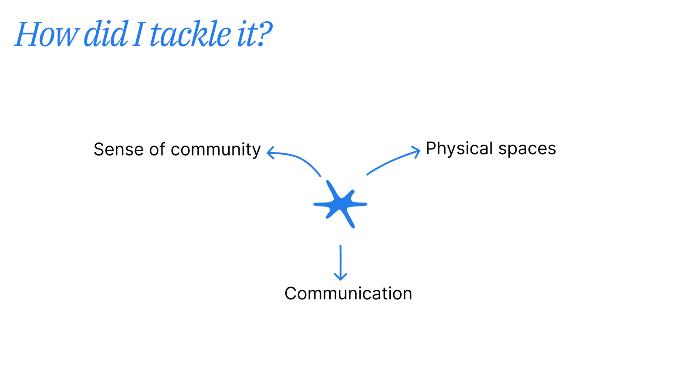

## Bacheche intelligenti

Il problema è che le bacheche tradizionali hanno parecchi difetti. Non attirano l’attenzione, quindi vengono ignorate, e quando qualcosa cambia non te ne accorgi. Di conseguenza sono poco usate e poco aggiornate, fanno solo quella cosa, se ne stanno lì ferme e non hanno niente che ti inviti ad agire.

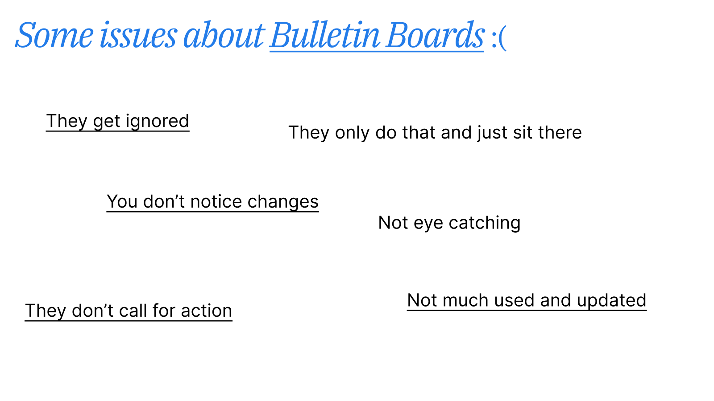

Così mi sono chiesto quale tecnologia potesse supportare la bacheca e renderla più intelligente. La mia risposta non è stata un unico dispositivo, ma tre touchpoint che lavorano insieme come un solo sistema: **chioschi**, **app** e **siti web**. Il chiosco mantiene la bacheca negli spazi fisici in cui le persone si incontrano, mentre l’app e il sito permettono agli stessi contenuti di seguirle ovunque siano.

## Approcci al chiosco

Sono partito dal chiosco. Prima di arrivare al design finale ho disegnato diverse configurazioni: schermi singoli e doppi, viste con molti contenuti o con uno solo, sistemi a tavolo e chioschi che si alzano e si abbassano.

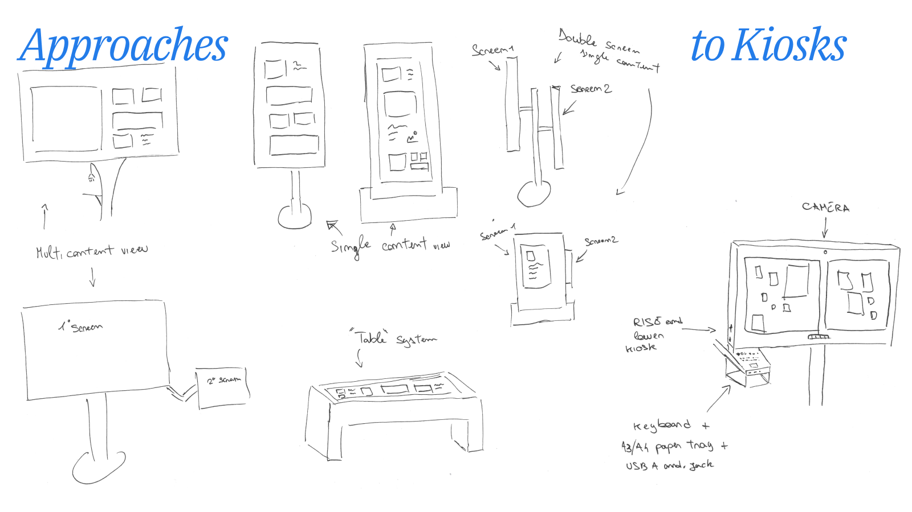
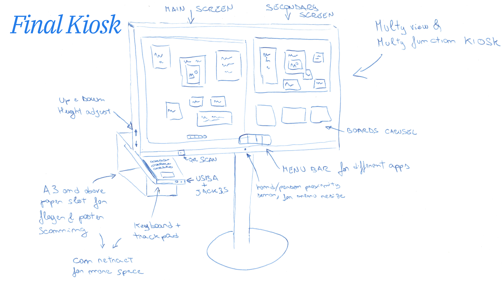

Il chiosco finale è una postazione **multi-vista e multifunzione** di circa 2 m × 1 m, costruita intorno a uno schermo principale e a uno secondario, con altezza regolabile e una barra dei menu per passare da un’app all’altra. Un **sensore di prossimità** rileva una mano o una persona e ridimensiona l’interfaccia di conseguenza, mentre un **sensore NFC**, uno scanner QR, porte USB-A e jack da 3,5 mm lo collegano ai dispositivi delle persone. Una **fessura per fogli dall’A3 in su** permette di scansionare direttamente volantini e poster, e tastiera e trackpad sono retrattili quando serve più spazio.

Sullo schermo la bacheca diventa un insieme di bacheche: una generale, alcune tematiche come quella degli esperimenti, e altre ancora da sfogliare.

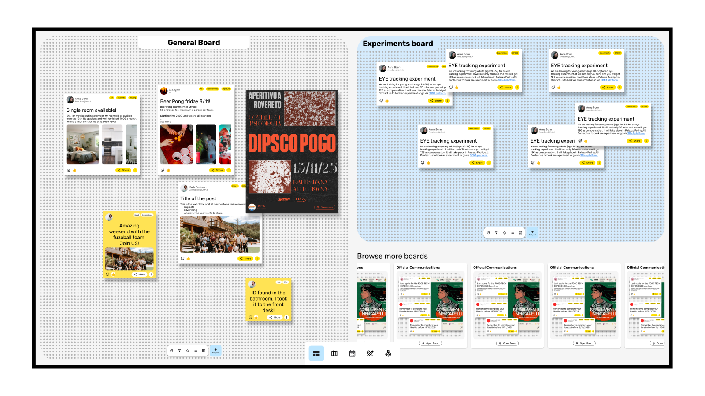

## Interazione e navigazione

Uno schermo così grande ha sollevato due domande che hanno dato forma a tutto il modello di interazione. La prima era se il chiosco dovesse essere usato da una persona o da due contemporaneamente. Ho scelto di progettare per **un utente principale, con altri che guardano**: lo schermo di sinistra è quello principale, e alcune funzioni occupano l’intera superficie quando ne hanno bisogno. La seconda era dove mettere la navigazione. L’ho collocata in una **barra delle app centrale**, perché è facile da raggiungere, l’ho adattata tramite il sensore di prossimità e ho evitato gerarchie profonde.

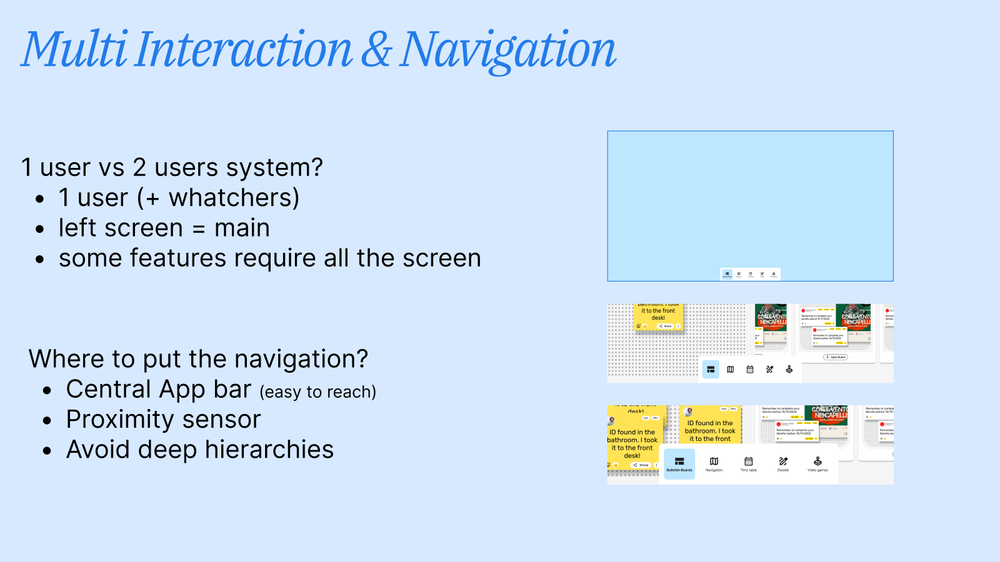

## Un sistema sempre in movimento

Per risolvere il problema del “se ne sta lì fermo”, la bacheca non sta mai ferma. Finché la telecamera e i sensori non rilevano qualcuno che si avvicina, continua a muoversi lentamente: i post si spostano, le bacheche cambiano a carosello e le funzioni e i poster scorrono come in uno slideshow. Così il chiosco non sembra mai un muro statico.

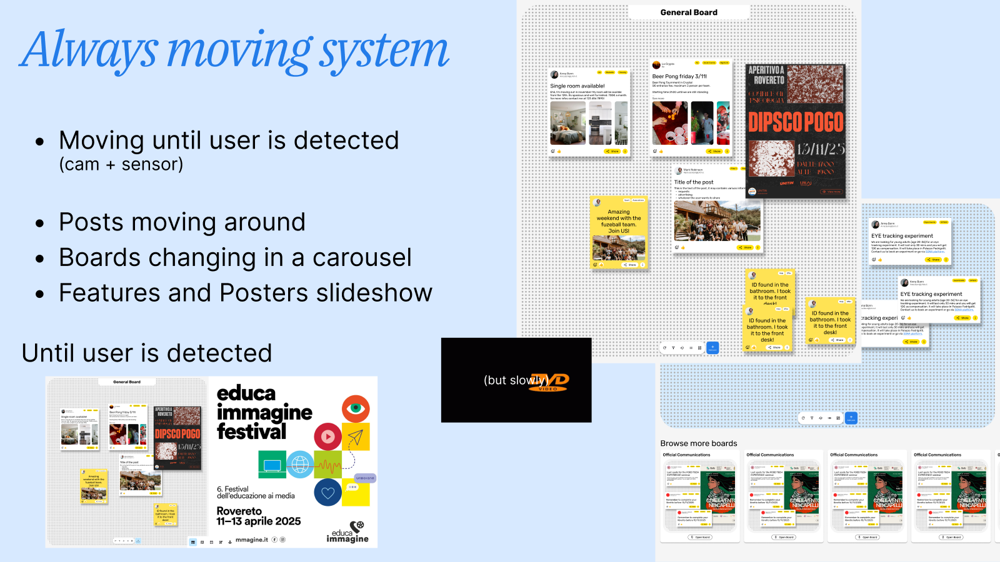

## Il sistema dei post

Quando qualcuno si ferma davanti al chiosco, l’attenzione passa ai post. Ce ne sono di tre tipi, a seconda del contenuto, e sono moderati sia dall’AI sia da persone. Per invitare all’azione, la bacheca mantiene un aspetto scheumorfico, con uno sfondo a pois, e usa un approccio **ordinato contro disordinato**: si può passare da una vista pulita a una più caotica, che ricorda una vera bacheca affollata. Intorno ai post si possono aggiungerne di nuovi, filtrarli e ordinarli alfabeticamente, aprire un singolo elemento, condividerlo, reagire o segnalarlo.

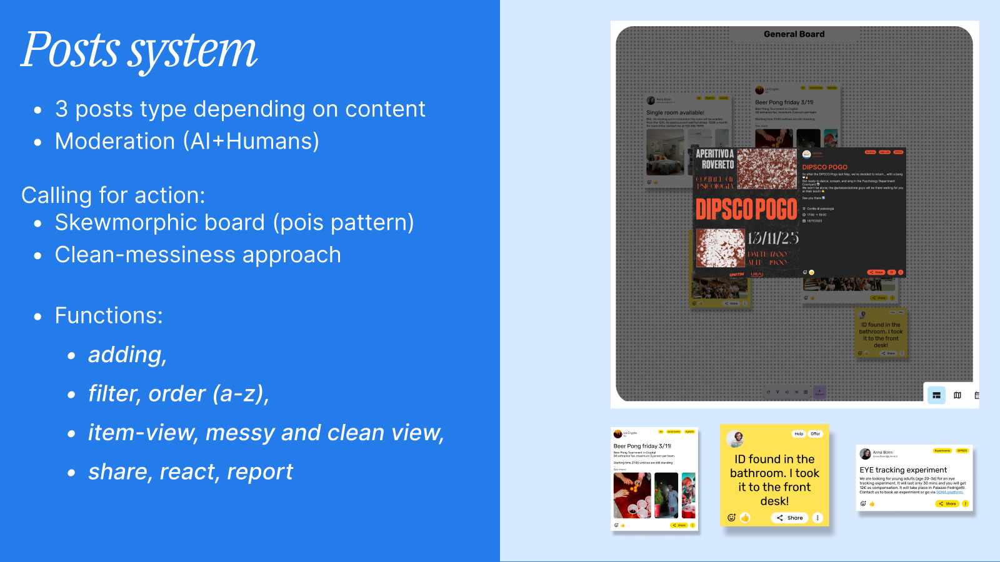

## Aggiungere un post

Ci sono tre modi per aggiungere un post. Può arrivare da un file su una chiavetta USB, da un volantino cartaceo dall’A3 in su scansionato nella fessura, oppure essere inserito manualmente. Nei primi due casi l’AI recupera automaticamente le informazioni e agli utenti resta solo da controllarle. Per pubblicare si accede inquadrando un codice QR con il telefono, con la eCard studente nell’app dell’università oppure con le proprie credenziali.

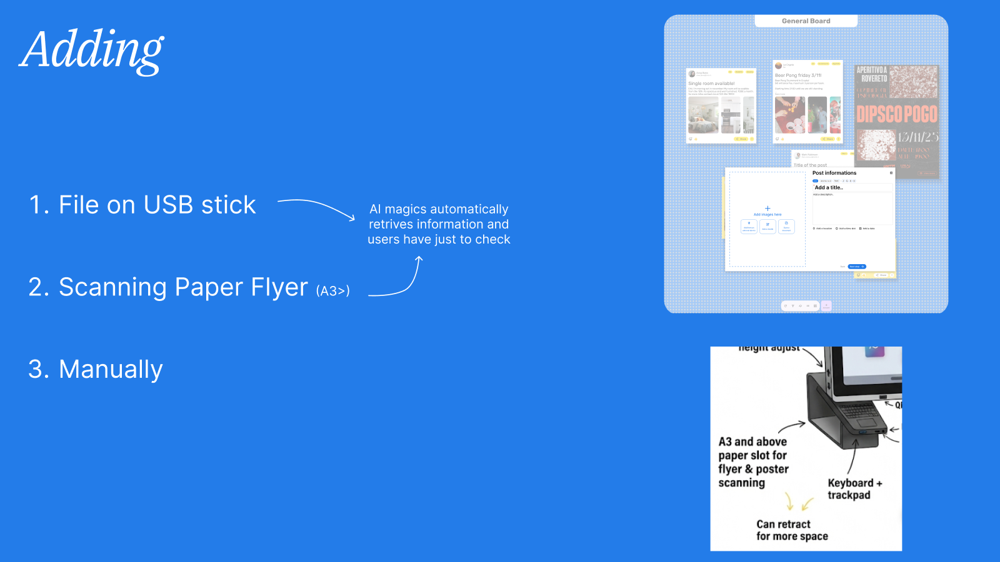
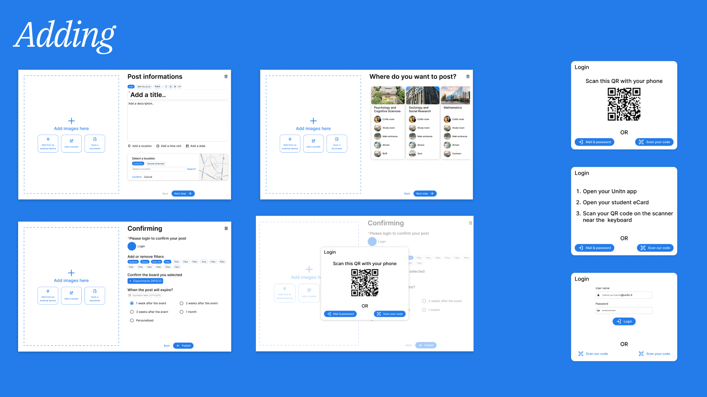

## Condividere è bello

Tutto quello che trovi sulla bacheca può venire via con te: i post si possono inviare ai propri dispositivi tramite codice QR, e-mail o NFC. L’invio per e-mail richiede un indirizzo universitario, che serve anche a tenere lontano lo spam.

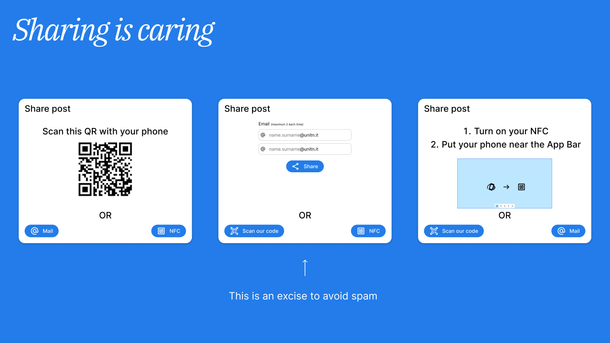

## Ridurre la distanza con l’utente

Oltre ai post, la bacheca è anche una porta d’accesso ad altri servizi dell’università e a un po’ di divertimento. Dal chiosco puoi orientarti negli spazi interni con **Cicerone** e consultare gli orari del giorno, lasciare un disegno su una bacheca condivisa di **doodling**, oppure prenderti una pausa con il **gaming**, attraverso un catalogo di giochi in stile arcade.

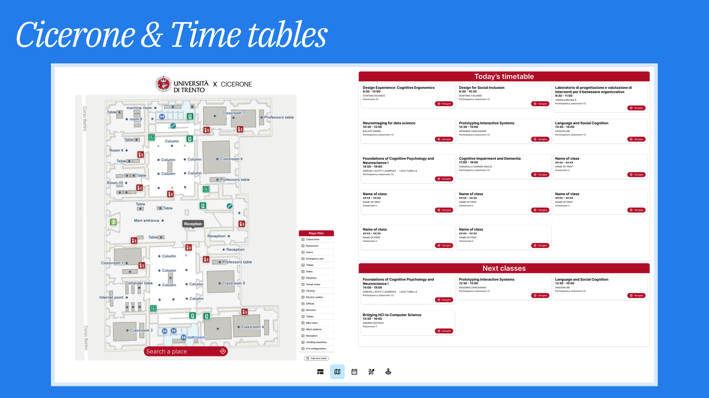
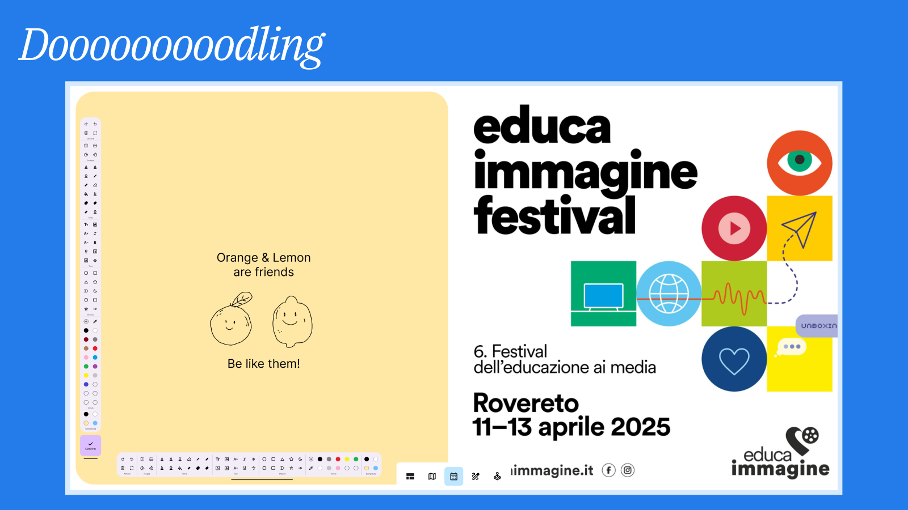
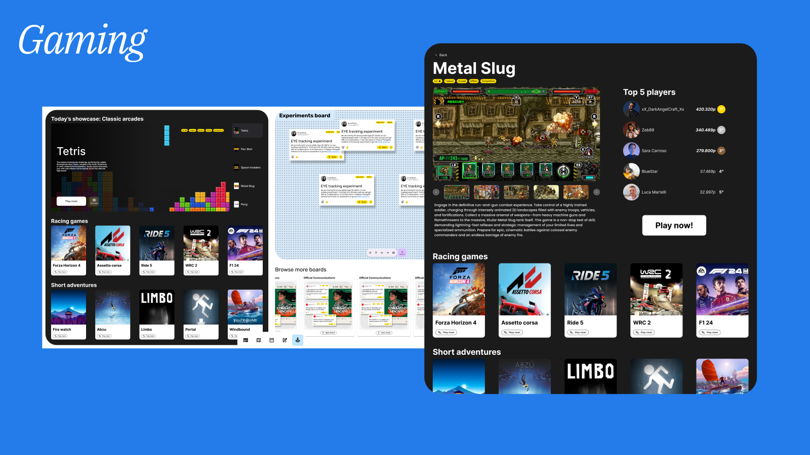
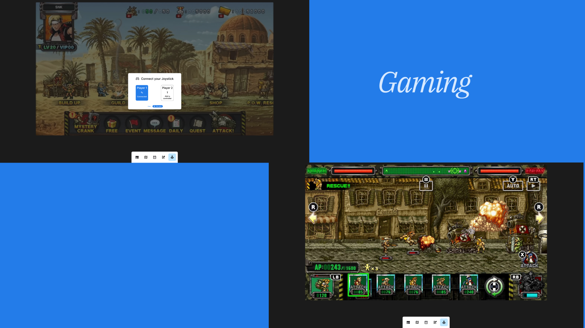

## L’app e il sito web

Il chiosco è solo una parte di Agorà. Le stesse bacheche, gli stessi post e le stesse notifiche vivono su un **sito web** e dentro l’**app** dell’università, così il sistema continua a funzionare anche lontano dalla bacheca fisica: puoi seguire le tue bacheche, gestire i tuoi post e ricevere notifiche ovunque tu sia.

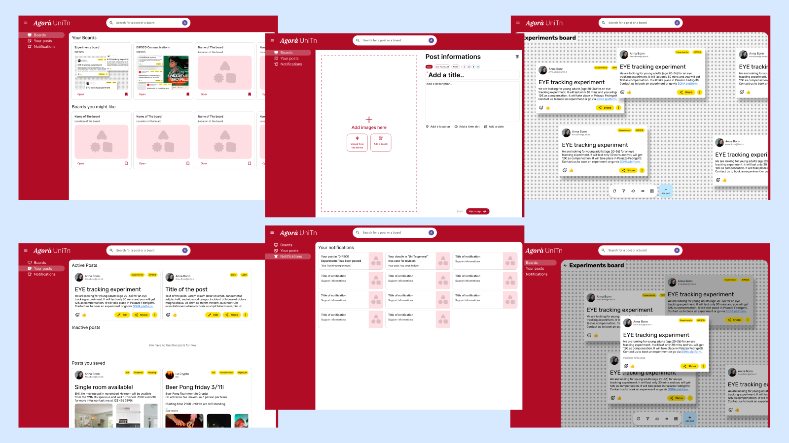

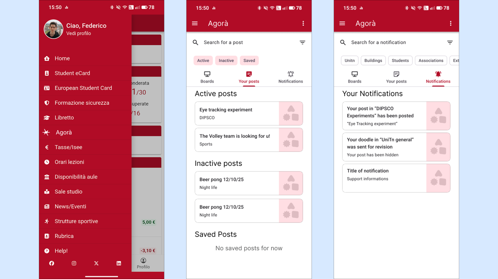
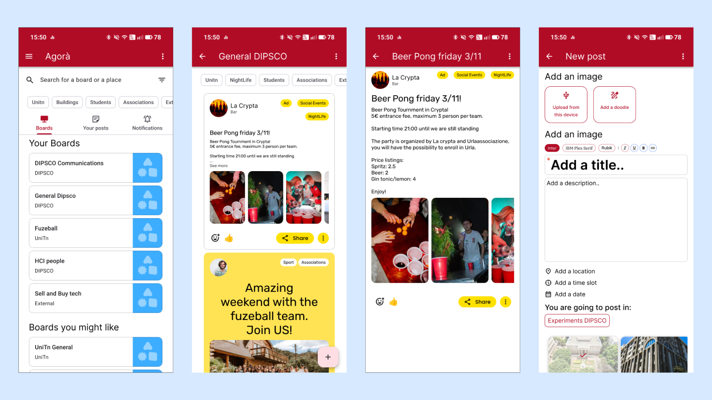

## Cosa ho notato nel progetto

Ripensandoci, ho notato un “happy path bias” nel mio design: mi sono concentrato su ciò che va per il verso giusto, e la prevenzione degli errori e il recupero dagli errori richiedono ancora lavoro. Lo stesso vale per ciò che succede quando cade la connessione: una modalità offline dovrebbe permettere al sistema di continuare a funzionare in forma ridotta invece di bloccarsi del tutto. L’interazione multiutente si è rivelata uno spazio di design che ho solo iniziato a esplorare, e scegliere un utente principale è stata solo una prima risposta. Infine, progettare su una scala così grande è complicato: azzeccare le dimensioni su un chiosco di due metri è una sfida a sé. Sono questi i punti da cui ripartirei se portassi avanti Agorà.
