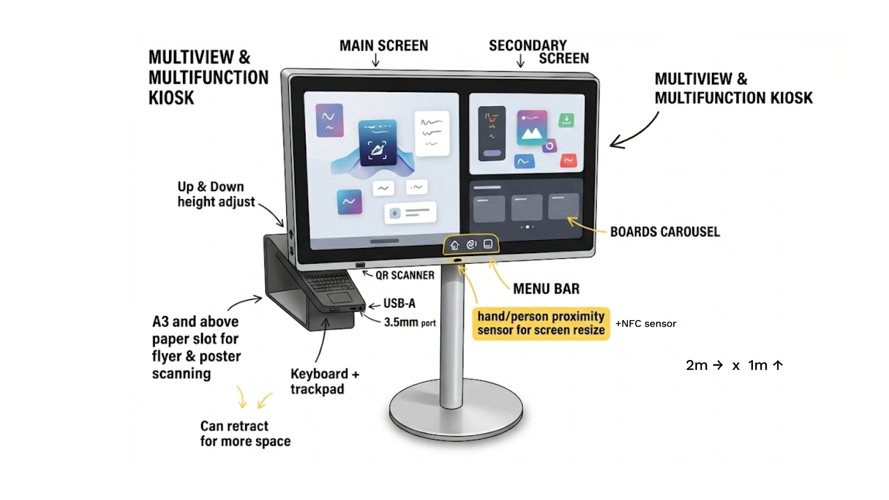
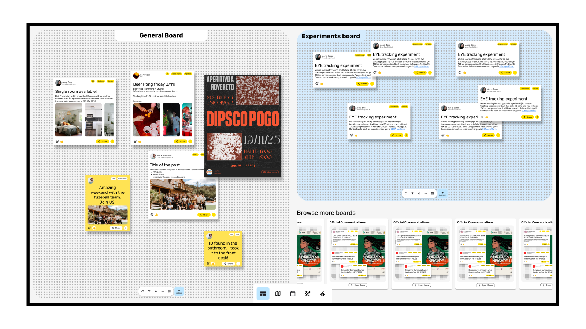
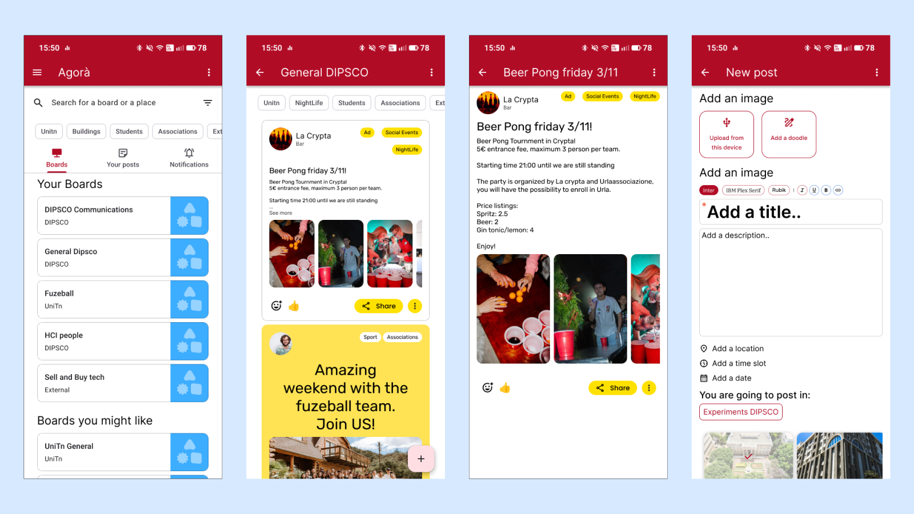

## Il progetto

- Bacheche intelligenti per l’università: un chiosco, un’app e un sito web che funzionano come un unico sistema.
- Progetto individuale per il corso di Prototyping Interactive Systems, laurea magistrale in Human-Computer Interaction; presentato a dicembre 2025.
- Il mio lavoro: definizione del problema, esplorazione e design del chiosco, modello di interazione, interfacce per tutti e tre i touchpoint.

## Il problema

- Come si costruisce una comunità all’università, si fanno conoscere gli eventi e si raggiungono davvero le persone? Perché la vita universitaria sembra “morta”?
- Tre lenti: senso di comunità, spazi fisici, comunicazione.
- Dove si incontrano: la bacheca, che oggi viene ignorata, non attira l’attenzione, cambia di rado e non invita ad agire.

## L’idea: bacheche intelligenti

- Usare la tecnologia per supportare la bacheca e renderla più intelligente.
- Un sistema su tre touchpoint: **chioschi, app e sito web**.
- Chiosco esplorato con schizzi (schermi singoli e doppi, uno o più contenuti, a tavolo, che si alzano e si abbassano) prima del design finale.
- Chiosco finale, circa 2 m × 1 m: schermo principale + secondario, altezza regolabile, sensori di prossimità e NFC, scanner QR, porte USB-A e jack da 3,5 mm, fessura per fogli A3+ per scansionare volantini, tastiera e trackpad retrattili.

## Interazione

- Un utente principale (più chi guarda): lo schermo di sinistra è quello principale, alcune funzioni usano tutta la superficie.
- Barra delle app centrale perché facile da raggiungere, adattata dal sensore di prossimità; niente gerarchie profonde.
- Contro il problema del “se ne sta lì fermo”: la bacheca si muove lentamente finché non rileva qualcuno (post che si spostano, bacheche a carosello, poster in sequenza).

## Post

- 3 tipi di post, moderati da AI e persone.
- Invito all’azione: bacheca scheumorfica a pois, viste ordinata e disordinata.
- Aggiungere, filtrare, ordinare dalla A alla Z, aprire, condividere, reagire, segnalare.
- Post aggiunti da chiavetta USB o scansionando un volantino (in entrambi i casi l’AI estrae le informazioni e gli utenti le controllano), oppure manualmente; accesso con codice QR, eCard studente o credenziali.
- Condivisione tramite codice QR, e-mail (solo indirizzo universitario, contro lo spam) o NFC.

## Oltre la bacheca

- Dal chiosco: navigazione indoor e orari con Cicerone, doodling, gaming.
- Le stesse bacheche, post e notifiche nell’app dell’università e su un sito web.

## Cosa ho notato

- “Happy path bias” in tutti i flussi: prevenzione degli errori e recupero dagli errori richiedono più lavoro.
- Una modalità offline, perché il sistema continui a funzionare in forma ridotta.
- L’interazione multiutente è uno spazio di design che ho solo iniziato a esplorare; resta mia intenzione esplorare due persone che usano lo stesso schermo insieme.
- Gli schermi molto grandi sono difficili da progettare: le dimensioni sono una sfida a sé.
