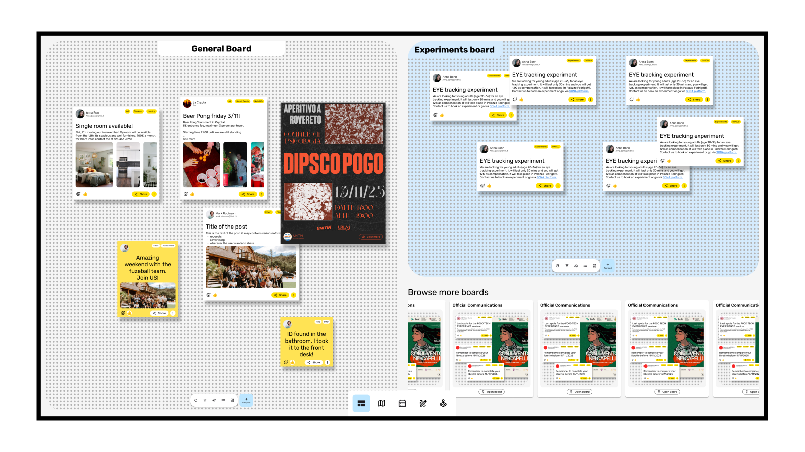
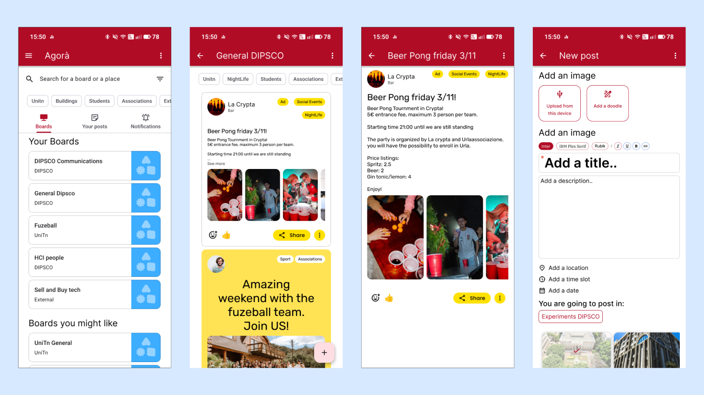

## About the project

- Smart bulletin boards for universities: a kiosk, an app and a website working as one system.
- Solo project for the Prototyping Interactive Systems course, MSc in Human-Computer Interaction; presented in December 2025.
- My work: problem framing, kiosk exploration and design, interaction model, interfaces for all three touchpoints.

## The problem

- How do you build a community in a university, tell people about events and actually reach them? Why does uni life feel “dead”?
- Three lenses: sense of community, physical spaces, communication.
- Where they meet: the bulletin board, which today gets ignored, isn’t eye-catching, rarely changes and doesn’t call for action.

## The idea: Smart Bulletin Boards

- Use technology to support the bulletin board and make it smarter.
- One system across three touchpoints: **kiosks, app and website**.
- Kiosk explored through sketches (single and double screens, one or many contents, table-like, moving up and down) before the final design.
- Final kiosk, about 2 m × 1 m: main + secondary screen, height adjustment, proximity and NFC sensors, QR scanner, USB-A and 3.5 mm ports, A3+ paper slot for scanning flyers, retractable keyboard and trackpad.

## Interaction

- One main user (plus watchers): the left screen is the main one, some features use the whole surface.
- Central app bar because it is easy to reach, adapted by the proximity sensor; no deep hierarchies.
- Against the “it just sits there” problem: the board keeps moving slowly until someone is detected (posts drift, boards rotate, posters run as a slideshow).

## Posts

- 3 post types, moderated by AI and humans.
- Calling for action: skeuomorphic polka-dot board, clean vs. messy views.
- Add, filter, order A–Z, open, share, react, report.
- Add posts from a USB stick or by scanning a paper flyer (in both cases AI extracts the information and users just check it), or manually; log in via QR code, student eCard or credentials.
- Share via QR code, e-mail (university address only, to avoid spam) or NFC.

## Beyond the board

- From the kiosk: Cicerone indoor navigation and timetables, doodling, gaming.
- The same boards, posts and notifications in the university app and on a website.

## What I’ve noticed

- “Happy path bias”: error prevention and recovery need more work.
- An offline mode for graceful degradation.
- Multi-user interaction is a design space I only started to explore.
- Very large screens are hard to design for: sizes are a challenge of their own.
