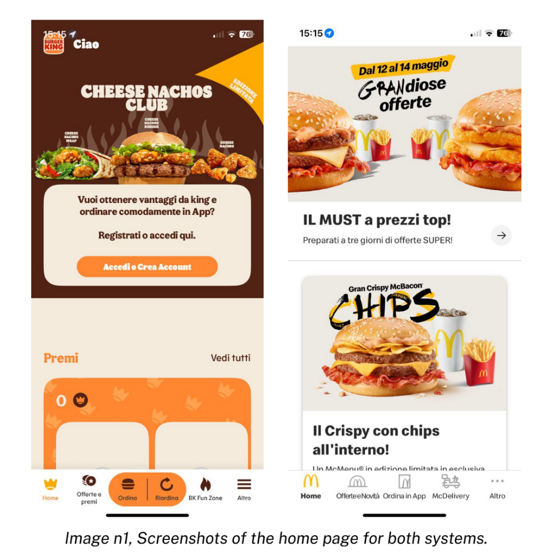
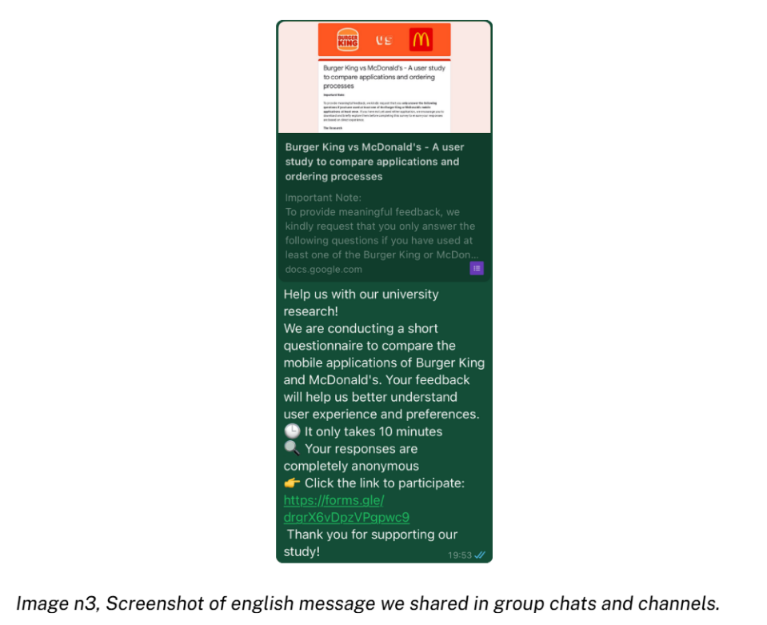
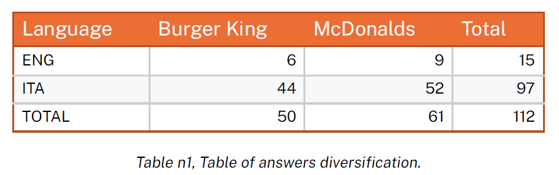
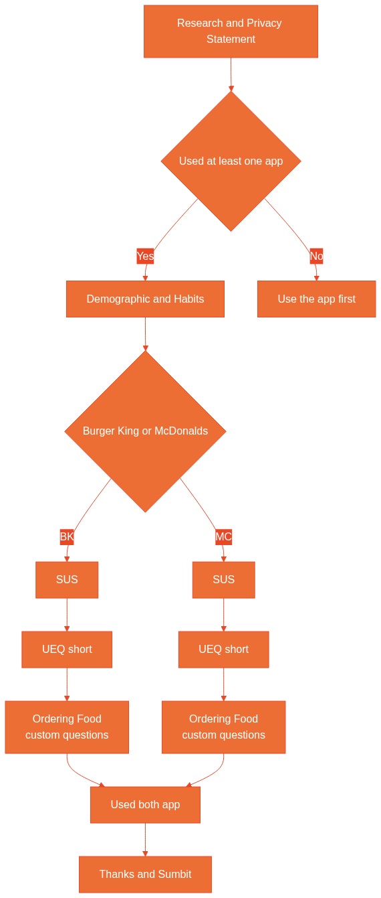
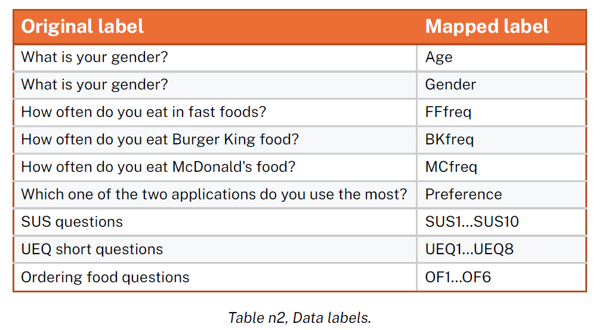
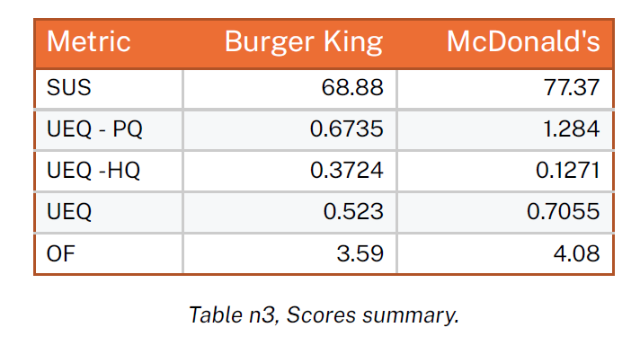

## Contesto

Questo è un progetto di gruppo del corso *Design Experience: Cognitive Ergonomics* dell’Università di Trento (anno accademico 2024/2025). Il corso trattava gli strumenti che chi fa user research usa per studiare e valutare i sistemi, così abbiamo scelto due prodotti che le persone usano davvero tutti i giorni e li abbiamo messi a confronto: le app di **McDonald’s** e **Burger King** in Italia.

- **Team:** Samuele Mazzei, Lorenzo Zambotto, Samuele Nigroni, Nataliya Zhigalina e io. Abbiamo condotto lo studio insieme, quindi “noi” qui sotto indica tutto il team.
- **Tipo di studio:** questionario online quantitativo, between-subjects.
- **Strumenti:** Google Forms (questionario), R (analisi).
- **Raccolta dati:** 3 settimane, 112 risposte.

In seguito abbiamo ampliato lo studio con test di significatività e un modello di regressione, che abbiamo presentato in una sessione di metodologia della ricerca quantitativa.

## Domande di ricerca

Abbiamo scelto queste due app perché offrono funzionalità molto simili nella stessa categoria: menu, promozioni e programmi fedeltà, ordini da remoto. Proprio perché sono così simili, qualsiasi differenza percepita dagli utenti ci dice qualcosa sul design, non su cosa le app sanno fare.

Lo studio è stato guidato da quattro domande:

1. **Usabilità:** le due app differiscono in modo significativo nell’usabilità percepita? *(misurata con SUS)*
2. **User experience:** gli utenti riportano differenze nella qualità pragmatica ed edonica? *(misurata con UEQ-S)*
3. **Processo di ordinazione:** una delle due app viene percepita come più efficiente, chiara e trasparente quando si ordina? *(sei domande create da noi)*
4. **Valutazioni negli store:** i voti di App Store e Google Play corrispondono ai punteggi di usabilità che misuriamo?

## Le due app a confronto

Prima di progettare il questionario abbiamo analizzato entrambe le app, per capire bene cosa stavamo confrontando.

**Valutazioni negli store.** Nell’App Store (“Cibi e bevande”) McDonald’s era 2ª con 2,8 stelle su oltre 11.500 valutazioni, mentre Burger King era 8ª con 4 stelle su circa 10.000. Su Google Play McDonald’s era di nuovo 2ª, con 3,1 stelle su oltre 700.000 recensioni; Burger King era 4ª, con 4,3 stelle su 35.000. Il numero di recensioni di McDonald’s su Google Play ci è sembrato insolitamente alto rispetto all’App Store e ad app simili: potrebbe dipendere da bot che gonfiano il voto, oppure dal fatto che agli utenti Android venga chiesto più spesso di lasciare una recensione. In ogni caso, i voti degli store premiavano chiaramente Burger King: per questo abbiamo aggiunto la domanda di ricerca 4.

**Caricamento.** McDonald’s è più lenta a caricarsi e mostra una schermata bianca con una barra di avanzamento. Burger King si carica quasi all’istante, mostrando il logo su sfondo rosso.

**Interfaccia principale.** Entrambe le app usano una barra in basso con le stesse sezioni principali, quasi nello stesso ordine: Home, offerte e promozioni, Ordina/Menu e un menu hamburger per le impostazioni. McDonald’s aggiunge un pulsante separato per la consegna a domicilio, mentre Burger King la inserisce dentro “Ordina”. McDonald’s punta soprattutto sullo scorrimento verticale, su un’interfaccia bianca e sulle foto; Burger King usa molto lo scorrimento orizzontale (soprattutto nella home), una palette più ampia sui toni dell’arancione e del marrone e più elementi grafici. In entrambe le app la home è dedicata alle promozioni del momento e alle novità dei partner.

**Impostazioni e servizi.**

- In entrambe le app la registrazione è obbligatoria per usare quasi ogni funzione.
- Nessuna delle due offre una lingua diversa dall’italiano.
- Entrambe hanno l’informativa sulla privacy e una mappa con il ristorante più vicino, più la ricerca di tutti i punti vendita in Italia.
- Solo Burger King ha una sezione FAQ, che va dal programma fedeltà ai pagamenti.

**Promozioni.** Entrambe le app offrono codici sconto disponibili solo in app, uno dei motivi principali per cui le persone le scaricano. Burger King ha anche un programma fedeltà: si raccolgono monete virtuali (le “corone”) da riscattare con cibo gratis.

**Menu e ordinazione.** In entrambe le app si può consultare il menu, ordinare e pagare, scegliendo poi il ritiro al bancone, il drive-through o il servizio al tavolo; la consegna passa da servizi esterni. Burger King permette di aggiungere o togliere ingredienti; McDonald’s permette solo di toglierli.

## Disegno dello studio

Ci siamo concentrati sul **processo di ordinazione**, la funzione principale e più usata di entrambe le app, oltre che sull’usabilità e sulla user experience in generale.

**Perché between-subjects.** Ogni partecipante ha valutato una sola app: quella che usa di più. L’abbiamo scelto per due motivi:

- **Metodologico:** valutare entrambe le app avrebbe introdotto effetti di trascinamento, di ordine e di contrasto e sovraccarico cognitivo. Così ogni valutazione si basa sull’esperienza reale con un’app, non su un confronto forzato.
- **Pratico:** un questionario più corto riduce il rischio di stanchezza e di abbandoni.

**Perché un perimetro ristretto.** I nostri primi appunti includevano anche compiti sulla consultazione del menu e sugli sconti. Nel questionario finale abbiamo tenuto solo l’usabilità generale (SUS), la UX generale (UEQ-S) e il flusso di ordinazione. Uno studio mirato ci ha dato confronti più puliti; il compromesso è che non possiamo dire nulla sulle altre funzionalità (vedi Limiti).

**Etica e privacy.** La partecipazione era volontaria e anonima, non abbiamo raccolto dati personali identificativi e il questionario si apriva con un’informativa sulla privacy.

## Reclutamento e campione

Abbiamo usato un **campionamento di convenienza non probabilistico** tramite canali digitali: messaggi diretti, gruppi WhatsApp, canali Telegram, forum studenteschi e social media, sia in ambito universitario sia nelle cerchie informali. Ogni messaggio spiegava lo studio e conteneva il link al questionario, in italiano o in inglese a seconda del gruppo.

L’unico criterio di inclusione era aver usato almeno una delle due app. Una domanda filtro all’inizio lo verificava; chi non ne aveva usata nessuna veniva portato a una pagina di ringraziamento e invitato a provare prima un’app, perché volevamo il parere di utenti attivi.

**Correggere uno squilibrio a metà raccolta.** All’inizio gli utenti McDonald’s erano molto più numerosi di quelli Burger King (a un certo punto oltre l’80% contro il 20%). Abbiamo cambiato i messaggi di reclutamento per raggiungere community con più probabilità di includere utenti Burger King, chiedendo comunque di rispondere solo a chi aveva usato l’app. Questo ha riequilibrato in parte i gruppi, ma potrebbe aver introdotto qualche bias nelle risposte successive.

In tre settimane abbiamo raccolto **112 risposte**: 97 alla versione italiana e 15 a quella inglese.

## Il questionario

Il questionario (Google Forms) usava una logica condizionale per indirizzare ogni partecipante nel percorso della sua app:

1. **Introduzione e filtro:** scopo dello studio, informativa sulla privacy, “hai usato almeno una delle due app?”.
2. **Dati demografici e abitudini:** età, genere, quanto spesso si mangia nei fast food, quanto spesso si usano le app di Burger King e McDonald’s, e quale app si usa di più.
3. **Usabilità e UX:**
   - **SUS** (System Usability Scale): 10 item, un punteggio di usabilità da 0 a 100.
   - **UEQ-S** (User Experience Questionnaire, versione breve): 8 item, che danno qualità pragmatica, qualità edonica e un punteggio complessivo da −3 a +3. Copre il lato dell’esperienza e permette di verificare il risultato del SUS.
4. **Flusso di ordinazione (OF):** sei affermazioni create da noi, ciascuna un item Likert a 5 punti:
   - OF1: Riesco a selezionare comodamente il ristorante per il mio ordine.
   - OF2: Riesco a muovermi nell’app in modo efficiente per trovare i prodotti che voglio ordinare.
   - OF3: Vedo chiaramente il costo di ogni prodotto ed eventuali costi aggiuntivi.
   - OF4: Trovo facilmente la lista degli ingredienti e le informazioni nutrizionali dei prodotti.
   - OF5: Riesco a personalizzare facilmente gli ingredienti o le opzioni dei prodotti che scelgo.
   - OF6: Riesco a modificare senza fatica il contenuto del mio ordine prima di pagare.

Ogni item OF mostrava uno **screenshot della schermata corrispondente**, per aiutare i partecipanti a ricordare l’uso reale e ridurre il recall bias. Seguiva un campo di testo libero per segnalare problemi che le domande chiuse non coprivano. Una sezione finale permetteva a chi aveva usato entrambe le app di dire quale preferisce e perché.

## Preparazione e analisi dei dati

**Pulizia.** Abbiamo unito i dati della versione italiana e di quella inglese, tradotto tutte le risposte in inglese ed eliminato l’unica risposta di chi non aveva usato nessuna delle due app. Abbiamo tolto le colonne che non servivano (orario di invio, consenso, domanda filtro), separato le risposte qualitative da quelle quantitative e unito le colonne di SUS, UEQ e OF che Google Forms aveva diviso per app.

**Codifica.** Abbiamo dato a ogni colonna un’etichetta breve (Age, Gender, FFfreq, BKfreq, MCfreq, Preference, SUS1–10, UEQ1–8, OF1–6) e convertito tutte le risposte in numeri. Le risposte sulla frequenza sono diventate una scala da 1 a 5, da 1 = “raramente, qualche volta l’anno” a 5 = “molto spesso, (quasi) ogni giorno”. Il dataset unificato si trova nel file [EXPORT](https://docs.google.com/spreadsheets/d/1NkIwBv92GMJC6jpRZ1LgqFsNGC0A5vti9g_BGd8B9pA/edit?usp=sharing).

**Analisi in R.**

- **SUS:** item dispari riscalati da 0 a 4, item pari (formulati in negativo) invertiti, somma × 2,5.
- **UEQ-S:** item riscalati su −3…+3; qualità pragmatica = media degli item 1–4, qualità edonica = media degli item 5–8, punteggio complessivo = media di tutti gli 8. I punteggi tra −0,8 e +0,8 sono considerati neutri.
- **t-test di Welch per due campioni** per confrontare utenti Burger King e McDonald’s su SUS, UEQ-S (complessivo, pragmatico, edonico), ogni item OF e il totale OF.
- **Regressione lineare** per prevedere il SUS in base alla frequenza d’uso e all’app preferita.
- **Correlazioni di Pearson** tra SUS e UEQ-S, e tra età e ciascun punteggio.

Nell’analisi in R sono entrate 108 risposte: 49 utenti Burger King e 59 utenti McDonald’s (età mediana 23 anni). Parte dei risultati è raccolta nel documento [R Analysis Results](https://docs.google.com/document/d/1aXkcdm_7e0SzPnUc8XC__8ag4GNzaLVkNc_TuZm3G7A/edit?usp=sharing), mentre il report completo in R, con il codice, è su [questa pagina](https://report-qr-bk-vs-mc.netlify.app/).

## Risultati

| Metrica | Burger King | McDonald’s | Significativo? |
|---|---|---|---|
| SUS (0–100) | 63,88 | 77,37 | Sì, p < .001 |
| UEQ-S qualità pragmatica | 0,67 (neutra) | 1,28 (positiva) | Sì, p = .010 |
| UEQ-S qualità edonica | 0,37 (neutra) | 0,13 (neutra) | No, p = .282 |
| UEQ-S complessivo | 0,52 (neutro) | 0,71 (neutro) | No, p = .347 |
| Flusso di ordinazione (media, 1–5) | 3,59 | 4,08 | Sì, p < .001 |

*Nota: la tabella riassuntiva del nostro report riporta 68,88 per il SUS di Burger King, mentre il testo del report dice 66,88. Sono entrambi refusi: l’output di R dà 63,88, il valore usato qui.*

**Cosa dicono i numeri.**

- **Usabilità (D1): McDonald’s vince nettamente.** La sua media SUS supera la soglia di 70 punti per un’usabilità accettabile; quella di Burger King resta sotto.
- **User experience (D2): McDonald’s è più pragmatica.** Ha ottenuto un punteggio significativamente più alto nella qualità pragmatica, il lato dell’esperienza legato ai compiti. Burger King ha un punteggio leggermente più alto nella qualità edonica (stimolazione e novità), ma la differenza non è statisticamente significativa, così come quella del punteggio UEQ-S complessivo.
- **Ordinazione (D3): il divario sta in due passaggi precisi.**
  - **Trovare ingredienti e informazioni nutrizionali (OF4)** è la differenza più grande: 2,33 per Burger King contro 4,05 per McDonald’s (p < .001).
  - **Personalizzare i prodotti (OF5):** 3,57 contro 4,20 (p = .002). In realtà Burger King offre *più* personalizzazione (si possono anche aggiungere ingredienti), eppure i suoi utenti l’hanno trovata meno facile.
  - Scegliere il ristorante, trovare i prodotti, vedere i costi e modificare l’ordine (OF1, OF2, OF3, OF6) non mostrano differenze significative.
- **Valutazioni negli store (D4):** i voti degli store premiavano Burger King, mentre i nostri punteggi di usabilità e di qualità pragmatica premiavano McDonald’s. Non abbiamo fatto un test formale su questo punto, ma nel nostro campione le due misure andavano in direzioni opposte.

**Altri risultati.**

- Usare l’app più spesso predice un punteggio SUS più alto (p = .017). Anche tenendo conto di questo, preferire McDonald’s resta un predittore significativo di un punteggio SUS più alto (p < .001).
- I punteggi SUS e UEQ-S sono fortemente correlati per entrambe le app (r = .68 per Burger King, r = .64 per McDonald’s), il che supporta la validità convergente delle due misure.
- L’età non è correlata in modo significativo a nessuno dei punteggi.

## Limiti

**Metodo**

- I questionari raccolgono esperienze soggettive e ricordate, non comportamenti osservati, e i partecipanti li hanno compilati in un ambiente non controllato.
- Il perimetro volutamente ristretto (SUS, UEQ-S e ordinazione) non ci permette di confrontare altre funzionalità che influenzano l’esperienza, e questo limita la generalizzabilità dei risultati.

**Dati**

- **Squilibrio linguistico:** 97 risposte in italiano contro 15 in inglese, troppo poche per confrontare i due gruppi.
- **Squilibrio tra app:** più utenti McDonald’s che Burger King. Il reclutamento mirato ha ridotto il divario, ma potrebbe aver introdotto un bias in alcune risposte successive.
- **Poche risposte aperte:** l’ultima domanda aperta ha ricevuto troppo poche risposte approfondite per spiegare *perché* chi usa entrambe le app ne preferisce una.
- **Campione di convenienza:** abbiamo raggiunto soprattutto persone del Nord Italia.

## Riflessioni e prossimi passi

**Perché così pochi utenti Burger King?** Una possibile spiegazione è la presenza sul territorio: in Italia Burger King ha circa 280 ristoranti, concentrati soprattutto al Centro e al Nord, mentre McDonald’s ne ha circa 720 in tutto il Paese e serve circa 1,2 milioni di clienti al giorno. Non abbiamo trovato dati paragonabili per Burger King, ma con meno ristoranti è probabile che serva meno clienti, il che è coerente con il minor numero di utenti Burger King che abbiamo raggiunto.

**I risultati valgono per l’Italia.** Entrambe le app sono localizzate e in altri Paesi le interfacce potrebbero essere diverse, quindi questi risultati valgono solo per l’Italia.

**Cosa faremmo dopo:**

- **Allargare il perimetro** a sconti, ricerca dei ristoranti e servizi di localizzazione, e consultazione del menu, per avere un quadro più completo di ogni app.
- **Aggiungere sessioni di think-aloud** per vedere come le persone usano davvero le app in tempo reale e perché, affiancando dati qualitativi ai risultati del questionario.
