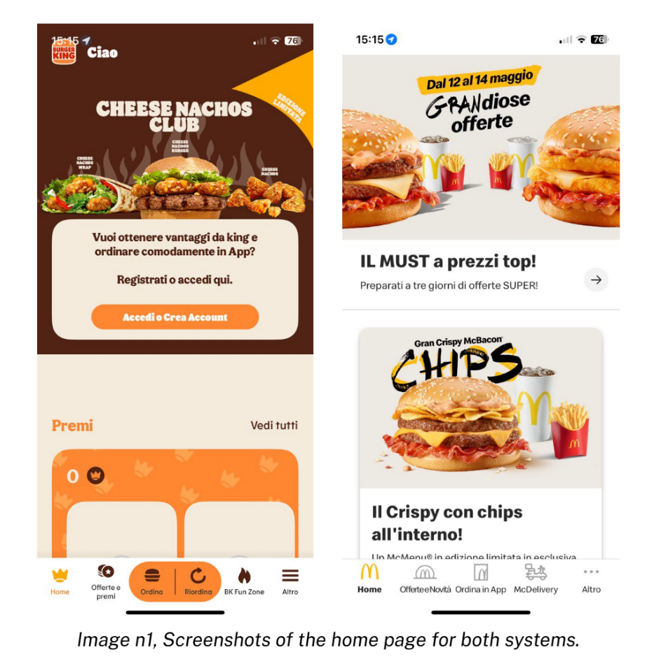
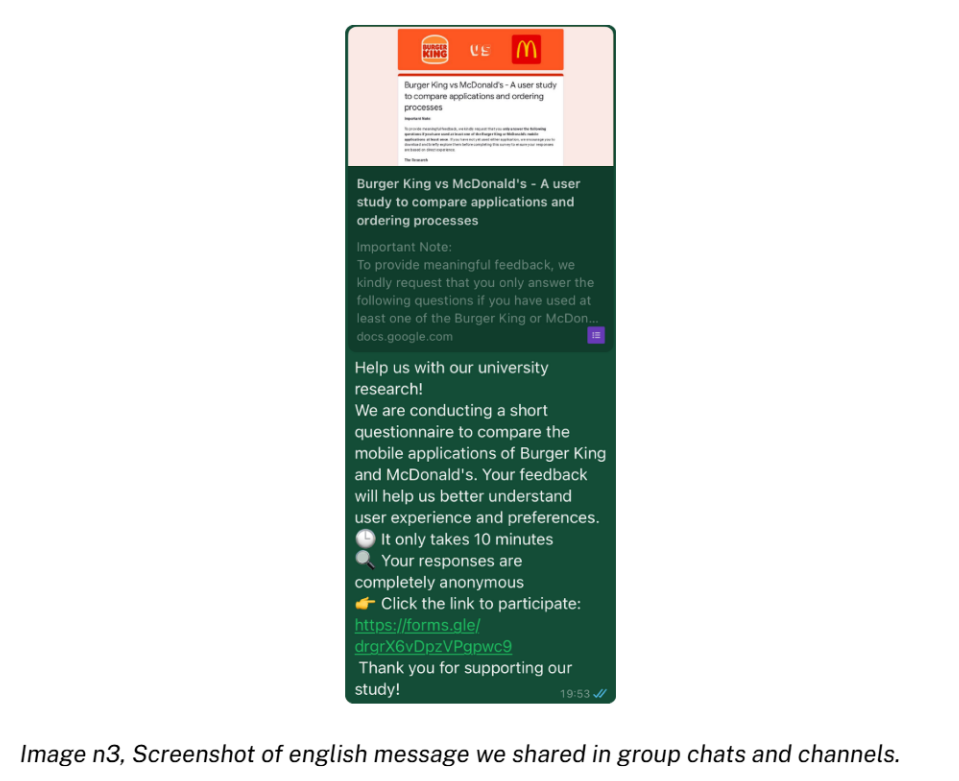
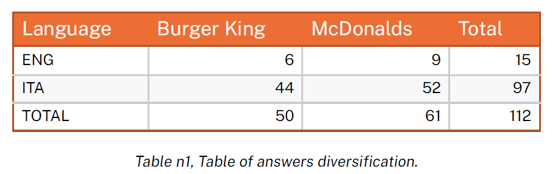
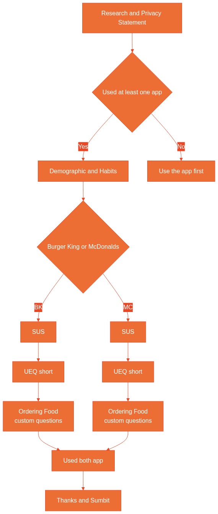
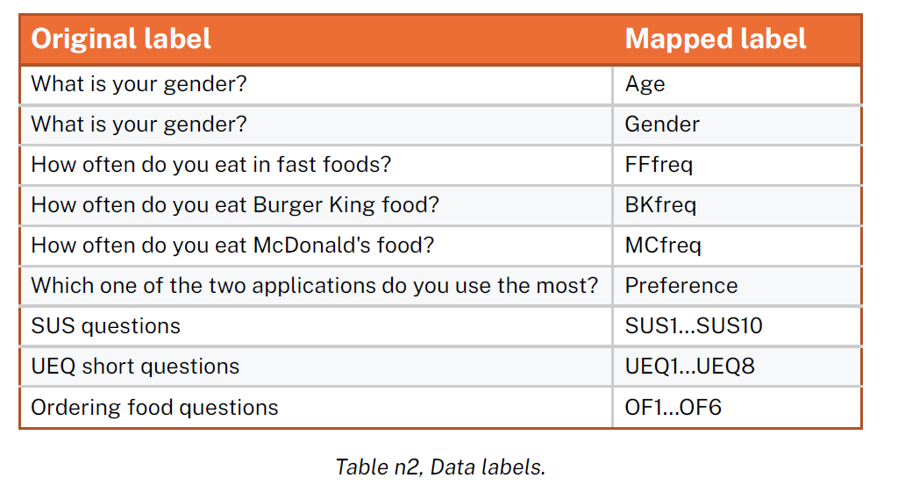
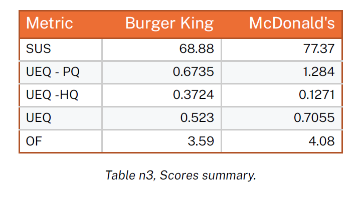

## Context

This is a team project from the *Design Experience: Cognitive Ergonomics* course at the University of Trento (academic year 2024/2025). The course was about the tools user researchers use to study and evaluate systems, so we picked two products people actually use every day and put them side by side: the **McDonald’s** and **Burger King** apps in Italy.

- **Team:** Samuele Mazzei, Lorenzo Zambotto, Samuele Nigroni, Nataliya Zhigalina and me. We ran the study as a group, so “we” below means the whole team.
- **Type of study:** quantitative, between-subjects online survey.
- **Tools:** Google Forms (survey), R (analysis).
- **Data collection:** 3 weeks, 112 responses.

The study was later extended with significance tests and a regression model, which we presented in a quantitative research methodology session.

## Research questions

We chose these two apps because they offer very similar features in the same category: menus, promotions and loyalty programs, remote ordering. Because they are so close, any difference users perceive tells us something about the design, not about what the apps can do.

Four questions guided the study:

1. **Usability:** do the two apps differ significantly in perceived usability? *(measured with SUS)*
2. **User experience:** do users report differences in pragmatic and hedonic quality? *(measured with UEQ-S)*
3. **Ordering process:** is one app perceived as more efficient, clear and transparent when ordering food? *(six custom questions)*
4. **Store ratings:** do App Store and Google Play ratings match the usability scores we measure?

## The two apps at a glance

Before designing the survey, we reviewed both apps to understand what we were comparing.

**Store ratings.** In the App Store (“Food & Drink”), McDonald’s ranked 2nd with 2.8 stars from over 11,500 ratings, while Burger King ranked 8th with 4 stars from about 10,000. In Google Play, McDonald’s was again 2nd, with 3.1 stars from over 700,000 reviews; Burger King was 4th, with 4.3 stars from 35,000. The McDonald’s review count on Google Play looked unusually high compared with the App Store and similar apps. It could come from bots inflating the rating, or from Android users being prompted more often to leave a review. Either way, store ratings clearly favoured Burger King: that is why we added research question 4.

**Loading.** McDonald’s takes longer to load and shows a white screen with a progress bar. Burger King loads almost instantly, showing its logo on a red background.

**Main interface.** Both apps use a bottom bar with the same main sections in almost the same order: Home, offers and promotions, Order/Menu and a hamburger menu for settings. McDonald’s adds a separate delivery button, while Burger King puts delivery inside “Order”. McDonald’s relies mostly on vertical scrolling, a white interface and photos; Burger King uses a lot of horizontal scrolling (especially on the home page), a wider orange and brown palette and more graphic elements. Both home pages focus on current promotions and partner news.

**Settings and services.**

- Registration is required to use almost any feature in both apps.
- Neither app offers a language other than Italian.
- Both have a privacy policy and a map of the nearest restaurant, plus a search for all locations in Italy.
- Only Burger King has an FAQ section, covering topics from the loyalty program to payments.

**Promotions.** Both apps offer discount codes that are only available in the app, which is one of the main reasons people download them. Burger King also has a loyalty program: users collect virtual coins (“corone”) and redeem them for free food.

**Menu and ordering.** In both apps users can browse the menu, order and pay, then choose pickup at the counter, drive-through or table service; delivery goes through third-party services. Burger King lets users add or remove ingredients; McDonald’s only lets them remove ingredients.

## Study design

We focused on the **food ordering process**, the core and most frequently used function of both apps, plus overall usability and user experience.

**Why between-subjects.** Each participant evaluated only one app: the one they use most. We chose this for two reasons:

- **Methodological:** rating both apps would have introduced carryover, order and contrast effects and cognitive overload. This way, each evaluation is grounded in real experience with one app instead of a forced comparison.
- **Practical:** a shorter survey reduces the risk of fatigue and drop-outs.

**Why a narrow scope.** Our early notes also included tasks about menu browsing and discounts. In the final questionnaire we kept only general usability (SUS), general UX (UEQ-S) and the ordering flow. A targeted study gave us cleaner comparisons; the trade-off is that we can’t say anything about the other features (see Limitations).

**Ethics and privacy.** Participation was voluntary and anonymous, no personally identifiable information was collected, and a privacy statement opened the survey.

## Recruitment and sample

We used **non-probability convenience sampling** through digital channels: direct messages, WhatsApp groups, Telegram channels, student forums and social media, across both university networks and informal circles. Each message explained the study and linked the survey, in Italian or English depending on the group.

The only inclusion criterion was having used at least one of the two apps. A screening question at the start checked this; people who had used neither were sent to a thank-you page and invited to try an app first, because we wanted feedback from active users.

**Fixing an imbalance mid-study.** Early on, McDonald’s users far outnumbered Burger King users (at one point over 80% to 20%). We changed our recruitment messages to target communities more likely to include Burger King users, still asking people to answer only if they had used the app. This partly rebalanced the groups, but may have introduced some bias in later responses.

In three weeks we collected **112 responses**: 97 to the Italian version and 15 to the English one.

## The questionnaire

The survey (Google Forms) used conditional logic to send each participant down the flow for their app:

1. **Introduction and screening:** study purpose, privacy statement, “have you used at least one of the apps?”.
2. **Demographics and habits:** age, gender, how often they eat at fast-food restaurants, how often they use the Burger King and McDonald’s apps, and which app they use most.
3. **Usability and UX:**
   - **SUS** (System Usability Scale): 10 items, a usability score from 0 to 100.
   - **UEQ-S** (User Experience Questionnaire, short version): 8 items, giving pragmatic quality, hedonic quality and an overall score from −3 to +3. It covers the experience side and lets us cross-check the SUS result.
4. **Ordering flow (OF):** six custom statements, each a 5-point Likert item:
   - OF1: I can comfortably select the location for my order.
   - OF2: I can efficiently navigate the app to locate the products I want to order.
   - OF3: I can clearly see the cost of each product and any associated charges.
   - OF4: I can easily find the ingredient lists and nutritional information for the products.
   - OF5: I can customize the ingredients or options for the food items I select in an easy way.
   - OF6: I can effortlessly make adjustments to the contents of my order before checking out.

Each OF item showed a **screenshot of the matching app screen**, to help participants recall their real use and reduce recall bias. An open text box followed, for issues our closed questions didn’t cover. A final section let people who had used both apps say which one they prefer and why.

## Data preparation and analysis

**Cleaning.** We merged the Italian and English datasets, translated all answers into English and removed the one response from someone who had used neither app. We dropped columns we didn’t need (timestamp, consent, screening), separated qualitative from quantitative answers and merged the SUS, UEQ and OF columns that Google Forms had split by app.

**Coding.** We gave every column a short label (Age, Gender, FFfreq, BKfreq, MCfreq, Preference, SUS1–10, UEQ1–8, OF1–6) and converted all answers to numbers. Frequency answers became a 1–5 scale, from 1 = “rarely, a few times a year” to 5 = “very frequently, (almost) daily”. The merged dataset is in the [EXPORT](https://docs.google.com/spreadsheets/d/1NkIwBv92GMJC6jpRZ1LgqFsNGC0A5vti9g_BGd8B9pA/edit?usp=sharing) file.

**Analysis in R.**

- **SUS:** odd items rescaled to 0–4, even (negatively worded) items reverse-scored, sum × 2.5.
- **UEQ-S:** items rescaled to −3…+3; pragmatic quality = mean of items 1–4, hedonic quality = mean of items 5–8, overall = mean of all 8. Scores between −0.8 and +0.8 count as neutral.
- **Welch two-sample t-tests** comparing Burger King and McDonald’s users on SUS, UEQ-S (overall, pragmatic, hedonic), each OF item and the OF total.
- **Linear regression** predicting SUS from frequency of use and preferred app.
- **Pearson correlations** between SUS and UEQ-S, and between age and every score.

108 responses went into the R analysis: 49 Burger King users and 59 McDonald’s users (median age 23). Part of the results is collected in the [R Analysis Results](https://docs.google.com/document/d/1aXkcdm_7e0SzPnUc8XC__8ag4GNzaLVkNc_TuZm3G7A/edit?usp=sharing) document, and the full R report, with code, is on [this page](https://report-qr-bk-vs-mc.netlify.app/).

## Results

| Metric | Burger King | McDonald’s | Significant? |
|---|---|---|---|
| SUS (0–100) | 63.88 | 77.37 | Yes, p < .001 |
| UEQ-S pragmatic quality | 0.67 (neutral) | 1.28 (positive) | Yes, p = .010 |
| UEQ-S hedonic quality | 0.37 (neutral) | 0.13 (neutral) | No, p = .282 |
| UEQ-S overall | 0.52 (neutral) | 0.71 (neutral) | No, p = .347 |
| Ordering flow (mean, 1–5) | 3.59 | 4.08 | Yes, p < .001 |

*Note: the summary table in our report shows 68.88 for Burger King’s SUS, and the report text says 66.88. Both are typos: the R output gives 63.88, the value used here.*

**What the numbers say.**

- **Usability (Q1): McDonald’s wins clearly.** Its SUS mean is above the 70-point benchmark for acceptable usability; Burger King’s is below it.
- **User experience (Q2): McDonald’s is more pragmatic.** It scored significantly higher on pragmatic quality, the task-oriented side of the experience. Burger King scored slightly higher on hedonic quality (stimulation and novelty), but that difference is not statistically significant, and neither is the difference in the overall UEQ-S score.
- **Ordering (Q3): the gap is in two specific steps.**
  - **Finding ingredients and nutritional information (OF4)** was the biggest difference: 2.33 for Burger King vs 4.05 for McDonald’s (p < .001).
  - **Customizing items (OF5):** 3.57 vs 4.20 (p = .002). Burger King actually offers *more* customization (adding ingredients too), yet its users found customizing less easy.
  - Choosing the location, finding products, seeing costs and editing the order (OF1, OF2, OF3, OF6) showed no significant difference.
- **Store ratings (Q4):** store ratings favoured Burger King, while our usability and pragmatic scores favoured McDonald’s. We didn’t run a formal test on this, but in our sample the two pointed in opposite directions.

**Other findings.**

- Using the app more often predicts a higher SUS score (p = .017). Even after accounting for that, preferring McDonald’s remains a significant predictor of a higher SUS score (p < .001).
- SUS and UEQ-S scores are strongly correlated for both apps (r = .68 for Burger King, r = .64 for McDonald’s), which supports the convergent validity of the two measures.
- Age is not significantly correlated with any of the scores.

## Limitations

**Method**

- Questionnaires collect subjective, recalled experiences, not observed behaviour, and participants filled them in an uncontrolled environment.
- The deliberately narrow scope (SUS, UEQ-S and ordering) means we can’t compare other features that also shape the experience, which limits how far the findings generalize.

**Data**

- **Language imbalance:** 97 Italian vs 15 English responses, too few to compare the two groups.
- **App imbalance:** more McDonald’s than Burger King users. Our targeted recruitment reduced the gap but may have biased some later responses.
- **Few open answers:** the final open question got too few detailed replies to explain *why* people who use both apps prefer one.
- **Convenience sample:** we mostly reached people in northern Italy.

## Reflections and next steps

**Why so few Burger King users?** One likely reason is presence: in Italy, Burger King has about 280 restaurants, mostly in the centre and north, while McDonald’s has about 720 across the country and serves around 1.2 million customers a day. We didn’t find comparable data for Burger King, but with fewer restaurants it likely serves fewer customers, which fits the lower number of Burger King app users we reached.

**Results are local.** Both apps are localized, and other countries may have different interfaces, so these results apply to Italy only.

**What we would do next:**

- **Broaden the scope** to discounts, restaurant search and location services, and menu browsing, for a fuller picture of each app.
- **Add think-aloud sessions** to see how people actually use the apps in real time and why, adding qualitative data to the survey results.
