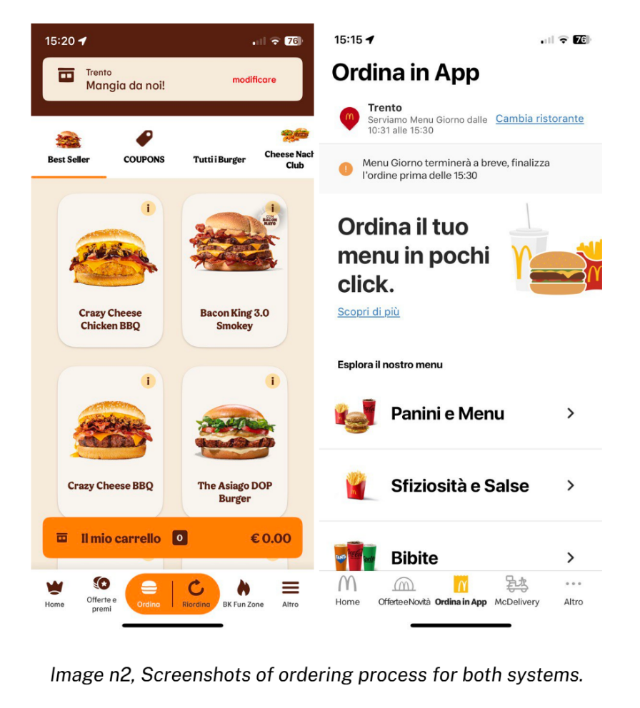
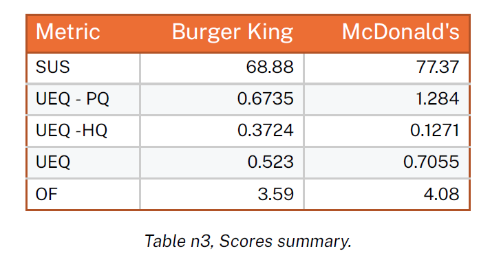

## Contesto

- Progetto di gruppo per il corso *Design Experience: Cognitive Ergonomics*, Università di Trento (anno accademico 2024/2025).
- **Team:** Samuele Mazzei, Lorenzo Zambotto, Samuele Nigroni, Nataliya Zhigalina e io; abbiamo condotto lo studio insieme.
- **Cosa:** un questionario quantitativo between-subjects che confronta le app di **McDonald’s** e **Burger King** in Italia.
- **Strumenti:** Google Forms, R. **Raccolta dati:** 3 settimane, 112 risposte.

## Domande di ricerca

- Le app offrono funzionalità quasi identiche (menu, promozioni, fedeltà, ordini da remoto), quindi le differenze percepite dipendono dal design.
- **D1 Usabilità:** le app differiscono nell’usabilità percepita? (SUS)
- **D2 User experience:** qualità pragmatica ed edonica sono diverse? (UEQ-S)
- **D3 Ordinazione:** un’app è più efficiente, chiara e trasparente quando si ordina? (6 domande create da noi)
- **D4 Valutazioni negli store:** i voti di App Store / Google Play corrispondono all’usabilità misurata?

## Le due app a confronto

- **Gli store premiano Burger King:** 4,0 e 4,3 stelle contro 2,8 e 3,1 per McDonald’s (App Store / Google Play). Il numero insolitamente alto di recensioni di McDonald’s su Google Play (oltre 700.000) ci è sembrato sospetto.
- **Caricamento:** Burger King quasi istantanea; McDonald’s più lenta, con schermata bianca e barra di avanzamento.
- **Navigazione:** entrambe con barra in basso (Home, Offerte, Ordina/Menu, Impostazioni). McDonald’s ha un pulsante separato per la consegna; Burger King la inserisce in Ordina.
- **Stile visivo:** McDonald’s bianca, basata su foto, scorrimento verticale; Burger King arancione/marrone, più grafica, molto scorrimento orizzontale.
- **In comune:** registrazione obbligatoria, solo italiano, informativa privacy, mappa del ristorante più vicino, codici sconto solo in app.
- **Solo Burger King:** sezione FAQ, monete fedeltà (“corone”), aggiunta di ingredienti (McDonald’s permette solo di toglierli).

## Disegno dello studio

- **Focus:** il flusso di ordinazione (la funzione principale e più usata), più usabilità e UX generali.
- **Between-subjects:** ognuno ha valutato solo l’app che usa di più, per evitare effetti di trascinamento, di ordine e di contrasto e tenere il questionario corto (meno stanchezza e abbandoni).
- **Perimetro ristretto per scelta:** i primi appunti includevano anche menu e sconti; abbiamo tenuto usabilità, UX e ordinazione per un confronto più pulito.
- **Etica:** partecipazione volontaria e anonima, nessun dato identificativo, informativa privacy all’inizio.

## Reclutamento e campione

- Campionamento di convenienza tramite WhatsApp, Telegram, forum studenteschi e social media, in italiano o in inglese.
- Criterio di inclusione: aver usato almeno una delle app (domanda filtro; chi non le usava veniva portato a una pagina di ringraziamento).
- All’inizio dominavano gli utenti McDonald’s (a un certo punto oltre 80/20), quindi abbiamo **adattato il reclutamento a metà raccolta** per raggiungere utenti Burger King.
- **112 risposte:** 97 in italiano, 15 in inglese.

## Il questionario

- Google Forms con logica condizionale: filtro → dati demografici e abitudini → SUS + UEQ-S → flusso di ordinazione.
- **Flusso di ordinazione (OF1–OF6):** scelta del ristorante, ricerca dei prodotti, chiarezza dei costi, ingredienti/informazioni nutrizionali, personalizzazione, modifica dell’ordine (item Likert a 5 punti).
- Ogni item OF mostrava uno **screenshot della schermata corrispondente** per aiutare il ricordo; seguiva un campo di testo libero.
- Chi usava entrambe le app poteva anche dire quale preferisce e perché.

## Preparazione e analisi dei dati

- Unite e tradotte le due versioni linguistiche, eliminato un non utente, codificata ogni risposta in numeri con etichette brevi.
- **R:** calcolo di SUS e UEQ-S, t-test di Welch su ogni misura, regressione lineare (SUS ~ frequenza d’uso + app preferita), correlazioni di Pearson.
- 108 risposte nell’analisi in R (49 Burger King, 59 McDonald’s).

## Risultati

- **SUS:** McDonald’s 77,37 contro Burger King 63,88, differenza significativa (p < .001). Solo McDonald’s supera la soglia di 70 punti.
- **UEQ-S qualità pragmatica:** 1,28 (positiva) contro 0,67 (neutra), significativa (p = .010).
- **UEQ-S edonica e complessiva:** Burger King leggermente più alta sull’edonica (0,37 contro 0,13), ma nessuna delle due differenze è significativa.
- **Flusso di ordinazione:** 4,08 contro 3,59, significativo (p < .001), trainato da:
  - **Ingredienti/informazioni nutrizionali (OF4):** 4,05 contro 2,33, il divario più grande.
  - **Personalizzazione (OF5):** 4,20 contro 3,57, anche se Burger King offre più opzioni.
- **Voti degli store contro usabilità:** direzioni opposte nel nostro campione (nessun test formale).
- Un uso più frequente dell’app predice un SUS più alto; preferire McDonald’s resta un predittore di SUS più alto anche tenendone conto. SUS e UEQ-S sono fortemente correlati (r ≈ .64–.68); l’età non è correlata in modo significativo a nessun punteggio.

## Limiti

- Esperienza auto-riferita e ricordata, in un contesto non controllato.
- Perimetro ristretto: altre funzionalità non confrontate.
- Gruppi sbilanciati: 97 risposte in italiano contro 15 in inglese; più utenti McDonald’s che Burger King; il reclutamento mirato potrebbe aver introdotto un bias.
- Troppo poche risposte aperte per spiegare *perché* si preferisce un’app.
- Campione di convenienza, soprattutto del Nord Italia.

## Riflessioni e prossimi passi

- I pochi utenti Burger King riflettono probabilmente la presenza sul territorio: circa 280 ristoranti in Italia contro circa 720 di McDonald’s.
- Le app sono localizzate: i risultati valgono solo per l’Italia.
- **Prossimi passi:** studiare sconti, servizi di localizzazione e consultazione del menu; aggiungere sessioni di think-aloud per capire l’uso in tempo reale e i motivi delle preferenze.
