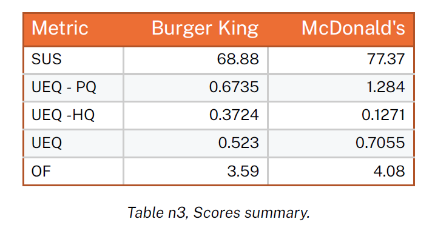

## Context

- Team project for the *Design Experience: Cognitive Ergonomics* course, University of Trento (academic year 2024/2025).
- **Team:** Samuele Mazzei, Lorenzo Zambotto, Samuele Nigroni, Nataliya Zhigalina and me; we ran the study as a group.
- **What:** a quantitative, between-subjects survey comparing the **McDonald’s** and **Burger King** apps in Italy.
- **Tools:** Google Forms, R. **Data collection:** 3 weeks, 112 responses.

## Research questions

- The apps offer near-identical features (menus, promotions, loyalty, remote ordering), so perceived differences point to design.
- **Q1 Usability:** do the apps differ in perceived usability? (SUS)
- **Q2 User experience:** do pragmatic and hedonic quality differ? (UEQ-S)
- **Q3 Ordering:** is one app more efficient, clear and transparent when ordering? (6 custom questions)
- **Q4 Store ratings:** do App Store / Google Play ratings match measured usability?

## The two apps at a glance

- **Store ratings favour Burger King:** 4.0 and 4.3 stars vs 2.8 and 3.1 for McDonald’s (App Store / Google Play). The unusually high number of Google Play reviews for McDonald’s (700,000+) looked suspicious.
- **Loading:** Burger King almost instant; McDonald’s slower, with a white screen and progress bar.
- **Navigation:** both use a bottom bar (Home, Offers, Order/Menu, Settings). McDonald’s has a separate delivery button; Burger King puts delivery inside Order.
- **Visual style:** McDonald’s is white, photo-driven, vertical scrolling; Burger King is orange/brown, more graphic, lots of horizontal scrolling.
- **Common ground:** registration required, Italian only, privacy policy, nearest-restaurant map, app-only discount codes.
- **Burger King only:** FAQ section, loyalty coins (“corone”), adding ingredients (McDonald’s only allows removing them).

## Study design

- **Focus:** the food ordering flow (the core, most-used function), plus overall usability and UX.
- **Between-subjects:** each person rated only the app they use most, to avoid carryover, order and contrast effects and to keep the survey short (less fatigue and drop-out).
- **Narrow scope by choice:** early notes also covered menu browsing and discounts; we kept usability, UX and ordering for a cleaner comparison.
- **Ethics:** voluntary, anonymous, no personally identifiable data, privacy statement up front.

## Recruitment and sample

- Convenience sampling via WhatsApp, Telegram, student forums and social media, in Italian or English.
- Inclusion: having used at least one of the apps (screening question; non-users were sent to a thank-you page).
- McDonald’s users dominated early (over 80/20 at one point), so we **adapted recruitment mid-study** to reach Burger King users.
- **112 responses:** 97 Italian, 15 English.

## The questionnaire

- Google Forms with conditional logic: screening → demographics and habits → SUS + UEQ-S → ordering flow.
- **Ordering flow (OF1–OF6):** location, finding products, cost clarity, ingredients/nutrition info, customization, editing the order (5-point Likert items).
- Each OF item showed a **screenshot of the matching screen** to aid recall; an open text box followed.
- Users of both apps could also state which they prefer and why.

## Data preparation and analysis

- Merged and translated the two language versions, removed one non-user, coded every answer numerically with short labels.
- **R:** SUS and UEQ-S scoring, Welch t-tests on every measure, linear regression (SUS ~ frequency of use + preferred app), Pearson correlations.
- 108 responses in the R analysis (49 Burger King, 59 McDonald’s).

## Results

- **SUS:** McDonald’s 77.37 vs Burger King 63.88, significant (p < .001). Only McDonald’s clears the 70-point benchmark.
- **UEQ-S pragmatic quality:** 1.28 (positive) vs 0.67 (neutral), significant (p = .010).
- **UEQ-S hedonic and overall:** Burger King slightly higher on hedonic (0.37 vs 0.13), but neither difference is significant.
- **Ordering flow:** 4.08 vs 3.59, significant (p < .001), driven by:
  - **Ingredients/nutrition info (OF4):** 4.05 vs 2.33, the largest gap.
  - **Customization (OF5):** 4.20 vs 3.57, even though Burger King offers more options.
- **Store ratings vs usability:** opposite directions in our sample (no formal test).
- More frequent use of the app predicts higher SUS; preferring McDonald’s still predicts higher SUS after accounting for it. SUS and UEQ-S correlate strongly (r ≈ .64–.68); age is not significantly correlated with any score.

## Limitations

- Self-reported, recalled experience in an uncontrolled setting.
- Narrow scope: other features not compared.
- Imbalanced groups: 97 Italian vs 15 English; more McDonald’s than Burger King users; targeted recruitment may have added bias.
- Too few open answers to explain *why* people prefer one app.
- Convenience sample, mostly northern Italy.

## Reflections and next steps

- Fewer Burger King users likely reflects presence: about 280 restaurants in Italy vs about 720 for McDonald’s.
- Apps are localized: results apply to Italy only.
- **Next:** study discounts, location services and menu browsing; add think-aloud sessions to understand real-time use and the reasons behind preferences.
