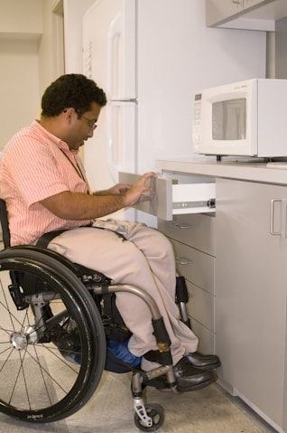
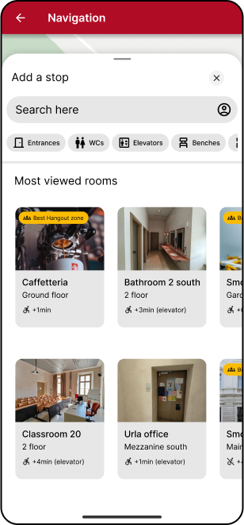
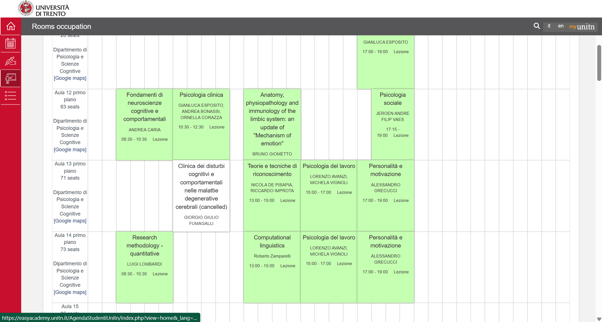

## Panoramica del progetto

Cicerone è un sistema di navigazione indoor inclusivo che aiuta le persone a orientarsi negli edifici pubblici che non conoscono, con percorsi pensati per le loro reali esigenze. Il nome viene proprio dal “cicerone”, la guida esperta che accompagna i visitatori.

- **Contesto:** progetto di gruppo per il corso di *Design for Social Inclusion* della mia laurea magistrale in Human-Computer Interaction all’Università di Trento. Il corso è durato 7 settimane, nella primavera del 2025, con la presentazione finale l’8 maggio 2025.
- **Team:** Federico Manzoni (io), Michele Cazzaro, Filippo D’Agnano, Ira Laihanen e Nataliya Zhigalina.
- **Il mio ruolo:** ho guidato il lavoro del gruppo. Ho rifatto gran parte della revisione della letteratura sulla navigazione indoor, ho contribuito a ideare personas e user journey, ho realizzato in Mappedin un prototipo funzionante della mappa del nostro dipartimento e ho progettato la maggior parte della UI ad alta fedeltà durante il design sprint (Michele mi ha aiutato con la navigazione in AR e con i totem). Dato che non tutti hanno contribuito allo stesso modo, mi sono fatto carico di una parte importante del lavoro per tenere il progetto in carreggiata.
- **Deliverable:** revisione della letteratura, personas e user journey, perimetro del prodotto (Minimum e “Maximum” Viable Product), studio di fattibilità TELOS, mockup ad alta fedeltà per app, totem e web app, piano finanziario e presentazione finale.
- **Risultato:** il progetto è stato valutato **30 e lode (31/30)**.

Il corso seguiva un programma fisso di 7 settimane: brainstorming, stato dell’arte, sviluppo dell’idea, studio di fattibilità, design sprint, analisi finanziaria e presentazione finale. Ogni settimana prevedeva due incontri, uno di lavoro pratico e uno di presentazioni e feedback. Questo articolo segue lo stesso ordine.

## Il problema

Il corso si concentrava su come soluzioni fisiche, tecnologiche e organizzative possano creare più opportunità per persone e gruppi svantaggiati. L’**esclusione sociale** è l’essere tagliati fuori dalla società a causa di barriere come discriminazione, povertà o sistemi progettati male. Questi sistemi creano *mismatch* tra le persone e il loro ambiente e alimentano un circolo di emarginazione. L’**inclusione sociale** significa cambiare attivamente queste condizioni, promuovendo partecipazione, dignità e pari opportunità.

Uno degli esempi più chiari di esclusione è l’accesso agli spazi sociali. Così, nel primo brainstorming, io e il mio team ci siamo fatti due domande:

- quali sono gli spazi più difficili da raggiungere?
- chi vive il mismatch più forte quando prova a raggiungerli?

La risposta ci ha portato alle **persone con disabilità visive e motorie** e a un problema che prima o poi tocca quasi tutti: arrivare a destinazione in un posto che non si conosce.

## Dalla città all’edificio

### Prima idea: percorsi accessibili in città

Invece di concentrarci su un ambiente specifico, la nostra prima idea strutturata riguardava la facilità di *raggiungere* una destinazione:

> **“Permettere alle persone di muoversi in città alle proprie condizioni, con percorsi accessibili basati sulle loro reali esigenze.”**

Siamo partiti da “qualsiasi utente” e poi abbiamo ristretto il campo alle persone con disabilità visive e motorie, quelle che con più probabilità vivono il mismatch più forte. A quel punto abbiamo studiato la letteratura.

### Cosa ci ha detto la ricerca sulla navigazione outdoor

- Diverse app affrontano già il problema (AXS Map, Wheelmap.org, AccessNow), ma nessuna di quelle che abbiamo analizzato era pienamente funzionante: quasi tutte erano datate, avevano pochi dati o dipendevano molto dal crowdsourcing.
- La ricerca sul tema è andata di pari passo con l’evoluzione tecnologica. Oggi si usa anche l’AI per analizzare immagini a livello stradale e valutare la presenza e lo stato dei marciapiedi.
- Per coprire diversi tipi di disabilità servono moltissimi dati. Per questo il crowdsourcing è così diffuso in questo campo, ma limita anche fattibilità e usabilità.

### La svolta

La ricerca outdoor era una base solida, ma intanto è successa una cosa buffa. Molti dei miei compagni di team sono studenti internazionali che non erano mai stati nell’edificio del mio dipartimento (il DIPSCO, a Rovereto): continuavano a perdersi e facevano fatica ad arrivare in aula in orario. In più, parte della letteratura sottolineava quanto sia difficile per le persone con disabilità visive orientarsi all’interno degli edifici.

Mettendo insieme le due cose, abbiamo riformulato l’idea:

> **“Permettere alle persone di orientarsi in edifici sconosciuti con percorsi accessibili basati sulle loro reali esigenze.”**

Abbiamo deciso di puntare tutto su questa idea e capire se potesse diventare qualcosa di concreto.

## Ricerca sulla navigazione indoor

Ho quindi rifatto gran parte della revisione della letteratura, questa volta sulla navigazione all’interno degli edifici. Si è rivelato un tema piuttosto di nicchia.

- **Target principale in letteratura:** persone cieche e ipovedenti, e persone con disabilità motorie.
- **Soluzioni esistenti:** solo poche opzioni concrete, come MapsPeople e Pointr.
- **Problemi e sfide:** dipendenza dagli altri, complessità degli ambienti interni, scarsa adozione di tecnologie e servizi, rumori forti e ostacoli fisici, difficoltà di implementazione (costi tecnologici elevati e personalizzazione caso per caso).

I messaggi chiave emersi hanno guidato tutto il resto:

1. Lo universal design deve essere centrale, per rendere la soluzione accessibile a tutti.
2. La priorità va alle persone cieche, ipovedenti e con disabilità motorie.
3. La navigazione deve essere **multimodale**, per coprire il maggior numero possibile di scenari ed esigenze.

L’idea reggeva e aveva pochi concorrenti diretti, quindi siamo passati a definirla.

## Definire Cicerone

Cicerone è un sistema di navigazione indoor inclusivo e multimodale che aiuta le persone a muoversi con sicurezza in edifici pubblici complessi. Il caso d’uso principale era il campus universitario, ma il sistema è pensato per estendersi a ospedali, biblioteche, stazioni, centri commerciali e altri spazi pubblici al chiuso.

**Filosofia di fondo**

- Basata sull’inclusive design.
- Orientata a eliminare i mismatch tra le esigenze delle persone e la progettazione degli spazi.
- Incoraggia anche l’adattamento dell’ambiente, non solo la guida digitale: codici colore, segnaletica migliore e totem interattivi.

**Per chi è pensato.** Per tutti, ma soprattutto per le persone con disabilità visive e motorie permanenti. Abbiamo individuato anche altri gruppi che potrebbero trarne beneficio: persone con disabilità temporanee, visitatori e turisti, persone che provano ansia nei luoghi sconosciuti.

**Stakeholder.** Gli stakeholder primari sono gli utenti (studenti e personale universitario) e l’istituzione che adotta Cicerone. Quelli secondari sono la direzione e i team di sviluppo e manutenzione.

## Personas e user journey

Abbiamo progettato attorno a tre proto-personas, costruite a partire dalla letteratura e non da una nostra ricerca con gli utenti, ognuna con esigenze e pain point diversi:

1. **Jane, studentessa di psicologia non vedente:** si affida a feedback vocali e aptici, ha difficoltà con gli ostacoli temporanei ed è spesso in ritardo.
2. **Mario, dottorando che usa la sedia a rotelle:** vuole percorsi accessibili e veloci e odia perdere tempo a cercare ascensori o aree fumatori.
3. **Steven, tecnico appena arrivato nel campus:** ha bisogno di una navigazione a mani libere mentre trasporta attrezzature e si perde facilmente.

Per ognuna abbiamo costruito una user journey dettagliata, così da coprirne le esigenze in ogni punto di contatto: dall’ingresso e l’orientamento fino al cambio di percorso per un ostacolo e all’invio di feedback. Apri le schede qui sotto per leggere esigenze e journey complete.

### Jane, studentessa di psicologia non vedente

Esigenze

Jane ha 22 anni e studia psicologia alla triennale. È completamente cieca ma molto indipendente. Si muove con il suo cane guida, Bolt, e usa tecnologie assistive come screen reader e navigazione vocale. In più ha sempre sonno, e per questo arriva spesso in ritardo a lezione.

##### Pain point:

- Ritardi cronici dovuti alla sonnolenza, che la mettono sotto pressione mentre si orienta
- Segnaletica interna poco chiara, che non la aiuta a orientarsi
- Ostacoli che Bolt non sempre riesce a individuare, come:
	- Barriere di cantiere temporanee
	- Mobili fuori posto
	- Altri ostacoli imprevisti
- Bisogno di indicazioni audio precise, con riferimenti spaziali dettagliati al posto delle informazioni visive
- Difficoltà in tempo reale quando incontra barriere impreviste o cambi di percorso

##### Esigenze principali:

- Muoversi in università in modo rapido ed efficiente, soprattutto vista la sua tendenza al ritardo
- Percorsi veloci e accessibili verso le aule, adatti sia a lei sia a Bolt
- Una navigazione audio che funzioni bene con lo screen reader del telefono
- Aggiornamenti e informazioni sul percorso in tempo reale, per recuperare i ritardi
- Una consapevolezza spaziale dettagliata grazie a istruzioni audio precise, passo dopo passo

##### In sintesi:

Jane tiene molto alla sua indipendenza, ma ha bisogno di una tecnologia che le dia indicazioni audio affidabili per muoversi in modo efficiente nonostante la fretta e gli ostacoli.

Journey

È il primo giorno del nuovo semestre. Jane si sveglia tardi e deve correre a lezione. Abita vicino all’università ma non è mai stata in quell’aula, quindi le serve il percorso accessibile più veloce.

- Jane si alza, si veste e controlla l’orario sul telefono: ha solo 10 minuti per arrivare in aula.
- Orientarsi in un edificio sconosciuto può essere complicato, e rischia di fare tardi.
- Arriva all’edificio con l’aiuto di Bolt e apre l’app Cicerone con i comandi vocali.
- Seleziona l’edificio universitario nell’app e cerca l’aula.
- L’app rileva la sua posizione e le propone il percorso accessibile più veloce, tenendo conto dei passaggi adatti ai cani guida.
- Jane segue le indicazioni audio passo passo con i suoi auricolari wireless.
- Il telefono vibra prima di ogni svolta e la avvisa di possibili ostacoli, come sedie fuori posto o altre persone (anche Bolt la aiuta, ovviamente).
- Bolt esita davanti a una barriera temporanea. Jane controlla l’app, che si aggiorna in tempo reale e le propone un percorso alternativo.
- Alla fine Jane riceve una notifica che le chiede un feedback, così può segnalare eventuali problemi e contribuire a migliorare l’accessibilità.

### Mario, dottorando che usa la sedia a rotelle

Esigenze

Mario ha 30 anni, fa un dottorato in giurisprudenza e si muove in sedia a rotelle. È una persona molto socievole e chiacchierona, e fuma spesso. Per il dottorato si sposta regolarmente tra uffici, aule e spazi comuni. Deve passare da molti uffici universitari per le sue ricerche, ma trovare percorsi accessibili è difficile, soprattutto per raggiungere le aree fumatori.

##### Pain point:

- Edifici complessi, con ascensori e porte accessibili nascosti o difficili da trovare
- Nessuna informazione chiara sui percorsi adatti alla sedia a rotelle, che lo costringe a giri più lunghi e indiretti
- Difficoltà a trovare aree fumatori accessibili senza deviazioni in zone inaccessibili
- Tempo perso ad aggirare scale e passaggi inaccessibili che scopre troppo tardi
- Pochi aggiornamenti in tempo reale su problemi di accessibilità, come ascensori fuori servizio
- Accessibilità diversa da un edificio universitario all’altro

##### Esigenze principali:

- Percorsi accessibili in sedia a rotelle tra tutti gli edifici e i luoghi dell’università
- Raggiungere gli uffici in modo efficiente, senza barriere come le scale
- Accesso rapido alle aree fumatori più vicine
- Informazioni in tempo reale su ascensori, rampe e porte automatiche
- Navigazione verso gli spazi comuni, per coltivare la sua vita sociale nel campus

##### In sintesi:

Mario tiene alle relazioni e alla sua indipendenza, ma ha bisogno di informazioni affidabili sull’accessibilità e di percorsi che tengano conto della sua mobilità, soprattutto verso i luoghi che frequenta di più, come uffici e spazi di ritrovo.

Journey

Mario partecipa a una conferenza legata alla sua ricerca all’Università di Trento, dove non è mai stato. Deve raggiungere diverse aule, alcuni uffici, il bar e le aree fumatori, e ogni percorso deve essere completamente accessibile in sedia a rotelle.

- Mario arriva all’Università di Trento per un seminario e gli serve un percorso accessibile per l’aula, senza perdere tempo.
- Vuole anche sapere dov’è l’area fumatori più vicina per la prossima pausa.
- Apre l’app e seleziona “Università di Trento” come luogo.
- Inserisce la destinazione (l’aula) e sceglie i percorsi accessibili in sedia a rotelle.
- L’app esclude scale e passaggi inaccessibili, dà priorità a rampe e porte automatiche e lo indirizza all’ascensore più vicino.
- Prima di partire salva tra i preferiti l’area fumatori più vicina e un punto caffè per dopo.
- L’app lo guida con indicazioni passo passo.
- L’ascensore più vicino è fuori servizio. Mario chiede un’alternativa e l’app gliela propone subito.
- Arriva alla conferenza in orario e se la gode.
- Durante la pausa trova facilmente l’area fumatori più vicina e chiacchiera con i colleghi.
- Lascia un feedback sull’ascensore guasto.
- Più tardi usa di nuovo l’app per trovare un punto caffè dove fare networking con altri ricercatori.

### Steven, tecnico appena arrivato nel campus

Esigenze

Steven ha 28 anni ed è un tecnico universitario senza disabilità fisiche. È nuovo nel ruolo e si occupa di manutenzione, tra riparazioni e consegne di attrezzature nei vari edifici dell’università. Lo chiamano “il fortunato” per le sue capacità fisiche, ma non conosce la planimetria del campus e spesso deve trasportare pacchi pesanti, attrezzi o apparecchiature.

##### Pain point:

- Si perde facilmente nei grandi edifici universitari, soprattutto con corridoi tutti uguali
- Non può controllare continuamente il telefono quando ha le mani occupate
- Fatica a trovare percorsi adatti alle consegne pesanti (senza scale né passaggi stretti)
- Non conosce gli edifici, e questo lo rende meno efficiente sul lavoro
- Ha bisogno di indicazioni passo passo nelle zone sconosciute per non confondersi
- Lavora sotto pressione per completare manutenzioni e consegne in tempo

##### Esigenze principali:

- Trovare aule ed edifici in modo efficiente, per finire i lavori in tempo
- Percorsi con ascensore quando trasporta pacchi o attrezzature pesanti
- Navigazione a mani libere, visto che ha spesso le mani occupate
- Imparare in fretta i percorsi, per familiarizzare con il campus
- Percorsi adatti alle consegne, con rampe e corridoi larghi

##### In sintesi:

Steven non ha limiti fisici, ma gli manca la conoscenza del posto. Ha bisogno di una navigazione pratica e a mani libere che si adatti al suo lavoro, soprattutto quando sposta oggetti pesanti o ingombranti in edifici che non conosce.

Journey

Steven riceve un incarico all’università: una riparazione in un laboratorio informatico e la consegna di nuove attrezzature. L’edificio è grande, sconosciuto e pieno di corridoi tutti uguali, e con le mani occupate non può continuare a guardare il telefono per cercare la strada.

- Steven arriva in un grande edificio universitario che non conosce per un lavoro di manutenzione.
- Chiede all’info point se è nell’edificio giusto.
- Apre l’app e cerca il laboratorio informatico dove deve andare.
- Attiva la modalità audio e sceglie un percorso senza scale.
- Indossa gli auricolari e l’app lo guida passo passo mentre cammina.
- L’app lo accompagna nei corridoi e fino all’ascensore per i piani superiori.
- Trova il laboratorio senza perdersi e senza chiedere indicazioni a nessuno.
- Finito il lavoro, usa di nuovo l’app per trovare il percorso più rapido e adatto alla consegna delle nuove attrezzature.
- Prima di andarsene salva l’edificio tra i preferiti, perché probabilmente tornerà per altre manutenzioni.

## Il perimetro del prodotto

Cicerone può essere molto semplice o piuttosto complesso, perché combina tante soluzioni, piccole e grandi. Gli investimenti in questo campo possono essere limitati e modificare fisicamente gli edifici può essere complesso e costoso. Per questo, invece di un unico prodotto, abbiamo definito diversi **livelli di adozione**, in base a quanto un cliente può o vuole spendere.

### Minimum Viable Product

Un’integrazione minima con le app e i siti esistenti dell’istituzione: rendering 3D dell’edificio, pianificazione del percorso e QR code come punto di partenza, senza indicazioni né avvisi in tempo reale. A seconda delle dimensioni dell’istituzione, la mappatura non dovrebbe richiedere più di un paio di giorni per edificio. L’ho verificato di persona: [il prototipo in Mappedin](https://app.mappedin.com/map/67e27b92167442000b4c75a8) dell’edificio del nostro dipartimento mi ha richiesto circa un giorno.

### “Maximum” Viable Product

Tutto quello che abbiamo immaginato, unendo software e interventi sull’ambiente:

- **Navigazione multimodale**
	- Audio: indicazioni vocali passo passo.
	- Aptica: vibrazioni per svolte e ostacoli.
	- Visiva: mappe 2D e 3D, overlay in realtà aumentata e indicazioni contestuali (ad esempio “gira dopo la panchina rossa”).
- **Percorsi adattivi**
	- Percorso più breve, adatto a persone con disabilità visive o ottimizzato per chi ha difficoltà motorie.
	- Ricalcolo in tempo reale per evitare ostacoli temporanei (ascensori guasti, lavori, gruppi di persone).
- **Accesso multipiattaforma**
	- App mobile (ad esempio dentro la UniTrento App), interfaccia web, schermi e totem interattivi agli ingressi e in altri punti chiave.
	- QR code come punti di partenza opzionali per le soluzioni a basso budget.
- **Dati in crowdsourcing**
	- Gli utenti possono segnalare problemi, suggerire punti di interesse e recensire i percorsi.
	- Un sistema di ricompense gamificato, simile a quello di Google Maps, per incentivare la partecipazione.
- **Personalizzazione rapida**
	- Profili di accessibilità predefiniti, oppure preferenze temporanee per chi usa l’app una volta sola o ha un’esigenza momentanea, senza toccare le impostazioni di default.
- **Geolocalizzazione**
	- AI: in modalità AR l’utente viene localizzato continuamente, perché l’AI riconosce gli elementi dell’edificio.
	- Posizionamento Wi-Fi (trilaterazione): l’utente viene localizzato in base all’intensità del segnale Wi-Fi.

Per un’esperienza ancora migliore abbiamo proposto anche interventi sull’ambiente che vanno oltre Cicerone: codici colore per edifici, piani e aule, porte e passaggi più larghi, nuovi ascensori e rampe, cartelli in braille.

## Studio di fattibilità (TELOS)

Per capire se Cicerone poteva andare oltre la fase di concept abbiamo condotto un’analisi di fattibilità basata sul framework TELOS (tecnologica, economica, legale, operativa e di tempistiche), estesa con le dimensioni culturale, di settore e di competitività. L’abbiamo presentata il 3 aprile 2025.

### Tecnologica: può funzionare?

Sì. Quasi tutte le tecnologie necessarie sono già state usate con successo in altri contesti e sono disponibili molti strumenti open source.

- Il **posizionamento indoor** tramite Wi-Fi o QR code è ben documentato e molto diffuso (ad esempio Pointr, MapsPeople).
- Il **riconoscimento di oggetti e ostacoli** con la computer vision (ispirato a Seeing AI) è realizzabile con strumenti come OpenCV e TensorFlow.
- La **navigazione in AR** è fattibile ma impegnativa; le API geospaziali di Niantic mostrano come l’AR possa ancorare la navigazione.
- Le **interfacce multimodali** (audio, aptiche, visive) sfruttano le funzioni standard degli smartphone.
- **Infrastruttura:** totem basati su Android, server istituzionali o in cloud e hardware leggero.

La geolocalizzazione basata sull’AI era chiaramente la parte “difficile”, soprattutto per la precisione in tempo reale al chiuso. Per questo abbiamo scelto un approccio modulare: Cicerone può partire con funzioni più semplici e crescere nel tempo.

### Economica: è sostenibile?

La nostra prima stima è stata costruita ruolo per ruolo: 13 figure (project manager, sviluppatori backend e mobile, UX/UI designer, un esperto di machine vision, uno specialista GIS, un ingegnere IoT, QA/tester e DevOps), ognuna con i giorni assegnati e una tariffa giornaliera. Il totale arrivava a **circa 180.000 €** per circa un anno di sviluppo. Più avanti abbiamo rivisto questa cifra nel piano finanziario (vedi sotto).

- **Finanziamento:** il primo rilascio finanziato da istituzioni partner (ad esempio l’Università di Trento); nel lungo periodo, bandi pubblici (iniziative UE per l’accessibilità), sponsor privati o ONG.
- **Gratis per gli utenti:** l’app resta gratuita per gli utenti finali, per essere davvero inclusiva; a pagare sono le istituzioni.
- **Ritorno dell’investimento:** meno dipendenza dal personale di assistenza, costi più bassi per segnaletica e manutenzione, più sicurezza e soddisfazione, migliore reputazione e posizione nelle classifiche di accessibilità.

### Legale: è conforme?

Le funzioni basate sulla fotocamera e la geolocalizzazione rendevano la conformità legale un tema centrale.

- **Privacy e GDPR:** nessun dato biometrico identificabile. Il riconoscimento degli oggetti si concentra sull’ambiente, non sui volti.
- **Cybersecurity:** conformità alla direttiva europea NIS2, con crittografia forte e controllo degli accessi.
- **Sicurezza pubblica:** alcuni dati sui luoghi (ad esempio aree riservate o mappe catastali, regolate dal D.Lgs. 33/2013) vanno gestiti con attenzione, e le autorità possono limitarne l’accesso.
- **Responsabilità:** gli utenti potrebbero comunque incontrare ostacoli, quindi servono condizioni d’uso chiare che definiscano le responsabilità.

### Operativa: le persone lo useranno?

Sì, soprattutto in istituzioni come le università, dove arrivano continuamente persone nuove.

- Abbiamo stimato circa **1.000 nuove persone all’anno** (circa 600 nuovi studenti e 400 utenti occasionali), ognuna con bisogno di 2–5 minuti di guida quando si perde, più o meno 10 volte a settimana finché non impara a orientarsi. Le persone cieche potrebbero continuare a usarlo a lungo termine.
- Scenari diversi, punti di accesso diversi: i nuovi studenti tramite l’app; i visitatori occasionali tramite totem, sito web e schermi con QR code; e poi i momenti in cui ci si perde o si vuole preparare un percorso in anticipo.
- Onboarding rapido, accesso senza login e totem rendono il sistema usabile anche per chi lo usa una volta sola.
- Il successo dipende anche dalla comunicazione: le persone devono sapere che Cicerone esiste (bacheche, materiali di orientamento), le mappe vanno aggiornate regolarmente dall’istituzione e dagli utenti, e QR code e mappe precaricate permettono l’uso offline.

### Tempistiche: quanto ci vorrà?

- **Sviluppo:** circa 10–12 mesi, tra selezione del personale, software, design, hardware, user research e test.
- **Implementazione dell’MVP in un’istituzione:** circa 1 mese o meno (mappa, rendering 3D, integrazione in app o siti esistenti), ideale per un pilota su un solo edificio o piano.
- **Implementazione della versione completa:** circa 2–3 mesi, a seconda delle dimensioni (scansioni a 360°, adattamento degli spazi, totem, schermi, beacon Wi-Fi).

### Culturale: sarà accolto bene?

- **Studenti:** maggiore senso di appartenenza, meno barriere linguistiche, meno stress e ansia.
- **Persone con disabilità:** più autonomia e un senso più forte di far parte della comunità.
- **Personale universitario:** più lavoro per gestire e mantenere il sistema, ma anche un lavoro che ha più senso.
- **Università:** più digitalizzazione e accessibilità, a vantaggio di classifiche e soddisfazione degli studenti.
- **Trade-off che abbiamo evidenziato:** meno interazioni quotidiane (come chiedere indicazioni a qualcuno) potrebbero indebolire in modo sottile i legami sociali, e più tecnologia significa più consumi energetici, più luce blu e problemi di smaltimento.

### Settore e concorrenza: c’è un mercato?

- Si stimava che il mercato del posizionamento e della navigazione indoor crescesse del 30–40% all’anno tra il 2025 e il 2030, spinto da AI, IoT, 5G e AR e dalla domanda crescente in sanità e accessibilità. Nel settore pubblico l’adozione è più lenta a causa delle normative.
- Tra i concorrenti ci sono Lazarillo, NaviLens e Seeing AI, pensati per persone cieche ma limitati ad alcune modalità o luoghi, e HyperAR, che offre posizionamento senza infrastruttura ma senza un focus sull’accessibilità.
- Per il nostro cliente principale, l’Università di Trento, non esisteva ancora una soluzione concorrente. Dato che la maggior parte dei prodotti concorrenti è gratuita, abbiamo mantenuto Cicerone gratuito.
- Ostacoli principali: attirare utenti, un software pesante e con molti dati, raccogliere fondi sufficienti e avere come clienti principali enti pubblici.

## Design sprint

Dopo il concept e lo studio di fattibilità avevamo **una settimana** per progettare le interfacce. Lo sprint ha prodotto mockup ad alta fedeltà per:

- l’**app mobile**, pensata per vivere dentro la UniTrento App;
- l’interfaccia dei **totem**;
- **due punti di accesso** nella web app dell’orario lezioni di UniTrento;
- l’accesso tramite **QR code**.

**Una scelta guidata dai vincoli.** Il tempo era pochissimo ed ero l’unico del team con buone competenze in Figma. Ho quindi deciso di basare le UI in gran parte sul design di Google Maps, invece di creare un linguaggio visivo da zero. La maggior parte del lavoro qui sotto è mia; Michele Cazzaro mi ha aiutato con la navigazione in AR e con il design dei totem.

### App mobile

Il flusso dell’app parte da dove gli studenti si trovano già: le lezioni del giorno nella UniTrento App, ognuna con un pulsante **Naviga**.

- Avvio della navigazione dall’orario delle lezioni.
- Anteprima e personalizzazione del percorso: aggiunta di tappe (con scorciatoie per ingressi, bagni, ascensori, panchine e aule più visitate) e cambio rapido del tipo di percorso. Ogni opzione mostra il tempo di percorrenza e quante scale comporta, e un grafico degli orari di punta aiuta a evitare la folla.
- Navigazione in 2D e 3D, con avvisi sugli ostacoli, ricalcolo del percorso e richiesta di aiuto.
- Navigazione in AR con riconoscimento degli ostacoli. Quando qualcuno ha già segnalato un ostacolo, l’app chiede “È ancora lì?”, così i dati in crowdsourcing restano aggiornati.
- Una **modalità per persone ipovedenti** accanto all’interfaccia standard con mappa, con testo molto più grande, pulsanti più grandi e le informazioni chiave sul percorso in primo piano.
- Impostazioni del profilo.
- Segnalazione di ostacoli (gruppo di persone, pericolo, accesso bloccato, percorso poco chiaro) e aggiunta di luoghi sociali (area fumatori, zona relax, zona caffè, punto d’incontro).

### Totem

I totem agli ingressi e nei punti chiave servono ai visitatori occasionali che non hanno l’app.

- Visualizzazione e filtro della mappa (aule, bagni, ascensori, zone sociali e altro).
- Navigazione verso gli eventi e le lezioni del giorno.
- Anteprima del percorso con tempo di percorrenza, scale e ascensori.
- Indicazioni passo passo.

### Web app e QR code

- Avvio della navigazione dall’orario delle lezioni e da altre funzioni della web app per gli studenti di UniTrento, tramite una voce dedicata “Cicerone Navigator” e un pulsante **Naviga** nei dettagli di ogni evento.
- Poster bilingui (italiano e inglese) con QR code sparsi nel campus: “Non sai dove sei? Scannerizza il QR code e fatti navigare con Cicerone in UniTrento App!”

## Piano finanziario

Cicerone si rivolge agli spazi pubblici e agli spazi privati aperti al pubblico i cui proprietari o gestori vogliono migliorarne accessibilità e orientamento: università, ospedali, musei, aeroporti e nodi di trasporto. Abbiamo presentato il piano finanziario il 17 aprile 2025.

- **Finanziamento:** la prima fase si appoggia soprattutto all’Università di Trento, così da poter prototipare, testare e installare i sensori in un ambiente favorevole che permette di iterare. Per crescere, avevamo previsto di contattare altri gestori di spazi e ONG come l’Unione Italiana Ciechi, l’European Disability Forum, l’Ente Nazionale Sordi, la Federazione Italiana per il Superamento dell’Handicap e l’Associazione Italiana Ambiente e Salute.
- **Modello di business:** Cicerone opera come realtà indipendente che collabora con istituzioni e aziende private per installare e mantenere il sistema nelle loro sedi. L’app resta gratuita per gli utenti.
- **Budget rivisto:** abbiamo suddiviso i costi in software e strumenti, hardware e materiali, sviluppo, test e comunicazione. Il totale era di circa 95.600 €; con un margine del 20% il budget arrivava a circa **115.000 €**, che abbiamo presentato come **120.000 €**, contro i 180.000 € dello studio di fattibilità.
- **Trade-off se i fondi non bastano:** la prima cosa a saltare sarebbe la geolocalizzazione basata sull’AI, uno dei punti di forza del sistema (posizionamento preciso in edifici con Wi-Fi debole o assente). Poi il personale (con un ritorno dell’investimento più lento) e il tempo dedicato alla cura visiva della UI. Potremmo anche chiedere all’Università di Trento di fornire i partecipanti per i test con gli utenti, risparmiando quella voce di budget.
- **Alternative più economiche:** hackathon o sprint di sviluppo guidati dalla community potrebbero far partire il progetto, risparmiare budget e accorciare i tempi.

Nel lungo periodo il valore per le istituzioni sta nei minori costi operativi e in più accessibilità, visibilità e soddisfazione degli utenti.

## Risultati

All’ultima lezione, l’8 maggio 2025, abbiamo presentato Cicerone insieme agli altri gruppi. Abbiamo ripercorso tutto il progetto, dalla definizione del problema e dalla ricerca fino alle scelte di design e alla fattibilità, chiudendo con il piano completo: circa 120.000 € e 12–15 mesi dal finanziamento all’implementazione.

Il progetto è stato accolto molto bene e valutato **30 e lode (31/30)**. Ripensandoci, credo si sia distinto per:

- un concept basato sulle esigenze riportate in letteratura e sui principi dell’inclusive design;
- uno studio di fattibilità che copriva gli aspetti tecnici, operativi, legali e finanziari;
- un approccio user-centered, costruito su letteratura, proto-personas e user journey;
- una presentazione che ha fatto capire bene cosa poteva fare Cicerone.

## Riflessioni e prossimi passi

Il risultato è stato ottimo, ma il percorso ha avuto le sue difficoltà:

- **Tempo:** dovevamo far convivere questo progetto con altri lavori di gruppo e altri corsi, quindi gestire il tempo è stata una sfida continua.
- **Dinamiche di team:** non tutti hanno contribuito allo stesso modo, così mi sono fatto carico di una parte importante del lavoro per tenere il progetto in carreggiata.
- **Iterazione del design:** avrei voluto più tempo per rifinire l’interfaccia e i flussi di interazione, più nel dettaglio e con dei test.
- **Documentazione:** l’idea di fondo era ben strutturata e basata sulla ricerca, ma non abbiamo avuto il tempo di completare e sistemare la documentazione.
- **Coerenza:** il design potrebbe essere più coerente, soprattutto nella UI e nel modo in cui le parti del sistema stanno insieme.

Con più tempo avrei svolto i test di usabilità che avevamo proposto e rifinito ulteriormente la UI.

Cicerone mi ha insegnato molto sull’inclusive design, sul lavoro di squadra sotto pressione e sul ragionare a livello di sistema. È stata anche l’occasione per lavorare su ricerca, design e strategia nello stesso progetto, e sono orgoglioso di com’è venuto.
