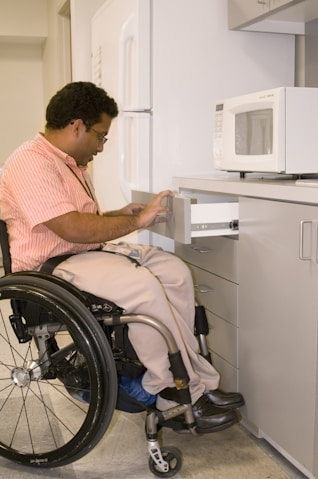

## Project overview

Cicerone is an inclusive indoor navigation system that helps people find their way through unfamiliar public buildings, using routes that fit their actual needs. The name comes from the Italian word for a knowledgeable guide.

- **Context:** group project for the *Design for Social Inclusion* course of my Master’s in Human-Computer Interaction at the University of Trento. The course ran over 7 weeks in spring 2025, with the final presentation on 8 May 2025.
- **Team:** Federico Manzoni (me), Michele Cazzaro, Filippo D’Agnano, Ira Laihanen and Nataliya Zhigalina.
- **My role:** I guided the team’s work. I redid most of the indoor navigation literature review, helped come up with the personas and user journeys, built a working map prototype of our department’s building in Mappedin, and designed most of the high-fidelity UI during the design sprint (Michele helped with the AR navigation and the kiosks). Because not everyone contributed equally, I took on a significant share of the overall workload to keep the project on track.
- **Deliverables:** literature review, personas and user journeys, product scope (Minimum and “Maximum” Viable Product), TELOS feasibility study, high-fidelity mockups for app, kiosks and web app, financial plan and final presentation.
- **Outcome:** the project was graded **31/30 with honors**.

The course followed a fixed 7-week program: brainstorming, state of the art, idea development, feasibility study, design sprint, financial analysis and final presentation. Each week had two sessions, one for hands-on work and one for presentations and feedback. This article follows the same order.

## The problem

The course looked at how physical, technological and organizational solutions can create more opportunities for disadvantaged people and groups. **Social exclusion** means being left out of society because of barriers like discrimination, poverty or poorly designed systems. These systems create *mismatches* between people and their environment and reinforce a cycle of marginalization. **Social inclusion** means actively changing those conditions to promote participation, dignity and equal opportunities.

One of the clearest examples of exclusion is access to social spaces. So in our first brainstorming my teammates and I asked two questions:

- which spaces are the hardest to reach?
- which people face the strongest mismatch when they try to reach them?

Our answer pointed to **people with visual and mobility impairments**, and to a problem that touches almost everyone at some point: getting to a destination in a place you don’t know.

## From city to building

### First idea: accessible routes in the city

Instead of tackling one specific environment, our first structured idea tackled how easily people can *reach* a destination:

> **“Allowing people to navigate the city on their own terms, using accessible routes based on their actual needs.”**

We started from “any possible user” and then narrowed down to sight- and mobility-impaired people, the ones most likely to face the strongest mismatch. Then we studied the literature.

### What the outdoor research showed

- Several apps already address the problem (AXS Map, Wheelmap.org, AccessNow), but none of the ones we analyzed were fully functional: most were outdated, lacked data or relied heavily on crowdsourcing.
- Research on the topic has followed technological progress. AI is now used to analyze street-level images and assess the presence and state of sidewalks.
- Covering different types of disability takes a lot of data. That is why crowdsourcing is so common in this field, but it also limits feasibility and usability.

### The pivot

The outdoor research was solid enough to build on, but then something funny happened. Many of my teammates are international students who had never been in my department’s building (DIPSCO, in Rovereto), and they kept getting lost inside it and struggled to reach class on time. Part of the literature also stressed how hard it is for visually impaired people to navigate buildings.

Putting the two together, we reframed the idea:

> **“Allowing people to navigate unfamiliar buildings using accessible routes based on their actual needs.”**

We decided to go all in and find out whether this lead could become something real.

## Researching indoor navigation

I then redid most of the literature review, this time on navigating buildings. It turned out to be a fairly niche topic.

- **Main target in the literature:** blind and visually impaired people, and people with mobility impairments.
- **Existing solutions:** only a few concrete options, such as MapsPeople and Pointr.
- **Issues and challenges:** reliance on other people, complex indoor environments, limited adoption of technologies and services, loud noises and physical obstacles, and implementation difficulties (high technology costs and case-by-case customization).

Our take-home messages shaped everything that followed:

1. Universal design should be a key focus, to make the solution accessible for everyone.
2. Priority goes to blind, visually impaired and mobility-impaired people.
3. Navigation has to be **multimodal** to cover a wide range of scenarios and needs.

The idea held up and had few direct competitors, so we moved on to defining it.

## Defining Cicerone

Cicerone is an inclusive, multimodal indoor navigation system that helps people move confidently through complex public buildings. Our primary use case was the university campus, but the system is designed to scale to hospitals, libraries, stations, shopping malls and other public indoor spaces.

**Core philosophy**

- Based on inclusive design.
- Focused on removing mismatches between user needs and the design of spaces.
- Encourages adapting the environment too, not just digital guidance: color coding, better signage and interactive kiosks.

**Who it is for.** Everyone, but especially people with permanent visual and mobility impairments. We also identified other groups who could benefit: people with temporary impairments, visitors and tourists, and people who feel anxious in unfamiliar places.

**Stakeholders.** Primary stakeholders are the users (students and university staff) and the institution that adopts Cicerone. Secondary stakeholders are management and the developers and maintenance teams.

## Personas and journeys

We designed around three proto-personas, built from the literature rather than from our own user research, each with different needs and pain points:

1. **Jane, blind psychology student:** relies on voice and haptic feedback, struggles with temporary obstacles and often runs late.
2. **Mario, PhD student and wheelchair user:** wants fast, accessible routes and hates wasting time looking for elevators or smoking areas.
3. **Steven, technician new to the campus:** needs hands-free navigation while carrying equipment, and gets lost easily.

We mapped each persona across a detailed user journey, so that their needs were covered at every touchpoint: from entering and orienting themselves to rerouting around obstacles and giving feedback. Open the cards below for the full needs and journeys.

### Jane, blind psychology student

Needs

Jane is a 22-year-old bachelor’s student in psychology. She is completely blind but highly independent. She moves around with her guide dog, Bolt, and uses assistive technologies like screen readers and voice navigation. She is also sleepy all the time, which often makes her late for class.

##### Pain points:

- Chronic lateness due to sleepiness, which puts her under time pressure while navigating
- Unclear indoor signage that doesn’t help her orientation
- Environmental obstacles that Bolt might not always detect, such as:
	- Temporary construction barriers
	- Misplaced furniture
	- Other unexpected obstructions
- Need for precise audio guidance with detailed spatial cues instead of visual information
- Real-time navigation problems when she meets unexpected barriers or route changes

##### Key needs:

- Quick, efficient navigation around the university, especially given her tendency to be late
- Fast, accessible routes to classrooms that work for both her and Bolt
- Audio-based navigation that works well with her phone’s screen reader
- Real-time updates and route information to make up for her frequent lateness
- Detailed spatial awareness through precise, step-by-step audio instructions

##### Jane recap:

Jane values her independence, but she needs technology that gives reliable, audio-based guidance so she can move efficiently despite time pressure and environmental obstacles.

Journey

It’s the first day of the new semester. Jane wakes up late and has to rush to her lecture. She lives close to the university building but has never been in this classroom, so she needs the fastest accessible route.

- Jane gets out of bed, gets dressed and checks her schedule on her phone: she has only 10 minutes to reach the classroom.
- Navigating an unfamiliar building can be tricky, and she might be late.
- She reaches the building with Bolt’s help and opens the Cicerone app with voice commands.
- She selects the university building in the app and searches for the classroom.
- The app detects her location and suggests the fastest accessible route, considering guide-dog-friendly paths.
- Jane follows the turn-by-turn audio instructions through her wireless earbuds.
- The app vibrates before each turn and warns her about potential obstacles like misplaced chairs or other people (Bolt helps with this too, of course).
- Bolt hesitates at a temporary barrier. Jane checks the app, which has real-time updates and suggests an alternative route.
- Afterwards, Jane gets a notification asking for feedback, so she can report navigation issues and help improve accessibility.

### Mario, PhD student and wheelchair user

Needs

Mario is a 30-year-old PhD student in law who uses a wheelchair. He is very talkative and social, and he smokes frequently. For his doctoral studies he regularly moves between offices, lecture halls and social spaces. He has to visit many university offices for his research, but finding accessible routes is hard, especially to smoking areas.

##### Pain points:

- Complex building layouts with hidden or hard-to-find elevators and accessible doors
- No clear information on wheelchair-friendly routes, which forces him onto longer, indirect paths
- Difficulty finding accessible smoking spots without detours through inaccessible areas
- Time wasted getting around stairs and inaccessible paths he discovers too late
- Few real-time updates on accessibility issues like out-of-service elevators
- Inconsistent accessibility features across university buildings

##### Key needs:

- Wheelchair-accessible routes between all university buildings and locations
- Efficient navigation to university offices without barriers like stairs
- Quick access to smoking areas that are easy to reach from where he is
- Real-time accessibility information about elevators, ramps and automatic doors
- Navigation to social spaces, to keep up his social life on campus

##### Mario recap:

Mario values social interaction and independence, but he needs reliable accessibility information and route planning that considers his mobility, especially for places he visits often, like offices and social spots.

Journey

Mario attends a conference related to his research at the University of Trento, where he has never been. He needs to reach different lecture halls, some offices, the café and the smoking areas, and every route has to be fully wheelchair accessible.

- Mario arrives at the University of Trento for a seminar and needs a wheelchair-accessible route to the lecture hall, without wasting time.
- He also wants to know where the closest smoking area is for his next break.
- He opens the app and selects “University of Trento” as his location.
- He enters his destination (the lecture hall) and selects wheelchair-accessible routes.
- The app filters out stairs and inaccessible paths, prioritizes ramps and automatic doors, and directs him to the nearest elevator.
- Before heading off, he bookmarks the nearest smoking area and a coffee spot for later.
- The app guides him with turn-by-turn instructions.
- The nearest elevator is out of service. Mario asks for an alternative and the app provides one instantly.
- He arrives at the conference on time and enjoys it.
- During the break he easily finds the closest smoking area and chats with colleagues.
- He leaves feedback about the broken elevator.
- Later, he uses the app again to find a coffee spot where he can network with other researchers.

### Steven, technician new to the campus

Needs

Steven is a 28-year-old university technician with no physical impairments. He is new to the job and handles maintenance tasks, including repairs and equipment deliveries across university buildings. People call him the “lucky guy” because of his physical abilities, but he doesn’t know the campus layout and often has to carry heavy packages, tools or equipment.

##### Pain points:

- Gets lost easily in large university buildings, especially with similar-looking hallways
- Can’t keep checking his phone for directions when his hands are full
- Struggles to find routes suitable for heavy deliveries (no stairs, no narrow passages)
- Doesn’t know the building layouts, which makes him slower at his job
- Needs step-by-step guidance in unfamiliar areas to avoid confusion
- Works under time pressure to finish maintenance and deliveries

##### Key needs:

- Finding rooms and buildings efficiently, to finish tasks on time
- Elevator-accessible routes when carrying heavy packages or equipment
- Hands-free navigation, since his hands are often full
- Learning routes quickly, to get familiar with the campus
- Delivery-friendly paths with ramps and wide corridors

##### Steven recap:

Steven is physically capable but lacks local knowledge. He needs practical, hands-free navigation that fits his work, especially when moving heavy or bulky items through unfamiliar buildings.

Journey

Steven is assigned a job at the university: a repair in a computer lab and a delivery of new equipment. The building is big, unfamiliar and full of similar-looking hallways, and with his hands full he can’t keep checking his phone for directions.

- Steven arrives at a large, unfamiliar university building for a maintenance job.
- He checks at the info desk that he is in the right building.
- He opens the app and searches for the computer lab he needs.
- He turns on audio mode and selects a stair-free route.
- He puts on his earphones, and the app guides him step by step while he walks.
- The app leads him efficiently through the hallways and to the elevator for the upper floors.
- He finds the lab without getting lost or asking anyone for directions.
- After the job, he uses the app again to find the quickest delivery-friendly route to drop off the new equipment.
- Before leaving, he bookmarks the building, since he’ll probably be back for more maintenance work.

## Scoping the product

Cicerone can be very simple or fairly complex, combining many smaller and larger solutions. Investment in this field can be limited, and physical changes to buildings can be complex and expensive. So instead of a single product we defined **levels of adoption**, based on how much a client is able or willing to spend.

### Minimum Viable Product

Minimal integration with the institution’s existing apps and websites: a 3D rendering of the building, route planning and QR codes as starting points, with no real-time directions or warnings. Depending on the size of the institution, mapping should take no more than a couple of days per building. I tested this myself: [the Mappedin prototype I built](https://app.mappedin.com/map/67e27b92167442000b4c75a8) of our department’s building took me about a day.

### “Maximum” Viable Product

Everything we imagined, combining software and environmental changes:

- **Multimodal navigation**
	- Audio: step-by-step voice guidance.
	- Haptic: vibrations for turns and obstacles.
	- Visual: 2D and 3D maps, augmented reality overlays and contextual instructions (e.g. “turn after the red bench”).
- **Adaptive routing**
	- Shortest, vision-impaired-friendly and mobility-optimized routes.
	- Real-time rerouting around temporary obstacles (broken elevators, construction work, groups of people).
- **Cross-platform access**
	- Mobile app (e.g. inside the UniTrento App), web interface, screens and interactive kiosks at entrances and other key points.
	- Optional QR-code starting points for low-budget setups.
- **Crowdsourced data layer**
	- Users can report issues, suggest points of interest and review paths.
	- A gamified reward system, similar to Google Maps’ model, to encourage participation.
- **Quick personalization**
	- Preset accessibility profiles, or temporary preferences for one-time users and short-term needs, without changing the default settings.
- **Geolocation**
	- AI: in AR mode, the user is located continuously as the AI recognizes the building’s features.
	- Wi-Fi positioning (trilateration): the user is located from the strength of the Wi-Fi signal.

For the best experience, we also pushed for environmental changes beyond Cicerone itself: color-coding buildings, floors and rooms, widening doors and pathways, adding elevators and ramps, and adding braille signs.

## Feasibility study (TELOS)

To check whether Cicerone could move beyond the concept phase, we ran a feasibility analysis based on the TELOS framework (Technological, Economic, Legal, Operational, Schedule), extended with Cultural and Industry dimensions and competitiveness. We presented it on 3 April 2025.

### Technological: can it work?

Yes. Most of the technologies have already been used successfully elsewhere, and many open-source tools are available.

- **Indoor positioning** via Wi-Fi or QR codes is well documented and widely used (e.g. Pointr, MapsPeople).
- **Object and obstacle recognition** with computer vision (inspired by Seeing AI) is achievable with tools like OpenCV and TensorFlow.
- **AR navigation** is feasible but demanding; Niantic’s geospatial APIs show how AR can anchor navigation.
- **Multimodal interfaces** (audio, haptic, visual) rely on standard smartphone capabilities.
- **Infrastructure:** Android-based kiosks, institutional or cloud servers and lightweight hardware.

AI-based geolocation was clearly the “hard” part, especially for real-time indoor accuracy. That is why we chose a modular approach: Cicerone can launch with simpler features and grow over time.

### Economic: is it financially viable?

Our first estimate was built role by role: 13 roles (project manager, backend and mobile developers, UX/UI designers, a machine vision expert, a GIS specialist, an IoT engineer, QA/test and DevOps engineers), each with allocated days and a daily rate. The total came to **about €180,000** for roughly a year of development. We later refined this number in the financial plan (see below).

- **Funding:** initial deployment funded by partner institutions (e.g. the University of Trento); in the long term, public grants (EU accessibility initiatives), private sponsors or NGOs.
- **Free for users:** the app stays free for end users to keep it inclusive; institutions are the paying clients.
- **Return on investment:** less reliance on assistance staff, lower signage and maintenance costs, better safety and satisfaction, and a better reputation and accessibility ranking for the institution.

### Legal: is it compliant?

Camera-based features and geolocation made legal compliance a central concern.

- **Privacy and GDPR:** no identifiable biometric data. Object detection focuses on the environment, not on faces.
- **Cybersecurity:** compliance with the EU NIS2 Directive, with strong encryption and access controls.
- **Public safety:** some location data (e.g. restricted areas or cadastral maps covered by Italian Legislative Decree 33/2013) must be handled carefully, and authorities may restrict access to it.
- **Liability:** users might still run into obstacles, so clear terms of use are needed to define responsibility.

### Operational: will people use it?

Yes, especially in institutions like universities, where new people arrive all the time.

- We estimated about **1,000 new people a year** (around 600 new students and 400 occasional users), each needing 2–5 minutes of guidance when lost, roughly 10 times a week until they learn the place. Blind users might keep using it long term.
- Different scenarios, different entry points: new students through the app; occasional visitors through kiosks, the website and screens with QR codes; plus moments when people get lost or want to prepare a route in advance.
- Quick onboarding, no-login access and kiosks keep it usable even for one-time users.
- Success also depends on awareness: people need to know Cicerone exists (info boards, orientation materials), maps need regular updates from the institution and from users, and QR codes and preloaded maps support offline use.

### Schedule: how long will it take?

- **Development:** about 10–12 months, including hiring, software, design, hardware, user research and testing.
- **Implementation of the MVP in an institution:** about 1 month or less (map, 3D rendering, integration into existing apps or websites), ideal for piloting a single building or floor.
- **Implementation of the full version:** about 2–3 months, depending on size (360° scans, adapting spaces, kiosks, screens, Wi-Fi beacons).

### Cultural: will it be welcome?

- **Students:** a greater sense of belonging, fewer language barriers, less stress and anxiety.
- **Disabled users:** more autonomy and a stronger feeling of being part of the community.
- **University staff:** more work to manage and maintain the system, but also a sense of purpose.
- **Universities:** more digitalization and accessibility, which supports rankings and student satisfaction.
- **Trade-offs we flagged:** fewer everyday interactions (like asking someone for directions) could subtly affect social bonds, and more technology means more energy use, more blue light and recycling issues.

### Industry and competition: is there a market?

- The indoor positioning and navigation market was estimated to grow 30–40% a year between 2025 and 2030, driven by AI, IoT, 5G and AR, and by growing demand in healthcare and accessibility. Public-sector adoption is slower because of regulation.
- Competitors include Lazarillo, NaviLens and Seeing AI, which target blind users but are limited to certain modalities or places, and HyperAR, which offers infrastructure-free positioning without an accessibility focus.
- There was no competing solution yet for our primary client, the University of Trento. Since most competing products are free, we kept Cicerone free to use.
- Main obstacles: attracting users, heavy and data-intensive software, raising enough funding, and relying on public organizations as clients.

## Design sprint

After the concept and the feasibility study, we had **one week** to design the interfaces. The sprint produced high-fidelity mockups for:

- the **mobile app**, designed to live inside the UniTrento App;
- the **kiosk** interface;
- **two access points** in UniTrento’s class schedule web app;
- **QR code** access.

**A decision driven by constraints.** Time was very short, and I was the only person in the team with strong Figma skills. So I decided to build the UIs largely on Google Maps’ design rather than start a visual language from scratch. Most of the work below is mine; Michele Cazzaro helped me with the AR navigation and the kiosk design.

### Mobile app

The app flow starts where students already are: today’s lessons in the UniTrento App, each with a **Navigate** button.

- Starting navigation from the class schedule.
- Route preview and personalization: adding stops (with shortcuts to entrances, toilets, elevators, benches and the most viewed rooms) and quickly switching route style. Each option shows the travel time and how many stairs it involves, and a rush-hour chart helps avoid peak times.
- Navigation in 2D and 3D, with obstacle warnings, rerouting and a call for help.
- AR navigation with obstacle recognition. When someone has already reported an obstacle, the app asks “Is it still there?”, so the crowdsourced data stays up to date.
- A **visually impaired mode** next to the standard map interface, with much larger text, bigger buttons and the key route information up front.
- Profile settings.
- Reporting obstacles (group of people, danger, access blocked, unclear way) and adding social places (smoking area, hangout zone, coffee zone, meet-up zone).

### Kiosks

Kiosks at entrances and key points serve occasional visitors who don’t have the app.

- Viewing and filtering the map (classrooms, toilets, elevators, social zones and more).
- Navigating to today’s events and lessons.
- Route preview with travel time, stairs and elevators.
- Step-by-step directions.

### Web app and QR codes

- Starting navigation from the class schedule and other features of UniTrento’s student web app, through a dedicated “Cicerone Navigator” entry and a **Navigate** button in each event’s details.
- Bilingual (Italian and English) QR posters around campus: “Are you lost? Scan the QR code and navigate with Cicerone in UniTrento App!”

## Financial plan

Cicerone is aimed at public spaces and publicly accessible private spaces whose owners or managers want to improve accessibility and navigability: universities, hospitals, museums, airports and transport hubs. We presented the financial plan on 17 April 2025.

- **Funding:** the first phase relies mainly on the University of Trento, so we can prototype, test and install sensors in a supportive environment that allows iteration. To scale, we planned to reach out to other space managers and to NGOs such as Unione Italiana Ciechi, the European Disability Forum, Ente Nazionale Sordi, the Federazione Italiana per il Superamento dell’Handicap and the Associazione Italiana Ambiente e Salute.
- **Business model:** Cicerone acts as an independent entity that partners with institutions and private companies to install and maintain the system in their venues. The app stays free for users.
- **Refined budget:** we broke costs down into software and tools, hardware and materials, and development, testing and communication. The total was about €95,600; with a 20% buffer, the budget came to about **€115,000**, which we presented as **€120,000**, down from the €180,000 of the feasibility study.
- **Trade-offs if funding falls short:** the first thing to go would be AI-based geolocation, one of the system’s main strengths (accurate positioning in buildings with weak or no Wi-Fi). Next would be personnel (which means a slower return on investment) and the time spent on visual UI polish. We could also ask the University of Trento to provide participants for user testing, saving that part of the budget.
- **Cheaper alternatives:** hackathons or community-driven development sprints could kick-start the project, save budget and shorten the timeline.

The long-term value for institutions is lower operating costs and better accessibility, visibility and user satisfaction.

## Outcome

In the final lecture on 8 May 2025, we presented Cicerone alongside the other groups. We walked through the whole project, from problem framing and research to design decisions and feasibility, and closed with the full plan: about €120,000 and 12–15 months from funding to implementation.

The project was very well received and was graded **31/30 with honors**. Looking back, I think it stood out for:

- a concept based on user needs reported in the literature and on inclusive design principles;
- a feasibility study that covered the technical, operational, legal and financial sides;
- a user-centered approach, built on literature, proto-personas and user journeys;
- a presentation that made clear what Cicerone could do.

## Reflection and next steps

The result was great, but the process had its challenges:

- **Time:** we had to balance this project with other group work and courses, so time management was a constant struggle.
- **Team dynamics:** not everyone contributed equally, so I took on a significant share of the work to keep the project on track.
- **Design iteration:** I would have liked more time to refine the interface and the interaction flows, in more detail and with testing.
- **Documentation:** the core idea was well structured and based on research, but we didn’t have time to finish and clean up the documentation.
- **Cohesion:** the design could be more consistent, especially in the UI and in how the parts of the system fit together.

Given more time, I would have run the usability tests we had proposed and refined the UI further.

Cicerone taught me a lot about inclusive UX design, teamwork under pressure and system-level thinking. It was also a chance to work on research, design and strategy within the same project, and I’m proud of how it turned out.
