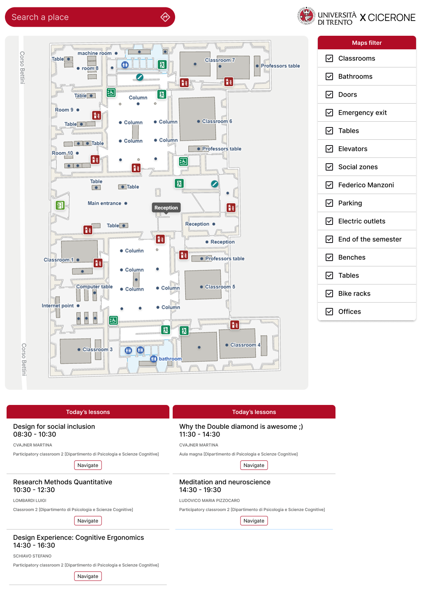

## Project overview

- **What:** Cicerone, an inclusive, multimodal indoor navigation system for unfamiliar public buildings, starting from university campuses.
- **Context:** *Design for Social Inclusion* course, Master’s in Human-Computer Interaction, University of Trento. 7 weeks, spring 2025.
- **Team:** Federico Manzoni (me), Michele Cazzaro, Filippo D’Agnano, Ira Laihanen, Nataliya Zhigalina.
- **My role:** guided the team’s work; indoor navigation literature review, personas and user journeys (with the team), Mappedin map prototype, most of the high-fidelity UI (with Michele on AR navigation and kiosks). I also took on a significant share of the overall workload.
- **Outcome:** graded **31/30 with honors**.

## The problem

- Social exclusion often comes from *mismatches* between people and poorly designed environments.
- Getting to a destination in an unfamiliar place is one of the clearest examples.
- People with **visual and mobility impairments** face the strongest mismatch.

## From city to building

- **First idea:** accessible routes in the city. Outdoor apps (AXS Map, Wheelmap.org, AccessNow) were outdated, short on data or too dependent on crowdsourcing.
- **Pivot:** international teammates kept getting lost in our department’s building, and the literature confirmed how hard indoor navigation is for visually impaired people.
- **New goal:** “Allowing people to navigate unfamiliar buildings using accessible routes based on their actual needs.”

## Researching indoor navigation

- I redid most of the literature review: a niche topic, with few concrete solutions (MapsPeople, Pointr).
- Main challenges: reliance on others, complex spaces, low adoption, noise and obstacles, high costs and case-by-case customization.
- Take-home messages: universal design, priority to blind, visually impaired and mobility-impaired people, and **multimodal** navigation.

## Defining Cicerone

- Inclusive design that removes mismatches and also pushes for changes to the space (color coding, signage, kiosks).
- For everyone, with a focus on permanent visual and mobility impairments; also useful for temporary impairments, visitors and people anxious in new places.
- Scales from universities to hospitals, libraries, stations and malls.

## Personas and journeys

- **Jane**, blind psychology student: audio and haptic guidance, often late, temporary obstacles.
- **Mario**, PhD student and wheelchair user: step-free routes, elevators, social and smoking areas.
- **Steven**, technician new to the campus: hands-free guidance while carrying equipment.
- Each persona has a full user journey, from entering the building to rerouting and feedback.

## Scoping the product

- **Minimum Viable Product:** 3D map, route planning and QR starting points inside existing apps. My Mappedin prototype of one building took about a day.
- **“Maximum” Viable Product:** audio, haptic and visual (2D/3D, AR) navigation, adaptive routing with real-time rerouting, app, web, screens and kiosks, crowdsourced reports with rewards, quick personalization, AI and Wi-Fi positioning.
- Levels of adoption let each institution choose what it can afford.

## Feasibility study (TELOS)

- **Technological:** feasible with existing tools (Wi-Fi/QR positioning, OpenCV, TensorFlow, AR APIs). AI geolocation is the hard part, so we chose a modular rollout.
- **Economic:** first estimate of about €180,000, built role by role (13 roles); free for users, paid for by institutions.
- **Legal:** GDPR (no biometric data), NIS2, public-safety limits on location data, liability terms.
- **Operational:** an estimated 1,000 new people a year (new students and occasional visitors), plus blind users who benefit long term.
- **Schedule:** about 10–12 months of development; MVP set-up in about a month, full version in 2–3 months.
- **Cultural and industry:** more autonomy and belonging; a market growing an estimated 30–40% a year; no competing solution yet at the University of Trento.

## Design sprint

- **One week**, high-fidelity mockups for app, kiosks, web app and QR codes.
- **Decision:** with little time and me as the only strong Figma user, I built the UIs largely on Google Maps’ design.
- Key features: navigation from the class schedule, route options with time and stairs, rush-hour info, AR obstacle recognition, a visually impaired mode, obstacle and social-place reporting.

### Mobile app

- Navigation from the class schedule.
- Route preview and personalization (adding stops, quick route style switch).
- Navigation with obstacle warnings, rerouting and call for help.
- AR navigation with obstacle recognition and rerouting.
- Profile settings.
- Adding social places and reporting issues.

### Kiosks

- Map viewing and filtering.
- Navigation to today’s events.
- Route preview.
- Step-by-step directions.

### Web app

- Navigation from the class schedule and other features of UniTrento’s student web app.

## Financial plan

- First phase backed by the University of Trento; NGOs (e.g. Unione Italiana Ciechi, European Disability Forum) and other venues to scale.
- Business model: install and maintain Cicerone for institutions; free app for users.
- Refined budget: about €95,600 + 20% buffer, presented as **€120,000** (down from €180,000).
- If funding falls short: drop AI geolocation first, then personnel and UI polish; ask the university for test participants.

## Outcome

- Final presentation on 8 May 2025: about €120,000 and 12–15 months from funding to implementation.
- Very well received and graded **31/30 with honors**.

## Reflection and next steps

- Hard parts: time pressure, uneven team contributions, documentation left unpolished.
- Given more time, I would have run the usability tests we had proposed and refined the UI.
- What I take away: inclusive design, teamwork under pressure and system-level thinking.
