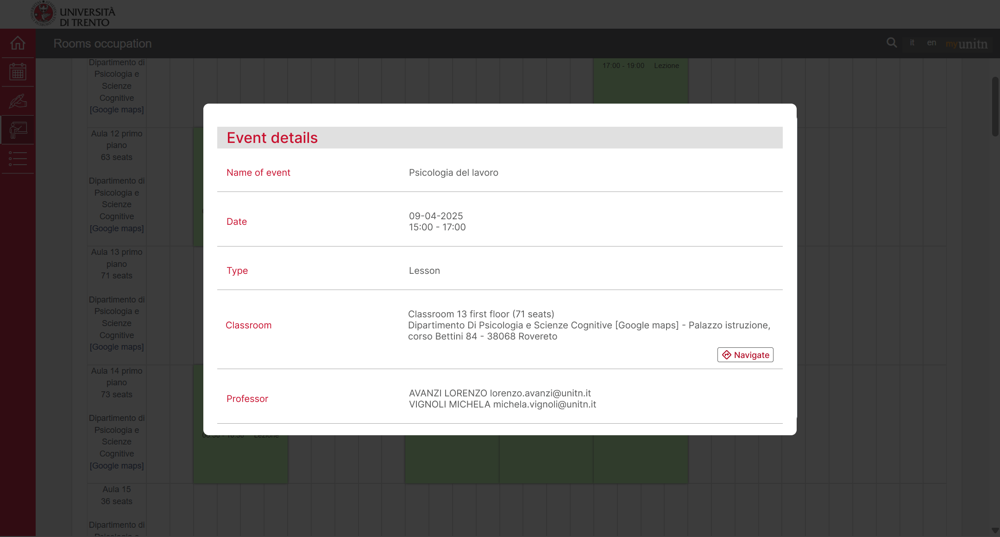

Cicerone è un sistema di navigazione indoor inclusivo che ho progettato con altri quattro compagni per il corso di *Design for Social Inclusion* della mia laurea magistrale in Human-Computer Interaction (Università di Trento, primavera 2025). È nato da un problema reale: gli studenti internazionali continuavano a perdersi nell’edificio del nostro dipartimento, e la letteratura mostrava quanto questo sia ancora più difficile per le persone con disabilità visive e motorie. Dopo la ricerca siamo passati dalla navigazione in città a quella dentro gli edifici. Ho rifatto gran parte della revisione della letteratura sulla navigazione indoor, ho realizzato in circa un giorno un prototipo funzionante della mappa dell’edificio in Mappedin e ho progettato la maggior parte della UI ad alta fedeltà in un design sprint di una settimana, basandomi sul design di Google Maps per andare veloce.

Il concept unisce guida audio, aptica e visiva (2D, 3D e AR), percorsi adattati alle esigenze di ognuno, segnalazioni degli ostacoli in crowdsourcing e accesso dalla UniTrento App, dalla web app dell’orario lezioni, dai totem e dai QR code. L’abbiamo basato su tre personas e sulle loro user journey, verificato con uno studio di fattibilità TELOS e un piano finanziario (circa 120.000 €) e articolato da un Minimum a un “Maximum” Viable Product. Il progetto è stato valutato 30 e lode (31/30).

## Mockup

