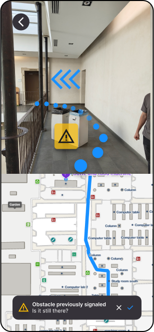
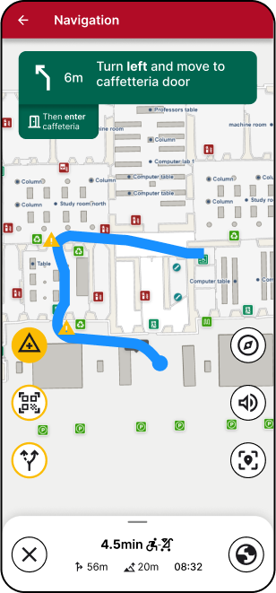
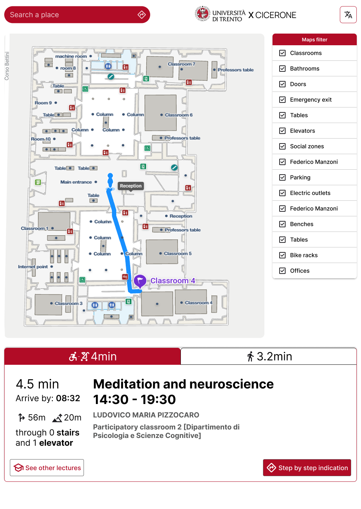
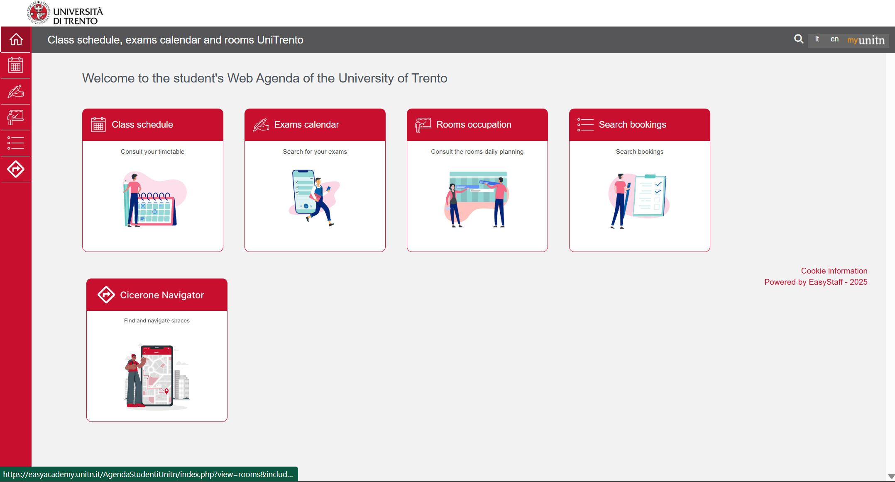

Cicerone is an inclusive indoor navigation system that I designed with four teammates for the *Design for Social Inclusion* course of my Master’s in Human-Computer Interaction (University of Trento, spring 2025). It started from a real problem: international students kept getting lost in our department’s building, and the literature showed how much harder this is for people with visual and mobility impairments. After the research we pivoted from city navigation to buildings. I redid most of the indoor navigation literature review, built a working map prototype of the building in Mappedin in about a day, and designed most of the high-fidelity UI in a one-week design sprint, basing it on Google Maps’ design to move fast.

The concept combines audio, haptic and visual (2D, 3D and AR) guidance, routes adapted to each person’s needs, crowdsourced obstacle reports, and access from the UniTrento App, the class schedule web app, kiosks and QR codes. We grounded it in three personas and their user journeys, checked it with a TELOS feasibility study and a financial plan (about €120,000), and scoped it from a Minimum to a “Maximum” Viable Product. The project was graded 31/30 with honors.

## Mockups

