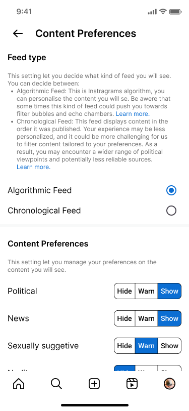
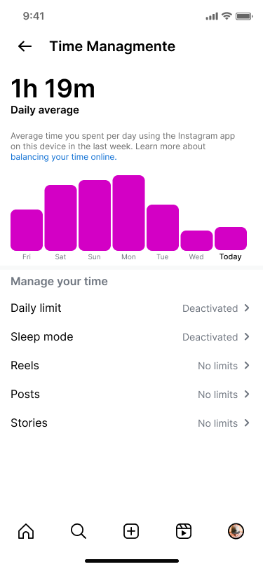
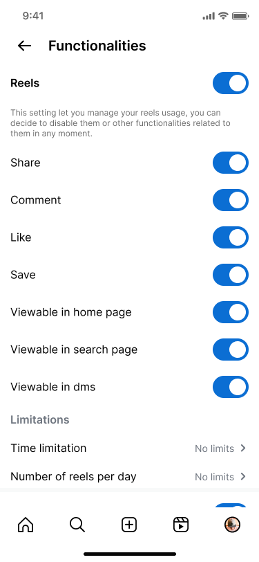
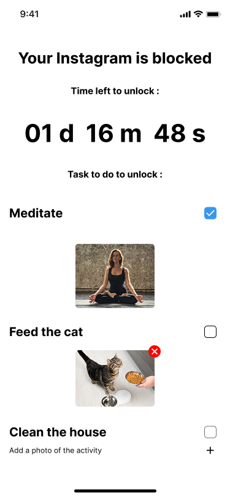

## Panoramica del progetto

“Brainrot Police” è un redesign UX/UI di Instagram che punta a far sì che l’app crei meno dipendenza e ad aiutare le persone a usarla in modo più consapevole, senza essere troppo invadente.

- **Contesto:** progetto universitario di gruppo, con un team di cinque persone: Federico Manzoni (io), Michele Cazzaro, Lorenzo Zambotto, Nataliya Zhigalina e Christoph Reuter.
- **Cosa abbiamo fatto:** abbiamo analizzato l’impatto personale e sociale di Instagram, mappato i pattern di design che alimentano la dipendenza, supportato ogni funzione proposta con la letteratura scientifica e progettato nuove funzioni e schermate partendo dalla UI esistente di Instagram.
- **Il mio ruolo:** ho progettato in Figma la parte di personalizzazione del redesign: il filtro e le preferenze sui contenuti, la modalità “Solo amici”, le schermate per attivare e disattivare le funzioni e (con Lorenzo) la scelta del tipo di feed. Mi sono occupato anche della campagna di sensibilizzazione.
- **Risultato:** il progetto è stato valutato **30/30**.

## Il problema

Andreassen e Pallesen (2014) definiscono la dipendenza dai social network come il passare troppo tempo sui social a causa di un impulso incontrollabile, fino ad avere conseguenze negative nella vita reale. Pensiamo che l’uso dei social vada in qualche modo regolato per i suoi effetti su:

- **Salute mentale:** problemi di immagine corporea, FOMO (fear of missing out, la paura di perdersi qualcosa), depressione e bassa autostima.
- **Salute fisica:** postura scorretta, affaticamento degli occhi e sonno disturbato.
- **Relazioni:** si rischia di dare più importanza al proprio personaggio online che ai rapporti reali.
- **Concentrazione:** meno produttività e più difficoltà a concentrarsi.

Abbiamo raccolto anche alcune note di approfondimento sulla dipendenza da internet: come si manifesta (comunicazione online continua o intrattenimento senza fine), cosa succede quando si prova a smettere e come il passare di continuo da un contenuto all’altro possa frammentare l’attenzione e indebolire la capacità di concentrarsi a fondo.

## Come abbiamo lavorato

Abbiamo seguito una roadmap semplice:

1. **Definire un problema generale** legato a un’interfaccia o a un artefatto, con un brainstorming su una board Miro condivisa.
2. **Analizzare gli aspetti umani e sociali** coinvolti.
3. **Studiare la letteratura scientifica.**
4. **Ridefinire il problema** alla luce di quanto imparato.
5. **Formulare soluzioni supportate dalla letteratura.**
6. **Presentare** il lavoro: 30 minuti per gruppo, più 10 minuti di domande.

La decisione chiave è stata il punto 5: **ogni funzione doveva avere una base scientifica.** Abbiamo ripreso le funzioni selezionate sulla board Miro, cercato articoli scientifici a supporto di ognuna, scartato quelle che non potevamo sostenere e tenuto un documento condiviso che collegava ogni funzione al suo articolo. Per esempio:

- L’indicatore del tempo trascorso e l’eliminazione dello scroll infinito e dell’indicatore “sta scrivendo” si basavano su *Addiction by Design: Some Dimensions and Challenges of Excessive Social Media Use*.
- La scala di grigi si basava su *True colors: Grayscale setting reduces screen time in college students*.
- L’eliminazione del pull-to-refresh si basava su *Defining and Identifying Attention Capture Deceptive Designs in Digital Interfaces*.
- La modalità “Solo amici” si basava su una revisione sistematica della letteratura sulla FOMO tra gli utenti dei social.
- La disattivazione delle notifiche e i compiti da completare prima di tornare sull’app si basavano su uno studio del 2024 su obiettivi e notifiche nell’uso dello smartphone.
- La modalità “Sto smettendo!” si basava su una ricerca sul “detox” da Instagram e sull’abbandono intermittente tra i Millennial.
- La scelta del tipo di feed si basava su una ricerca su come gli algoritmi dei feed influenzano opinioni e comportamenti durante una campagna elettorale.

Poi abbiamo progettato la UI **partendo dai componenti di Instagram stesso**, così che le nuove funzioni sembrassero parte naturale dell’app. Alcune funzioni sono state realizzate come mockup in Figma; altre, come l’eliminazione del pull-to-refresh, erano abbastanza semplici da poter essere spiegate durante la presentazione.

## Le vie della dipendenza

Per affrontare il problema abbiamo prima individuato le parti di Instagram che alimentano la dipendenza. Le abbiamo chiamate “vie della dipendenza”:

- **Ciclo della dopamina:** l’app sfrutta un ciclo di ricerca, attesa e ricompense imprevedibili.
- **Scroll infinito:** senza segnali di stop, favorisce un comportamento automatico e inconsapevole e tiene le persone incollate all’app.
- **Pull-to-refresh:** come una slot machine, dà ricompense imprevedibili che rinforzano l’abitudine.
- **Aspetti sociali:**
	- **Approvazione sociale:** like, commenti e numero di follower.
	- **FOMO:** le notifiche spingono a controllare l’app di continuo.
	- **Reciprocità:** l’indicatore di messaggio “Letto” e le condivisioni creano un senso di obbligo a rispondere.
- **UI accattivante:** l’interfaccia stessa è progettata per essere il più coinvolgente possibile.

## Obiettivi e filosofia

La nostra filosofia per ridurre il potenziale di dipendenza di Instagram si riassume in quattro obiettivi:

- Fare in modo che l’app **crei meno dipendenza**, mantenendone le funzioni essenziali.
- **Aumentare la consapevolezza** sulla dipendenza dai social e sul tempo passato sull’app.
- Dare alle persone **più controllo** per personalizzare la loro esperienza su Instagram.
- **Aiutare a ridurre o smettere** senza essere troppo invadenti.

## Il redesign

Dall’analisi e dagli obiettivi abbiamo ricavato una serie di nuove funzioni, ognuna pensata per una delle vie della dipendenza.

### Fermare lo scroll infinito

- **Addio scroll infinito:** il feed non è più infinito. Dopo una certa quantità di contenuti, l’app mostra un segnale di stop alla fine del feed. Ti dice quante volte hai caricato altri contenuti, e il pulsante per uscire diventa più grande ogni volta che continui. Il nostro principio era **fermare, informare, spingere** (nudge), con una spinta che diventa più forte con il tempo.
- **Niente pull-to-refresh:** l’abbiamo eliminato per togliere la ricompensa da slot machine.

### Rendere visibile il tempo

- **Indicatore del tempo trascorso:** un indicatore fluttuante che si può spostare nella UI ma non rimuovere. Cambia colore in base al tempo passato: grigio per poco tempo (ad esempio 10 minuti), arancione per un tempo medio (ad esempio 45 minuti) e rosso per troppo tempo (ad esempio 1 ora). L’obiettivo è rendere le persone consapevoli del tempo che passa e incoraggiarle a darsi dei limiti.
- **Modalità scala di grigi:** l’interfaccia diventa gradualmente in bianco e nero. Meno colore significa meno gratificazione: il feed diventa meno attraente e questo aiuta a ridurre il tempo davanti allo schermo.
- **The Mirror:** mentre scorri, l’app ti mostra il tuo volto. Vederci aumenta la consapevolezza di noi stessi e ci rende più attenti al nostro comportamento e a come influisce sui nostri obiettivi. Immagina di vedere la tua faccia mentre fai doomscrolling!

### Il tuo Instagram, le tue regole

Abbiamo deciso di lasciare che le persone costruiscano la propria esperienza: nelle impostazioni si può personalizzare quasi tutto.

- **Funzionalità:** attivare o disattivare Post, Reel e Storie, scegliere se poter condividere, commentare, mettere like e salvare, e dove far comparire i contenuti (home, pagina di ricerca, messaggi diretti).
- **Filtro e preferenze sui contenuti:** per ogni tipo di contenuto (politica, notizie, contenuti sessualmente allusivi, nudità, rappresentazioni fuorvianti, black humor, contenuti sensibili, informazioni non ancora verificate) scegli se **nasconderlo**, **ricevere un avviso** o **mostrarlo**.
- **Tipo di feed:** scegliere tra il feed algoritmico di Instagram e un feed cronologico. Le impostazioni spiegano il compromesso: il feed algoritmico è più personalizzato ma può spingerti verso filter bubble ed echo chamber; quello cronologico è meno personalizzato e può mostrare una gamma più ampia di punti di vista, comprese fonti meno affidabili.
- **Modalità “Solo amici”:** vedi solo i contenuti delle persone che ti seguono a loro volta; tutto il resto è nascosto.
- **Controllo delle notifiche:** disattivare tutte le notifiche per ridurre la FOMO.
- **Niente indicatore “sta scrivendo”:** meno pressione a rispondere subito.

### Aiutare a staccare

- **Limiti di tempo:** impostare limiti per tutta l’app o per contenuti e funzioni specifici. Ad esempio, i Reel si possono limitare per tempo o per numero al giorno (l’app ti dice quanti ne guardi di solito), in giorni e orari scelti, con un avviso quando ti avvicini al limite. Una schermata di gestione del tempo mostra la media giornaliera e i limiti per Reel, Post e Storie, oltre a una modalità notte.
- **Modalità “Sto smettendo!”:** per chi vuole smettere o ridurre. Scegli per quanto tempo, spieghi perché smetti, decidi se i tuoi contenuti restano visibili e aggiungi dei compiti da completare prima di poter riusare l’app.
- **Completare dei compiti prima di tornare:** mentre l’app è bloccata, un conto alla rovescia mostra il tempo rimanente, e puoi sbloccarla completando i tuoi compiti (ad esempio meditare o pulire casa) e aggiungendo una foto dell’attività.

### Una campagna di sensibilizzazione

Oltre alle funzioni, ho lavorato a una campagna di sensibilizzazione dentro Instagram stesso: post, Reel e Storie che compaiono ogni tanto, proprio come una pubblicità, per informare sulla dipendenza dai social, spiegare come gestirla e presentare i nuovi strumenti.

## Risultati

Abbiamo presentato il progetto in aula ed è stato valutato **30/30**. Brainrot Police interviene con piccole modifiche sulle scelte di design di Instagram che creano più dipendenza, e suggerisce che un social network può diventare più etico senza rinunciare alle sue funzioni essenziali.
