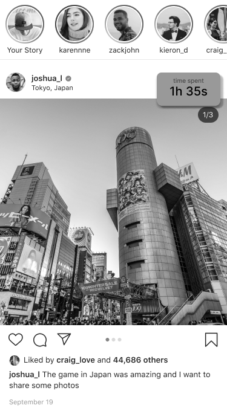
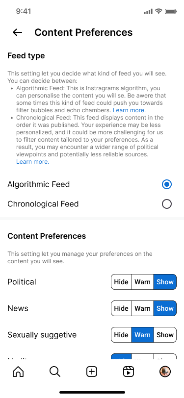
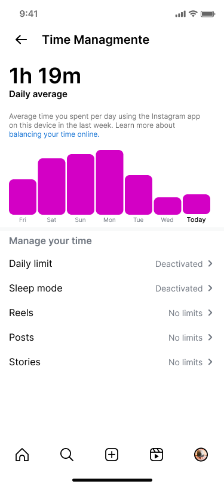
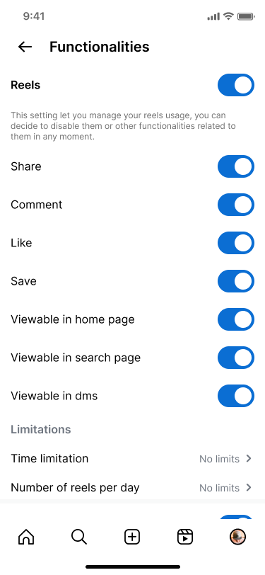
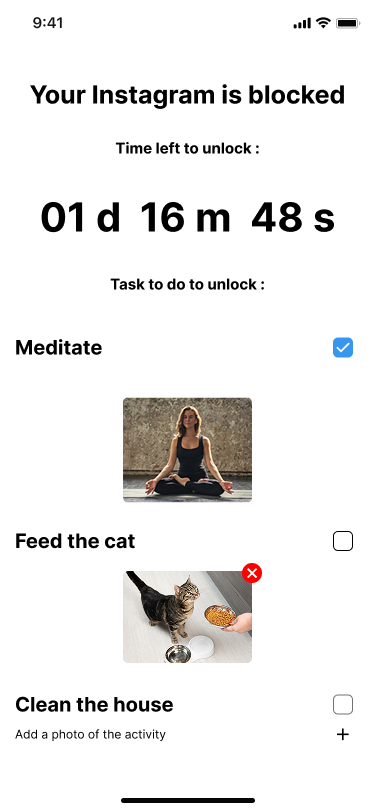

## Project overview

“Brainrot Police” is a UX/UI redesign of Instagram that aims to make the app less addictive and help people use it more consciously, without being overly forceful.

- **Context:** university group project with a five-person team: Federico Manzoni (me), Michele Cazzaro, Lorenzo Zambotto, Nataliya Zhigalina and Christoph Reuter.
- **What we did:** analyzed the personal and social impact of Instagram, mapped the design patterns that drive addiction, backed every proposed feature with scientific literature, and designed new features and screens on top of Instagram’s existing UI.
- **My role:** I designed the customization side of the redesign in Figma: the content filter and content preferences, the “Friends only” mode, the screens to turn features on and off, and (with Lorenzo) the choice of feed type. I was also in charge of the social awareness campaign.
- **Outcome:** the project was graded **30/30**.

## The problem

Andreassen and Pallesen (2014) define social networking site addiction as spending too much time on social media because of an uncontrollable urge, to the point where it has negative consequences in real life. We think social media use needs some regulation because of its effects on:

- **Mental health:** body image issues, FOMO (fear of missing out), depression and low self-esteem.
- **Physical health:** poor posture, eye strain and disrupted sleep.
- **Relationships:** people may prioritize their online persona over meaningful real-life connections.
- **Focus:** lower productivity and difficulty concentrating.

We also collected background notes on internet addiction: how it shows up (constant online communication or endless entertainment), what happens when people try to stop, and how constantly jumping between bits of content can fragment attention and weaken the ability to concentrate deeply.

## How we worked

We followed a simple roadmap:

1. **Define a general problem** around an interface or artifact, brainstorming on a shared Miro board.
2. **Analyze the human and social areas** involved.
3. **Review the scientific literature.**
4. **Redefine the problem** based on what we had learned.
5. **Formulate solutions backed by the literature.**
6. **Present** the work: 30 minutes per group, plus 10 minutes of questions.

The key decision was step 5: **every feature had to be science-backed.** We went through the features we had shortlisted on the Miro board, looked for papers supporting each one, dropped the ones we couldn’t back up, and kept a shared document mapping each feature to its paper. For example:

- The time-spent indicator and the removal of infinite scroll and of the “is typing” indicator were supported by *Addiction by Design: Some Dimensions and Challenges of Excessive Social Media Use*.
- Grayscale was supported by *True colors: Grayscale setting reduces screen time in college students*.
- Removing pull-to-refresh was supported by *Defining and Identifying Attention Capture Deceptive Designs in Digital Interfaces*.
- The “Friends only” mode was supported by a systematic literature review on FOMO among social media users.
- Turning off notifications and completing tasks before getting back were supported by a 2024 study on goal setting and notification alerts in smartphone use.
- The “I’m quitting!” mode was supported by research on Instagram “detox” and intermittent discontinuance among Gen Y.
- The choice of feed type was supported by research on how feed algorithms affect attitudes and behavior during an election campaign.

Then we designed the UI **starting from Instagram’s own components**, so the new features would feel like a natural part of the app. Some features were mocked up in Figma; others, like removing pull-to-refresh, were simple enough to be explained in the presentation.

## Avenues of addiction

To tackle the problem, we first identified the parts of Instagram that drive addiction. We called them “avenues of addiction”:

- **Dopamine cycle:** the app exploits a cycle of seeking, anticipation and unpredictable rewards.
- **Infinite scroll:** with no stopping cues, it encourages mindless, automatic behavior and keeps people engaged indefinitely.
- **Pull-to-refresh:** like a slot machine, it gives unpredictable rewards that reinforce the habit.
- **Social aspects:**
	- **Social validation:** likes, comments and follower counts.
	- **FOMO:** notifications push people to check the app constantly.
	- **Reciprocity:** the “Read” message indicator and sharing features create a sense of obligation to respond.
- **Enticing UI:** the interface itself is designed to be highly engaging.

## Goals and philosophy

Our philosophy for reducing Instagram’s addictive potential came down to four goals:

- Make the app **less addictive** while keeping its essential features.
- **Raise awareness** of social media addiction and of the time spent on the app.
- Give people **more control** to customize their Instagram experience.
- **Help people reduce or quit** without being overly forceful.

## The redesign

From the analysis and the goals we derived a set of new features, each targeting one of the avenues of addiction.

### Stopping the endless scroll

- **Goodbye infinite scroll:** the feed is no longer endless. After a certain amount of content, the app shows a stopping cue at the end of the feed. It tells you how many times you have loaded more content, and the “quit” button grows each time you keep going. Our principle was **stop, inform, nudge**, with a nudge that gets stronger over time.
- **No pull-to-refresh:** we removed it to take away the slot-machine-like reward.

### Making time visible

- **Time-spent indicator:** a floating indicator that can be moved around the UI but not removed. It changes color with the time spent: gray for a short time (e.g. 10 minutes), orange for a medium amount (e.g. 45 minutes) and red for too much (e.g. 1 hour). The goal is to make people aware of time passing and encourage them to set limits.
- **Grayscale mode:** the interface gradually turns black and white. Less color means less gratification, which makes the feed less appealing and helps reduce screen time.
- **The Mirror:** while you scroll, the app shows your own face. Seeing ourselves raises self-awareness, which makes us more conscious of our behavior and of how it affects our goals. Imagine seeing your own face while you’re doomscrolling!

### Your Instagram, your rules

We decided to let people build their own experience: almost everything can be customized in the settings.

- **Functionalities:** turn Posts, Reels and Stories on or off, choose whether you can share, comment, like and save, and where content appears (home, search page, direct messages).
- **Content filter and preferences:** for each type of content (political, news, sexually suggestive, nudity, misrepresentation, dark humor, sensitive content, not-yet-fact-checked information) you choose whether to **hide**, **warn** or **show** it.
- **Feed type:** choose between Instagram’s algorithmic feed and a chronological feed. The settings explain the trade-off: the algorithmic feed is more personalized but can push you towards filter bubbles and echo chambers; the chronological feed is less personalized and may show a wider range of viewpoints, including less reliable sources.
- **“Friends only” mode:** see only content from people who follow you back; everything else is hidden.
- **Notification controls:** turn off all notifications to reduce FOMO.
- **No “is typing” indicator:** less pressure to reply right away.

### Help to step away

- **Time limits:** set limits for the whole app or for specific content and features. For example, Reels can be limited by time or by number per day (the app tells you how many you usually watch), on chosen days and hours, with a warning when you get close to the limit. A time management screen shows your daily average and your limits for Reels, Posts and Stories, plus a sleep mode.
- **“I’m quitting!” mode:** for people who want to stop or cut down. You choose for how long, say why you’re quitting, decide whether your content stays visible, and add tasks to complete before you can use the app again.
- **Completing tasks before getting back:** while the app is blocked, a countdown shows the time left, and you can unlock it by completing your tasks (for example meditating or cleaning the house) and adding a photo of the activity.

### A social campaign

Alongside the features, I worked on a social campaign inside Instagram itself: posts, Reels and Stories that show up every now and then, just like an ad, to inform people about social media addiction, explain how to manage it and present the new tools.

## Outcome

We presented the project to the class and it was graded **30/30**. Brainrot Police targets Instagram’s most addictive design choices with small interventions, and suggests that a social media app can become more ethical without giving up its essential features.
