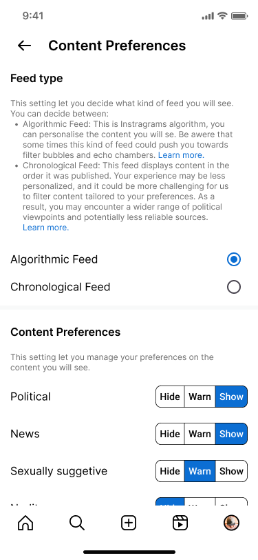
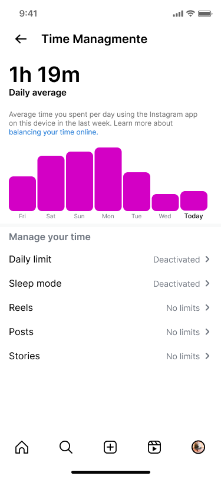
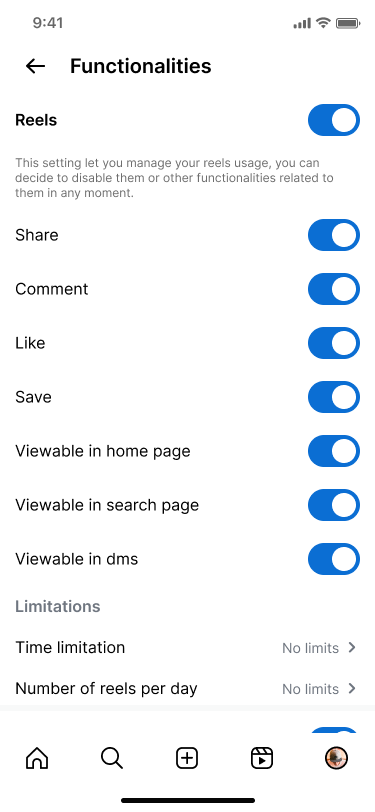
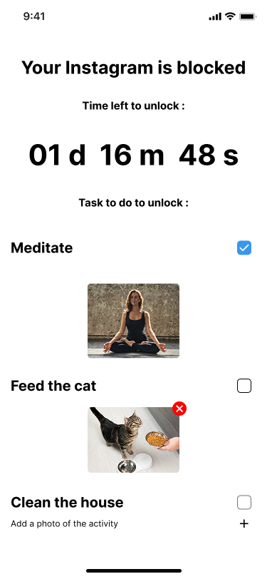

## Panoramica del progetto

- **Cosa:** “Brainrot Police”, un redesign UX/UI di Instagram perché crei meno dipendenza.
- **Team:** Federico Manzoni (io), Michele Cazzaro, Lorenzo Zambotto, Nataliya Zhigalina, Christoph Reuter.
- **Il mio ruolo:** funzioni di personalizzazione in Figma (filtro e preferenze sui contenuti, modalità “Solo amici”, attivazione e disattivazione delle funzioni, tipo di feed con Lorenzo) e la campagna di sensibilizzazione.
- **Risultato:** valutato **30/30**.

## Il problema

- Dipendenza dai social network: troppo tempo sui social a causa di un impulso incontrollabile, con conseguenze nella vita reale (Andreassen & Pallesen, 2014).
- Effetti: FOMO, bassa autostima, depressione, sonno disturbato, affaticamento degli occhi, relazioni reali più deboli, meno produttività e concentrazione.

## Come abbiamo lavorato

- Roadmap: definire il problema su Miro → analizzare gli aspetti umani e sociali → studiare la letteratura → ridefinire il problema → progettare soluzioni supportate dalla letteratura → presentare.
- **Ogni funzione doveva avere una base scientifica:** abbiamo collegato ogni funzione a un articolo e scartato quelle che non potevamo sostenere.
- Abbiamo progettato le nuove schermate partendo dai componenti della UI di Instagram.

## Le vie della dipendenza

- Ciclo della dopamina e ricompense imprevedibili.
- Scroll infinito senza segnali di stop.
- Pull-to-refresh, che funziona come una slot machine.
- Pressione sociale: like e follower, FOMO dalle notifiche, reciprocità (indicatori “Letto”, condivisioni).
- Una UI accattivante.

## Obiettivi e filosofia

- Ridurre i pattern che creano dipendenza mantenendo le funzioni essenziali.
- Aumentare la consapevolezza del tempo trascorso.
- Dare alle persone il controllo della propria esperienza.
- Aiutare a ridurre o smettere, senza forzature.

## Il redesign

- **Fermare lo scroll infinito:** un segnale di stop alla fine del feed (fermare, informare, spingere, con un pulsante per uscire sempre più grande); niente pull-to-refresh.
- **Rendere visibile il tempo:** un indicatore del tempo trascorso che diventa grigio, arancione e rosso; scala di grigi graduale; “The Mirror”, che mostra il tuo volto mentre scorri.
- **Il tuo Instagram, le tue regole:** interruttori per Post, Reel, Storie e interazioni; nascondi, avvisa o mostra per ogni tipo di contenuto; feed algoritmico o cronologico; modalità “Solo amici”; notifiche disattivate; niente indicatore “sta scrivendo”.
- **Aiutare a staccare:** limiti di tempo e di quantità (ad esempio Reel al giorno), modalità “Sto smettendo!” e compiti da completare prima di tornare.
- **Campagna di sensibilizzazione:** post, Reel e Storie dentro l’app sulla dipendenza dai social e sui nuovi strumenti.

## Risultati

- Valutato **30/30**.
- Una proposta basata sulla letteratura per un Instagram più etico, con più controllo per le persone e senza forzature.
