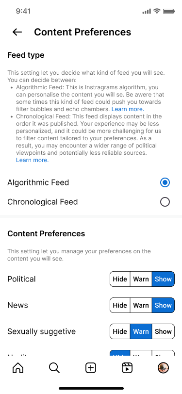
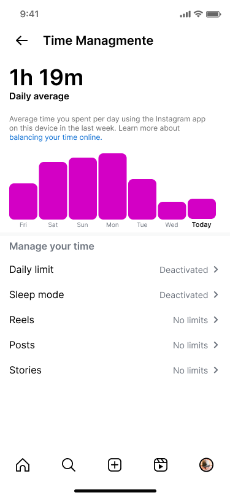
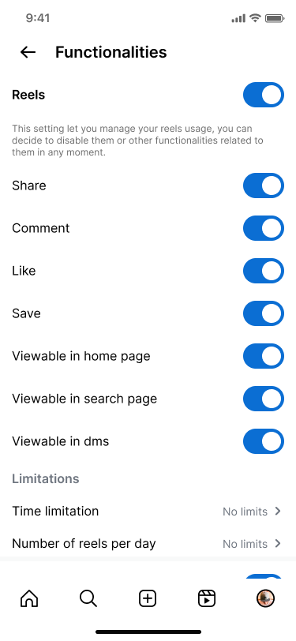
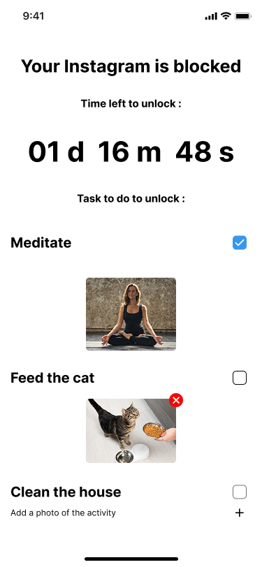

## Project overview

- **What:** “Brainrot Police”, a UX/UI redesign of Instagram to make it less addictive.
- **Team:** Federico Manzoni (me), Michele Cazzaro, Lorenzo Zambotto, Nataliya Zhigalina, Christoph Reuter.
- **My role:** customization features in Figma (content filter and preferences, “Friends only” mode, feature toggles, feed type with Lorenzo) and the social awareness campaign.
- **Outcome:** graded **30/30**.

## The problem

- Social networking site addiction: too much time on social media because of an uncontrollable urge, with real-life consequences (Andreassen & Pallesen, 2014).
- Effects: FOMO, low self-esteem, depression, poor sleep, eye strain, weaker real-life relationships, lower productivity and focus.

## How we worked

- Roadmap: define the problem on Miro → analyze human and social areas → review the literature → redefine the problem → design literature-backed solutions → present.
- **Every feature had to be science-backed:** we mapped each feature to a paper and dropped the ones we couldn’t support.
- We designed the new screens starting from Instagram’s own UI components.

## Avenues of addiction

- Dopamine cycle and unpredictable rewards.
- Infinite scroll with no stopping cues.
- Pull-to-refresh, which works like a slot machine.
- Social pressure: likes and followers, FOMO from notifications, reciprocity (“Read” indicators, sharing).
- An enticing UI.

## Goals and philosophy

- Reduce addictive patterns while keeping essential features.
- Raise awareness of time spent.
- Give people control over their experience.
- Help people reduce or quit, without being forceful.

## The redesign

- **Stopping the endless scroll:** a stopping cue at the end of the feed (stop, inform, nudge, with a growing “quit” button); no pull-to-refresh.
- **Making time visible:** a time-spent indicator that turns gray, orange and red; gradual grayscale; “The Mirror”, which shows your face while you scroll.
- **Your Instagram, your rules:** toggles for Posts, Reels, Stories and interactions; hide, warn or show per content type; algorithmic or chronological feed; “Friends only” mode; notifications off; no “is typing” indicator.
- **Help to step away:** time and quantity limits (e.g. Reels per day), “I’m quitting!” mode, and tasks to complete before getting back.
- **Social campaign:** in-app posts, Reels and Stories about social media addiction and the new tools.

## Outcome

- Graded **30/30**.
- A literature-backed proposal for a more ethical Instagram, with more control for people and no forcing.
