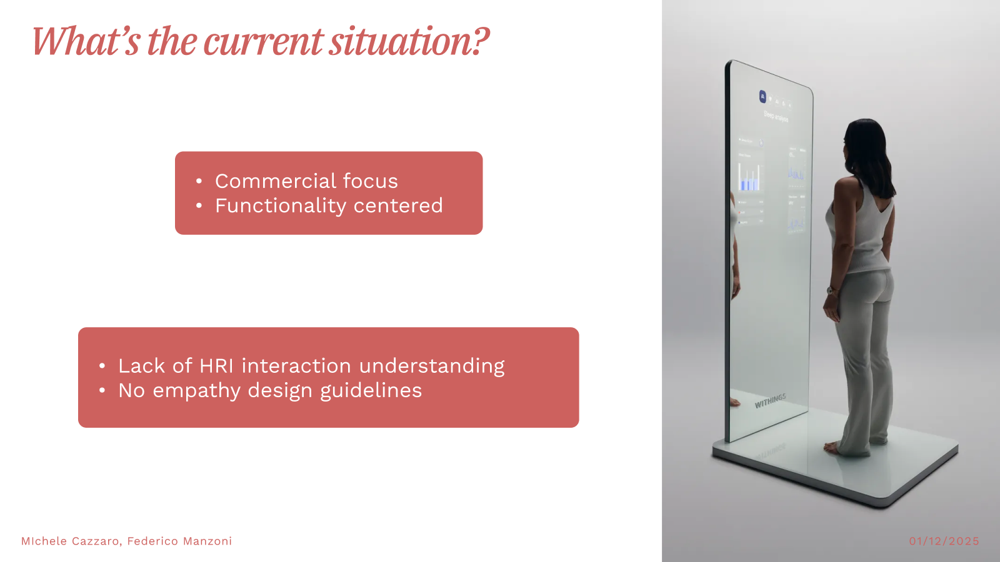
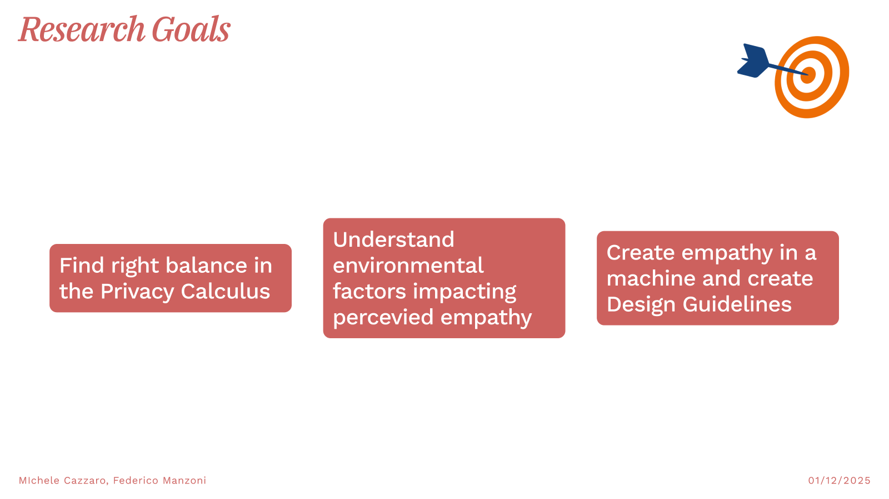
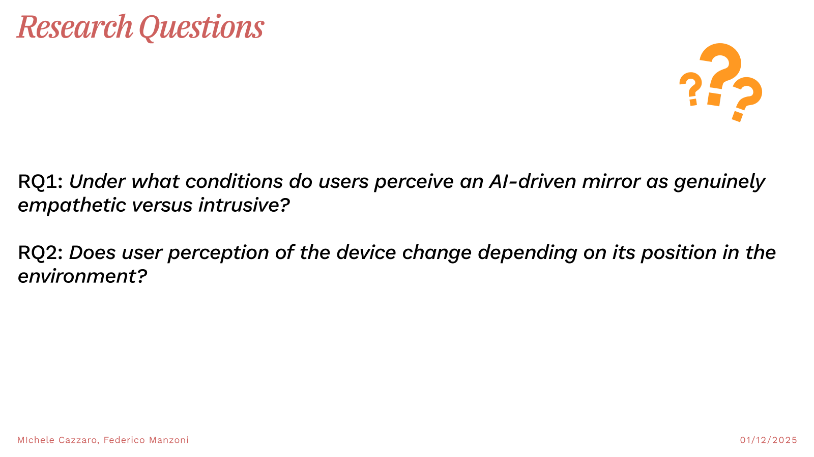
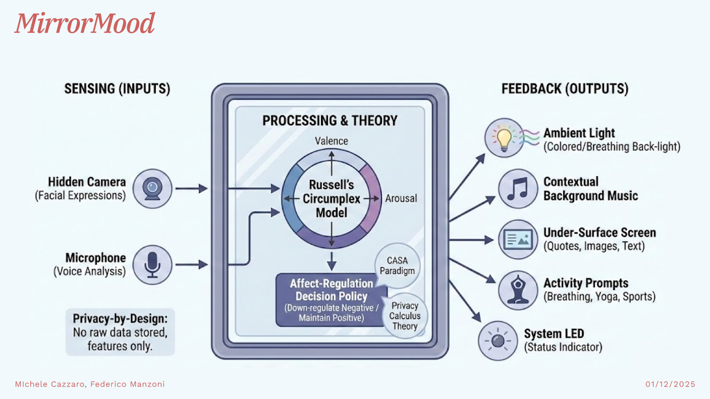
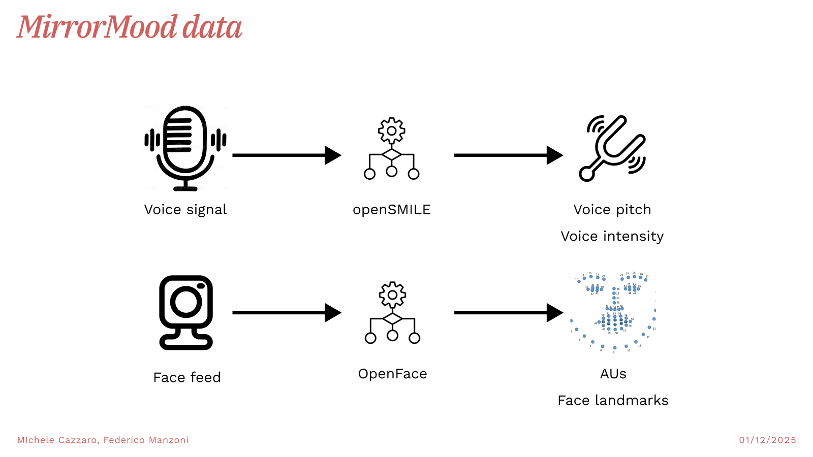
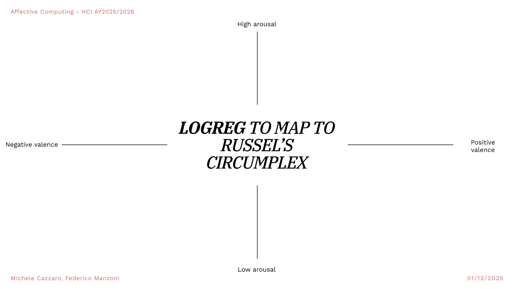
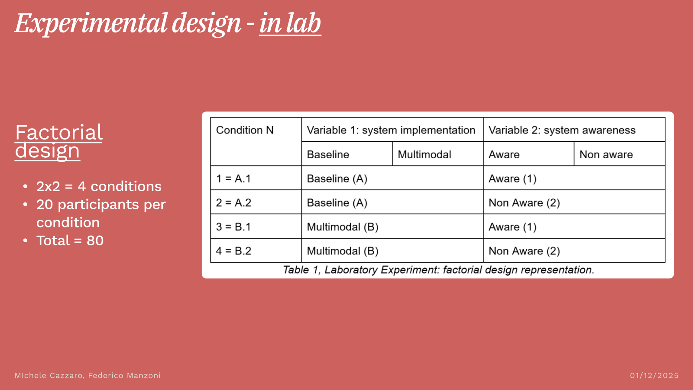
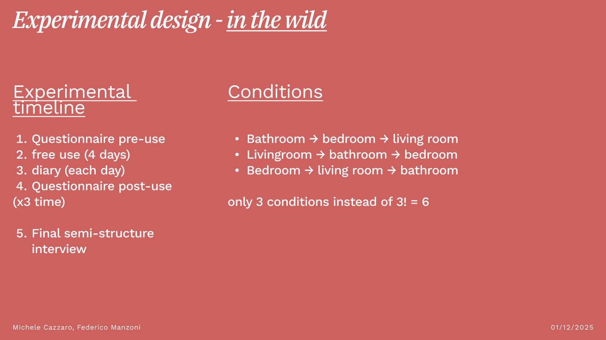
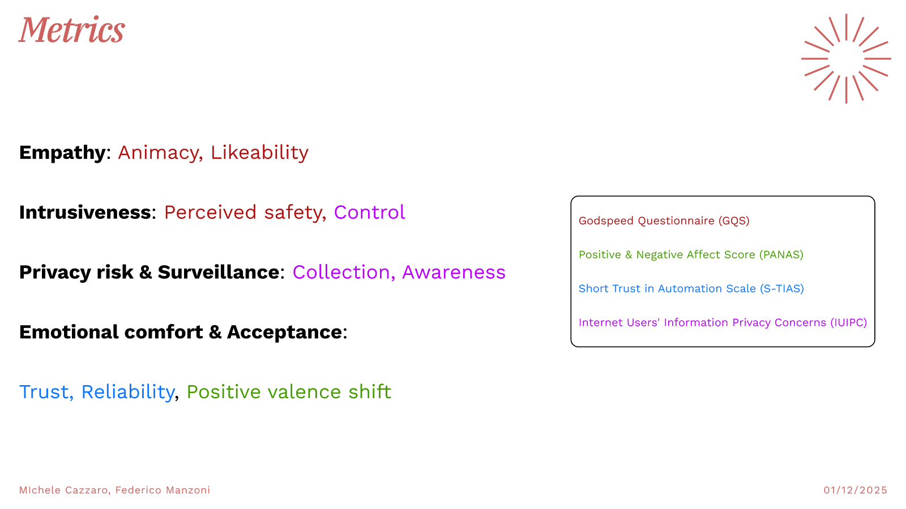
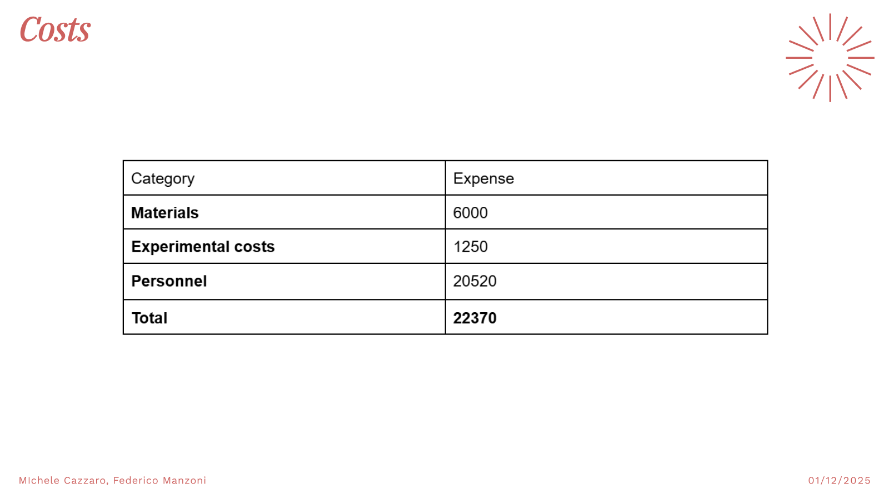

## Panoramica

MirrorMood è una **proposta di ricerca** che io e Michele Cazzaro abbiamo scritto per il corso di Affective Computing della nostra laurea magistrale in Human-Computer Interaction all’Università di Trento (anno accademico 2025/26). Abbiamo progettato uno specchio intelligente sensibile agli stati affettivi e uno studio mixed-methods per capire **quando un sistema del genere risulta empatico, e quando invece invadente**.

- **Team:** Michele Cazzaro e io.
- **Consegna:** una proposta di ricerca completa: concept del sistema, disegno sperimentale, piano di raccolta e analisi dei dati, piano di lavoro e budget.
- **Stato:** lo studio non è ancora stato condotto. Quello che segue è il design del sistema e della ricerca.

## Il problema

I progressi nella computer vision, nel deep learning e nell’hardware embedded hanno reso sempre più realizzabili i dispositivi che riconoscono le emozioni, e gli specchi intelligenti con riconoscimento delle espressioni facciali sono già stati esplorati per coaching, benessere e informazioni quotidiane. Riescono a dedurre le emozioni da segnali visivi e uditivi con buona accuratezza, ma faticano a *entrare in relazione* con chi li usa. Le implementazioni attuali:

- sono orientate al mercato e centrate sulle funzionalità, più che sull’esperienza sociale ed emotiva dell’utente;
- non comprendono a fondo l’interazione uomo-macchina che creano;
- non hanno linee guida di design per l’empatia.

La parte difficile è ottenere un **comportamento empatico** a partire dai dati raccolti: uno specchio che capisca il nostro stato emotivo e agisca di conseguenza tenendo conto del contesto, così che l’utente si senta sostenuto e non giudicato. Rilevare più modalità (voce, postura, contesto) potrebbe aumentare l’empatia percepita, ma anche la sensazione di sorveglianza. Per questo il compromesso del **privacy calculus** è al centro di tutto il progetto.

## Obiettivi e domande di ricerca

I nostri obiettivi: trovare il giusto equilibrio nel privacy calculus, capire quali fattori ambientali influenzano l’empatia percepita e creare empatia in una macchina, ricavandone **linee guida di design**.

- **RQ1:** In quali condizioni gli utenti percepiscono uno specchio basato su AI come davvero empatico invece che invadente?
- **RQ2:** La percezione del dispositivo cambia in base alla sua posizione nell’ambiente?

## Framework teorici

Abbiamo basato il progetto su quattro teorie, ognuna con un compito preciso:

- **Affective Computing** (Picard, 1997): le macchine possono e devono essere progettate per riconoscere, interpretare ed elaborare le emozioni umane. È il motivo per cui ha senso costruire uno specchio che riconosce le emozioni.
- **Modello circomplesso di Russell**: gli stati affettivi sono collocati lungo due assi, valenza e arousal. È adatto a un sistema multimodale, perché modalità di rilevamento diverse danno informazioni su dimensioni diverse.
- **Computers Are Social Actors (CASA)** (Reeves & Nass): le persone applicano regole sociali alla tecnologia, e questo spiega perché uno specchio possa sembrare “empatico”, oppure giudicante.
- **Privacy Calculus** (Dinev & Hart, 2006): gli utenti soppesano i benefici di un feedback personalizzato ed empatico rispetto al costo della sorveglianza percepita e della condivisione dei dati.

## Il sistema: MirrorMood

MirrorMood è uno specchio intelligente con una telecamera e un microfono nascosti che rilevano espressioni facciali e voce. Offre supporto emotivo attraverso un **feedback multimodale**: luce, musica e uno schermo sotto la superficie che mostra testi e immagini semplici.

### Perché uno specchio

- Le interazioni con lo specchio sono **volontarie, brevi e prevedibili**, inserite nella routine quotidiana (prepararsi al mattino, rilassarsi la sera). A differenza di smartphone e dispositivi indossabili non interrompono, quindi il feedback può risultare integrato invece che invadente.
- Guardarsi allo specchio spinge le persone verso l’**autoconsapevolezza oggettiva**, uno stato in cui si valutano in modo naturale: utile per valutare il proprio stato affettivo.
- Gli specchi si trovano in spazi intimi ma prevedibili, dove le persone regolano spesso i propri stati affettivi.

### Come si interagisce

L’**interazione diretta** è volutamente limitata: l’utente non parla con un LLM generico ma con uno strumento specializzato, e può chiedere solo dei propri stati emotivi attuali e passati, dell’andamento affettivo nel tempo, di come sentirsi meglio e di informazioni generiche sulla giornata (meteo, ora, giorno della settimana).

Il **feedback non richiesto** comprende:

- una retroilluminazione colorata e/o “che respira” che riflette lo stato emotivo rilevato dell’utente, basata sulla teoria del colore;
- un LED di sistema che mostra lo stato (in attesa, utente rilevato e analisi in corso, risposta, spento);
- una leggera musica di sottofondo adatta al contesto;
- citazioni, frasi motivazionali o affermazioni contestuali;
- sequenze guidate di respirazione, tai-chi o yoga, e suggerimenti di attività come bici, corsa, nuoto o camminata.

### Come decide cosa fare

Lo specchio non cerca di cambiare le emozioni in modo arbitrario. Segue una semplice regola decisionale basata sulla **teoria della regolazione affettiva** (Gross, 1998): gli stati a valenza positiva o calmi vengono mantenuti o leggermente rinforzati; gli stati a valenza negativa o di stress ad alto arousal non vengono mai amplificati, e lo specchio offre invece un feedback stabilizzante e di supporto.

Dietro le quinte, due **regressioni logistiche** separate stimano la valenza (dalla probabilità di un’espressione facciale positiva e di una voce con carica positiva) e l’arousal (dall’intensità dell’espressione facciale e dall’attivazione della voce). Il risultato colloca l’utente sul modello circomplesso di Russell e viene ricondotto a stati come felice, triste, calmo o nervoso.

**Perché non una rete neurale profonda?** Una singola rete che combini tutte le feature potrebbe essere più precisa, ma richiederebbe molti più dati e nasconderebbe il modo in cui lo specchio prende le decisioni. Due regressioni logistiche sono più semplici da implementare e mantengono lo specchio **trasparente**.

### Privacy by design

Lo specchio salva solo feature derivate (come le stime di valenza e arousal), mai immagini o audio grezzi. Riconosce i volti per rispondere solo al partecipante autorizzato, e solo quando è da solo; le interazioni con altre persone vengono scartate. I partecipanti possono disattivare lo schermo o usare una copertura fisica per la telecamera in qualsiasi momento, senza uscire dallo studio.

## Disegno dello studio: in laboratorio

Per rispondere alla RQ1 abbiamo progettato un **esperimento fattoriale 2×2 between-subjects** che manipola due variabili indipendenti:

- **Implementazione del sistema:** baseline (solo riconoscimento delle espressioni facciali) contro multimodale (espressioni facciali + tono emotivo della voce + postura). Ci dice quanta empatia può raggiungere ogni livello di rilevamento.
- **Consapevolezza del sistema:** partecipanti consapevoli o meno di quali feature lo specchio rileva. Ci dice come la trasparenza influenza il rischio per la privacy e la sorveglianza percepiti.

Ne risultano 4 condizioni con 20 partecipanti ciascuna, **80 in totale**. Ogni sessione prevede un questionario pre-task, circa 15 minuti di interazione in cui i partecipanti rispondono alle domande dello specchio, un questionario post-task e una breve intervista semi-strutturata per cogliere ciò che ai questionari potrebbe sfuggire.

## Disegno dello studio: sul campo

Per studiare il contesto (RQ2) abbiamo previsto un’installazione **within-subjects** nelle case dei partecipanti, per massimizzare la validità ecologica. Lo specchio resta 4 giorni ciascuno in **bagno, camera da letto e soggiorno** (12 giorni in totale) e usa una terza versione del sistema, sensibile al contesto, che considera anche l’andamento affettivo nel tempo e l’ora del giorno.

- **Controbilanciamento:** l’ordine delle stanze è controbilanciato per limitare effetti d’ordine e di abituazione. Tutti i 6 ordini possibili (3!) sarebbero l’ideale, ma ne abbiamo scelti 3 per mantenere fattibile uno studio sul campo già complesso e costoso. Con 10 partecipanti per sequenza, sono **30 in totale**.
- **Dati:** questionari prima e dopo ogni stanza, un diario giornaliero di una pagina e un’intervista semi-strutturata finale.
- **Controllo dell’ambiente:** posizionamento dove le interazioni avvengono in modo naturale, illuminazione adatta al riconoscimento delle espressioni (i livelli di lux vengono registrati), un avviso di riserva per le stanze rumorose, un segno sul pavimento per una distanza di interazione standard, registrazione dell’ora del giorno e le tutele per la privacy descritte sopra.

## Partecipanti

- **Chi:** adulti tra i 18 e i 65 anni (analizzati in tre fasce d’età: 18–30, 31–45, 46+), di qualsiasi genere, che parlano inglese, con vista normale o corretta a normale, in grado di dare il consenso. Non ci sono requisiti su familiarità con la tecnologia e atteggiamento verso la privacy, ma vengono misurati entrambi per riportarli nei risultati.
- **Studio a casa:** i partecipanti vivono da soli, o con un partner che partecipa a sua volta.
- **Esclusioni:** disturbi psichiatrici gravi in corso, farmaci psicoattivi che alterano in modo marcato l’espressione emotiva, traumi o lutti recenti (meno di 6 mesi) e forte disagio verso il rilevamento tramite telecamera.
- **Campionamento:** campionamento di convenienza tra volontari della comunità universitaria e del territorio, un approccio comune e pratico negli studi HCI esplorativi. Abbiamo tenuto 20 partecipanti per condizione in laboratorio per contenere i costi, e scelto 30 per lo studio sul campo come dimensione standard in HCI.

## Raccolta e analisi dei dati

- **Dati di sistema:** metriche di interazione (frequenza, durata, ora del giorno, latenza), feature estratte (action unit e probabilità delle emozioni da OpenFace, statistiche di altezza e intensità della voce da openSMILE) e log delle prestazioni.
- **Questionari:** PANAS (affetto positivo e negativo), Godspeed (percezione sociale, applicando CASA), S-TIAS (fiducia) e IUIPC (preoccupazioni per la privacy). Abbiamo collegato le loro sottoscale a quattro misure: **empatia** (animacy, likeability), **invadenza** (sicurezza percepita, controllo), **rischio per la privacy e sorveglianza** (raccolta, consapevolezza) e **comfort emotivo e accettazione** (fiducia, affidabilità, spostamento verso una valenza positiva).
- **Dati qualitativi:** interviste semi-strutturate e, sul campo, diari.

Abbiamo previsto ANOVA/MANOVA per confrontare gruppi e condizioni, la regressione per mettere in relazione misure dichiarate e rilevate, e un’analisi tematica con un codebook dedicato e il kappa di Cohen, **triangolando** risultati quantitativi e qualitativi. Tutti i dati saranno anonimizzati e conservati su un server cifrato dell’Università di Trento.

## Piano di lavoro e budget

Quattro work package, in sequenza:

1. **Preparazione e pilota:** 10 prototipi dello specchio, protocollo definitivo e uno studio pilota.
2. **Esperimento in laboratorio.**
3. **Installazione sul campo** (prevista come la fase più lunga).
4. **Analisi e diffusione,** compreso un articolo scientifico.

Il budget stimato è di circa **22.370 €**: 6.000 € per i materiali (prototipi da circa 600 € l’uno), 1.250 € per i compensi ai partecipanti e 20.520 € per il personale (tre sperimentatori).

## Compromessi e limiti

- **Fattibilità contro rigore:** 3 dei 6 ordini possibili delle stanze, e 20 partecipanti per condizione in laboratorio, per contenere i costi dello studio.
- **Trasparenza contro precisione:** regressioni logistiche al posto di una rete profonda potenzialmente più accurata.
- **Più rilevamento contro privacy:** proprio il compromesso che lo studio misura, gestito salvando solo dati derivati e dando controlli ai partecipanti.
- **Il campionamento di convenienza** rende il reclutamento pratico ma limita la generalizzabilità dei risultati.
- Vista la complessità dello studio, abbiamo consigliato di iniziare con un **pilota** della prima metà, per verificare fattibilità, qualità dei dati e ipotesi.

## Risultati attesi

L’obiettivo è un insieme di **linee guida di design per sistemi ambientali empatici** che bilancino supporto emotivo e aspettative di privacy, e una comprensione migliore di come complessità del rilevamento, trasparenza e contesto domestico determinino se una macchina sembra empatica, oppure inquietante e invadente.
