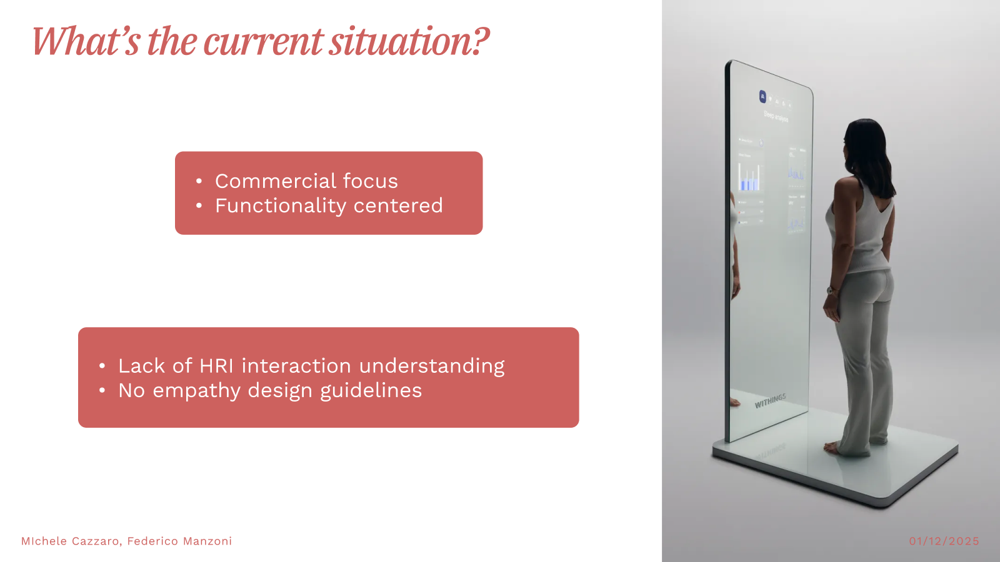
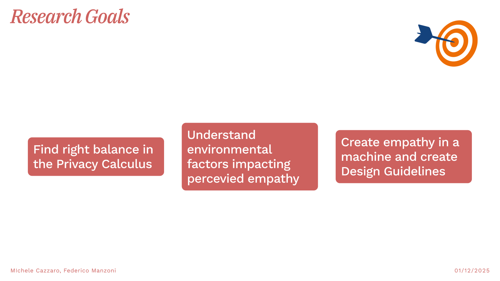
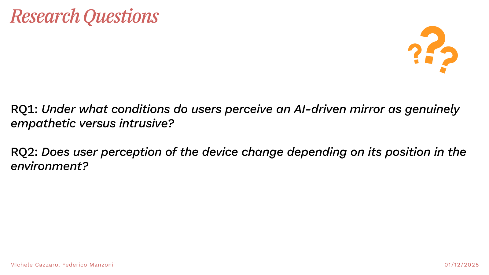
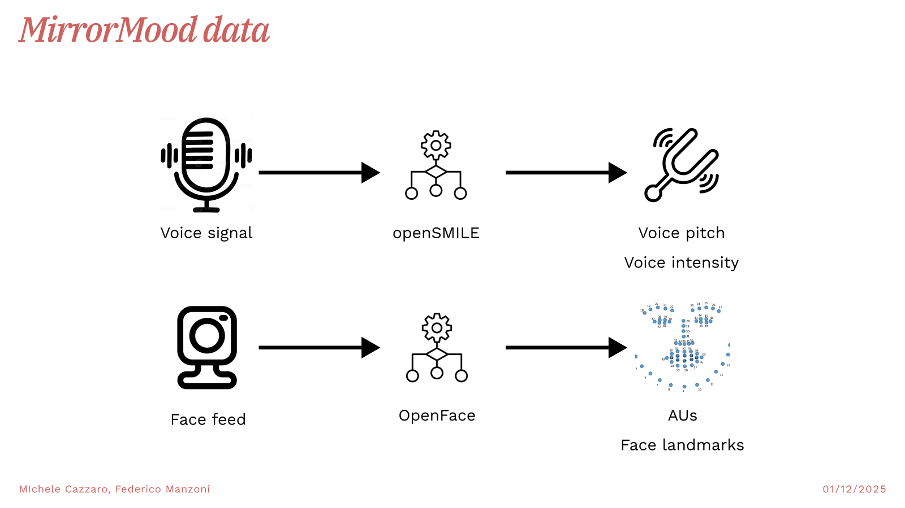
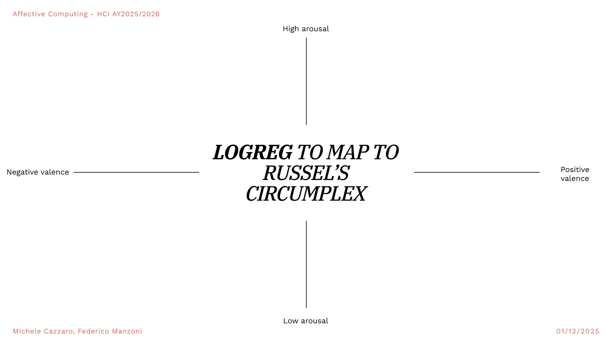
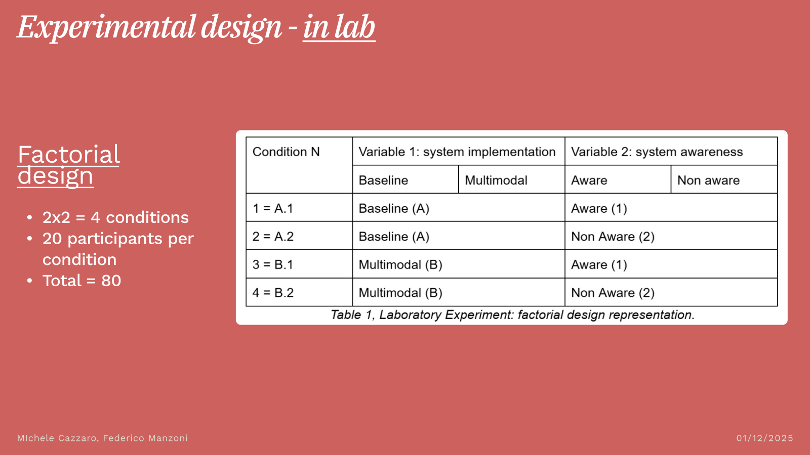
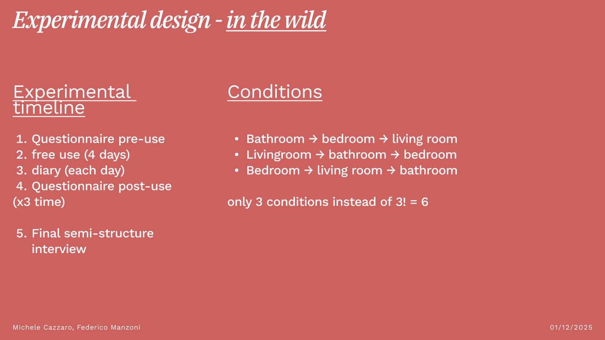
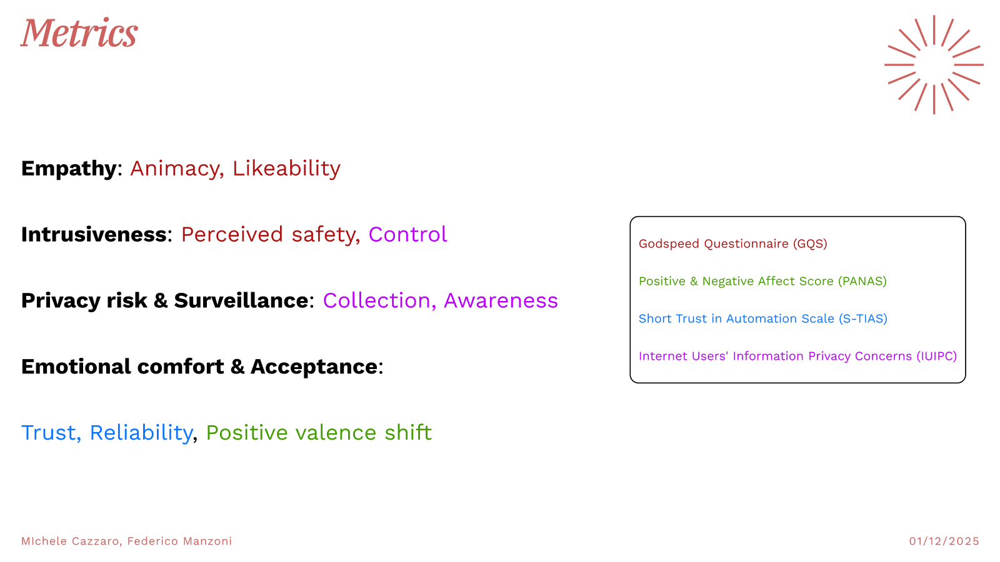
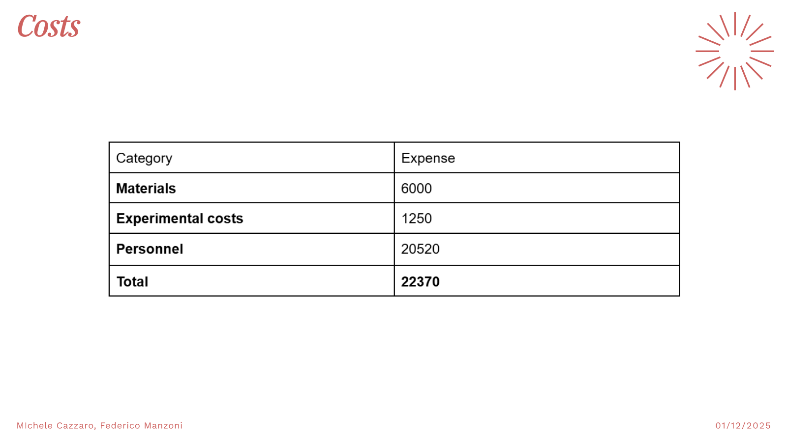

## Overview

MirrorMood is a **research proposal** that Michele Cazzaro and I wrote for the Affective Computing course of our MSc in Human-Computer Interaction at the University of Trento (academic year 2025/26). We designed an affect-aware smart mirror and a mixed-methods study to understand **when such a system feels empathetic, and when it feels intrusive**.

- **Team:** Michele Cazzaro and me.
- **Deliverable:** a full research proposal: system concept, experimental design, data and analysis plan, work plan and budget.
- **Status:** the study has not been run yet. What follows is the design of the system and of the research.

## The problem

Advances in computer vision, deep learning and embedded hardware have made emotion-aware devices increasingly feasible, and smart mirrors with facial emotion recognition have been explored for coaching, wellness support and daily information. They can infer emotions from visual and auditory cues with good accuracy, but they struggle to *relate* to their users. Current implementations:

- are commercially focused and centered on functionality rather than on the user’s social and emotional experience;
- lack an understanding of the human–machine interaction they create;
- have no design guidelines for empathy.

The hard part is getting **empathetic behavior** out of the collected data: a mirror that understands our emotional state and acts on it with knowledge of the context, so that the user feels supported rather than judged. Sensing more modalities (voice, posture, context) could increase perceived empathy, but it might also increase the sense of surveillance. That is why the **privacy calculus** trade-off is at the center of the project.

## Research goals and questions

Our goals: find the right balance in the privacy calculus, understand the environmental factors that affect perceived empathy, and create empathy in a machine while deriving **design guidelines**.

- **RQ1:** Under what conditions do users perceive an AI-driven mirror as genuinely empathetic versus intrusive?
- **RQ2:** Does user perception of the device change depending on its position in the environment?

## Theoretical frameworks

We grounded the project in four theories, each with a specific job:

- **Affective Computing** (Picard, 1997): machines can and should be designed to recognize, interpret and process human emotions. This justifies building an emotion-recognition mirror in the first place.
- **Russell’s Circumplex Model**: affective states placed along valence and arousal. It suits a multimodal system, because different sensing modalities inform different dimensions.
- **Computers Are Social Actors (CASA)** (Reeves & Nass): people apply social rules to technology, which explains why a mirror may feel “empathetic”, or judgemental.
- **Privacy Calculus** (Dinev & Hart, 2006): users weigh the benefits of personalized, empathetic feedback against the cost of perceived surveillance and data disclosure.

## The system: MirrorMood

MirrorMood is a smart mirror with a hidden camera and microphone that detect facial expressions and voice. It provides emotional support through **multimodal feedback**: light, music and an under-the-surface screen showing text and simple images.

### Why a mirror

- Mirror interactions are **voluntary, short and predictable**, embedded in daily routines (getting ready in the morning, winding down at night). Unlike phones or wearables, they don’t interrupt, so feedback can feel embedded rather than intrusive.
- Looking in a mirror nudges people towards **objective self-awareness**, a state in which they naturally evaluate themselves, which is useful for assessing their own affective state.
- Mirrors live in intimate but predictable spaces where people commonly regulate their affect.

### How people interact with it

**Direct interaction** is deliberately limited: the user is not talking to a generic LLM but to a specialized tool, and can ask only about current or past emotional states, affective trends over time, how to feel better, and generic information about the day (weather, time, day of the week).

**Unsolicited feedback** includes:

- a colored and/or breathing back-light reflecting the user’s detected emotional state, based on color theory;
- a system LED showing the status (idle, user detected and analyzing, answering, off);
- subtle contextual background music;
- contextual quotes, motivational phrases or affirmations;
- guided breathing, tai-chi or yoga sequences, and prompts for activities such as biking, running, swimming or walking.

### How it decides what to do

The mirror doesn’t try to change emotions arbitrarily. It follows a simple decision policy grounded in **affect-regulation theory** (Gross, 1998): positive-valence or calm states are maintained or gently reinforced; negative-valence or high-arousal distress states are never amplified, and the mirror offers stabilizing, supportive feedback instead.

Under the hood, two separate **logistic regressions** estimate valence (from the probability of a positive facial expression and of a positively charged voice) and arousal (from facial expression intensity and voice activation). The result places the user on Russell’s circumplex and is discretized into states such as happy, sad, calm or nervous.

**Why not a deep neural network?** A single network combining all features might be more precise, but it would need far more data and would hide how the mirror reaches its decisions. Two logistic regressions are simpler to implement and keep the mirror **transparent**.

### Privacy by design

The mirror stores only derived features (such as valence/arousal estimates), never raw images or audio. It recognizes faces so it can respond only to the authorized participant, and only when they are alone; interactions involving other people are discarded. Participants can disable the screen or use a physical camera cover at any time without leaving the study.

## Study design: in the lab

To answer RQ1, we designed a **2×2 between-subjects factorial experiment** that manipulates two independent variables:

- **System implementation:** baseline (facial expression recognition only) vs. multimodal (facial expressions + vocal affect + posture). This tells us how much empathy each level of sensing can achieve.
- **System awareness:** participants aware vs. not aware of which features the mirror captures. This tells us how transparency shapes perceived privacy risk and surveillance.

That gives 4 conditions with 20 participants each, **80 in total**. Each session includes a pre-task questionnaire, about 15 minutes of interaction in which participants answer the mirror’s questions, a post-task questionnaire and a brief semi-structured interview to capture what questionnaires might miss.

## Study design: in the wild

To study context (RQ2), we planned a **within-subjects** deployment in participants’ own homes, to maximize ecological validity. The mirror spends 4 days each in the **bathroom, bedroom and living room** (12 days in total), running a third, context-aware version of the system that also uses longitudinal affective trends and time of day.

- **Counterbalancing:** room order is counterbalanced to limit order and habituation effects. All 6 possible orders (3!) would be ideal, but we chose 3 sequences to keep an already complex and expensive field study feasible. With 10 participants per sequence, that’s **30 in total**.
- **Data:** questionnaires before and after each room, a one-page daily diary, and a final semi-structured interview.
- **Environmental control:** placement where interactions naturally happen, lighting suited to facial expression recognition (lux levels are logged), a fallback prompt for noisy rooms, a floor marker for a standard interaction distance, time-of-day logging and the privacy safeguards above.

## Participants

- **Who:** adults aged 18–65 (analyzed in three age groups: 18–30, 31–45, 46+), any gender, English speaking, normal or corrected-to-normal vision, able to give consent. There are no requirements on tech familiarity or privacy attitudes, but both are measured for reporting.
- **Home study:** participants live alone, or with a partner who also takes part.
- **Exclusions:** current severe psychiatric conditions, psychoactive medications that markedly alter emotional expression, recent (under 6 months) trauma or bereavement, and strong discomfort with camera-based sensing.
- **Sampling:** convenience sampling among volunteers from the university community and the local area, a common and practical approach for exploratory HCI studies. We kept 20 participants per lab condition to contain costs, and chose 30 for the field study as a standard size in HCI.

## Data collection and analysis

- **System data:** interaction metrics (frequency, duration, time of day, latency), extracted features (OpenFace action units and emotion probabilities, openSMILE pitch and intensity statistics) and performance logs.
- **Questionnaires:** PANAS (positive and negative affect), Godspeed (social perception, applying CASA), S-TIAS (trust) and IUIPC (privacy concerns). We mapped their sub-scales to four measures: **empathy** (animacy, likeability), **intrusiveness** (perceived safety, control), **privacy risk and surveillance** (collection, awareness) and **emotional comfort and acceptance** (trust, reliability, positive valence shift).
- **Qualitative data:** semi-structured interviews and, in the wild, diaries.

We planned ANOVA/MANOVA to compare groups and conditions, regression to relate self-reported and detected measures, and thematic analysis with a custom codebook and Cohen’s kappa, **triangulating** quantitative and qualitative results. All data will be anonymized and stored on an encrypted University of Trento server.

## Work plan and budget

Four work packages, run in order:

1. **Preparation and pilot:** 10 mirror prototypes, final protocol and a pilot study.
2. **Laboratory experiment.**
3. **In-the-wild deployment** (expected to be the most time-intensive).
4. **Analysis and dissemination,** including a scientific paper.

The estimated budget is about **€22,370**: €6,000 for materials (prototypes at about €600 each), €1,250 for participant compensation and €20,520 for personnel (three experimenters).

## Trade-offs and limitations

- **Feasibility vs. rigor:** 3 of the 6 possible room orders, and 20 participants per lab condition, to keep the study affordable.
- **Transparency vs. precision:** logistic regressions instead of a potentially more accurate deep network.
- **Richer sensing vs. privacy:** the very trade-off the study measures, handled with derived-only data storage and participant controls.
- **Convenience sampling** makes recruitment practical but limits how far results generalize.
- Given the study’s complexity, we recommended starting with a **pilot** of the first half to test feasibility, data quality and our hypotheses.

## Expected outcomes

The goal is a set of **design guidelines for empathetic ambient systems** that balance emotional support with privacy expectations, and a better understanding of how sensing complexity, transparency and domestic context shape whether a machine feels empathetic, or uncanny and invasive.
