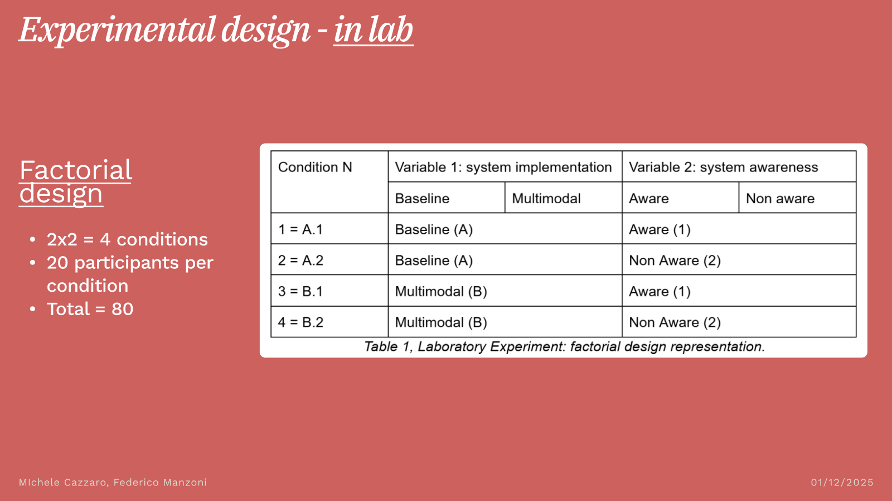

## Panoramica

- **Cosa:** proposta di ricerca per uno specchio intelligente sensibile agli stati affettivi e uno studio mixed-methods.
- **Contesto:** corso di Affective Computing, laurea magistrale in Human-Computer Interaction (2025/26), con Michele Cazzaro.
- **Stato:** progettato, non ancora condotto.

## Il problema

- Gli specchi intelligenti con riconoscimento delle emozioni esistono già, ma sono centrati sulle funzionalità e non hanno linee guida di design per l’empatia.
- Rilevare di più (voce, postura, contesto) può sembrare più empatico, ma anche più simile a una sorveglianza: un compromesso di **privacy calculus**.

## Domande di ricerca

- **RQ1:** Quando uno specchio basato su AI viene percepito come empatico invece che invadente?
- **RQ2:** La percezione cambia in base a dove si trova lo specchio in casa?

## Il sistema

- Telecamera + microfono nascosti → espressioni facciali e voce.
- **Perché uno specchio:** interazioni brevi, volontarie e abituali, in spazi intimi dove le persone già regolano i propri stati affettivi.
- Due regressioni logistiche stimano valenza e arousal sul modello circomplesso di Russell: scelte al posto di una rete profonda perché richiedono meno dati e restano **trasparenti**.
- Feedback: retroilluminazione che riflette lo stato emotivo rilevato, LED di stato, musica di sottofondo, citazioni, respirazione/yoga guidati e suggerimenti di attività.
- Regola di regolazione affettiva: rinforzare gli stati positivi o calmi, non amplificare mai il disagio.
- Privacy by design: si salvano solo feature derivate, mai immagini o audio grezzi; risponde solo al partecipante autorizzato, quando è da solo.

## Disegno dello studio

- **Laboratorio (RQ1):** 2×2 between-subjects (rilevamento baseline o multimodale × consapevoli o meno di cosa viene rilevato), 80 partecipanti, circa 15 minuti di interazione ciascuno.
- **Sul campo (RQ2):** within-subjects nelle case dei partecipanti, bagno/camera/soggiorno per 4 giorni ciascuno, 30 partecipanti.
- **Compromesso:** 3 ordini delle stanze controbilanciati invece di tutti e 6, per mantenere fattibile lo studio sul campo.
- **Misure:** PANAS, Godspeed, S-TIAS, IUIPC, log di sistema, diari e interviste, collegati a empatia, invadenza, rischio per la privacy e comfort emotivo.
- **Analisi:** ANOVA/MANOVA, regressione, analisi tematica (kappa di Cohen), triangolazione.

## Risultato atteso

- Linee guida di design per sistemi ambientali empatici che bilancino supporto emotivo e privacy.
- Quattro work package, a partire da 10 prototipi e uno studio pilota.
- Budget stimato di circa 22.370 €.
