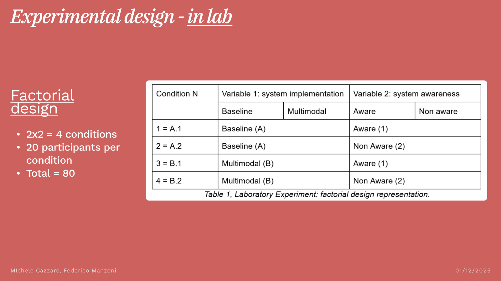

## Overview

- **What:** research proposal for an affect-aware smart mirror and a mixed-methods study.
- **Context:** Affective Computing course, MSc in Human-Computer Interaction (2025/26), with Michele Cazzaro.
- **Status:** designed, not yet run.

## The problem

- Smart mirrors with emotion recognition exist, but they are functionality-centered and have no design guidelines for empathy.
- Sensing more (voice, posture, context) may feel more empathetic, but also more like surveillance: a **privacy calculus** trade-off.

## Research questions

- **RQ1:** When is an AI-driven mirror perceived as empathetic versus intrusive?
- **RQ2:** Does perception change depending on where the mirror is in the home?

## The system

- Hidden camera + microphone → facial expressions and voice.
- **Why a mirror:** short, voluntary, routine interactions in intimate spaces where people already regulate their affect.
- Two logistic regressions estimate valence and arousal on Russell’s circumplex: chosen over a deep network because they need less data and stay **transparent**.
- Feedback: back-light reflecting the detected emotional state, status LED, background music, quotes, guided breathing/yoga and activity prompts.
- Affect-regulation policy: reinforce positive or calm states, never amplify distress.
- Privacy by design: only derived features stored, never raw images or audio; responds only to the authorized participant, alone.

## Study design

- **Lab (RQ1):** 2×2 between-subjects (baseline vs. multimodal sensing × aware vs. not aware of what is sensed), 80 participants, about 15 minutes of interaction each.
- **In the wild (RQ2):** within-subjects in participants’ homes, bathroom/bedroom/living room for 4 days each, 30 participants.
- **Trade-off:** 3 counterbalanced room orders instead of all 6, to keep the field study feasible.
- **Measures:** PANAS, Godspeed, S-TIAS, IUIPC, system logs, diaries and interviews, mapped to empathy, intrusiveness, privacy risk and emotional comfort.
- **Analysis:** ANOVA/MANOVA, regression, thematic analysis (Cohen’s kappa), triangulation.

## Expected outcome

- Design guidelines for empathetic ambient systems that balance emotional support and privacy.
- Four work packages, starting with 10 prototypes and a pilot study.
- Estimated budget of about €27,770.
