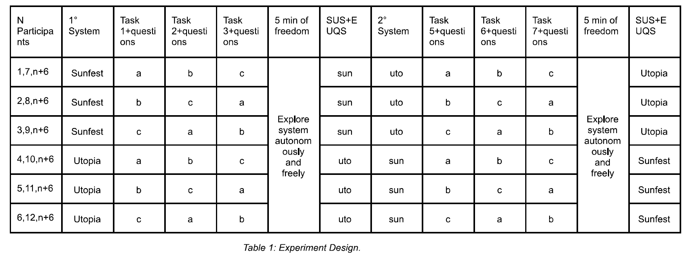
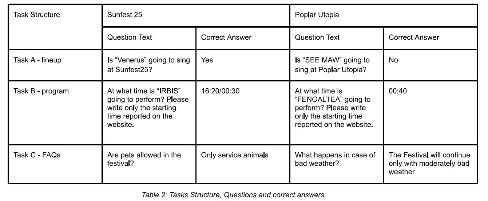
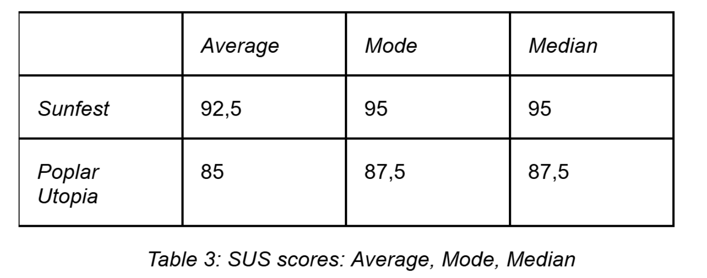
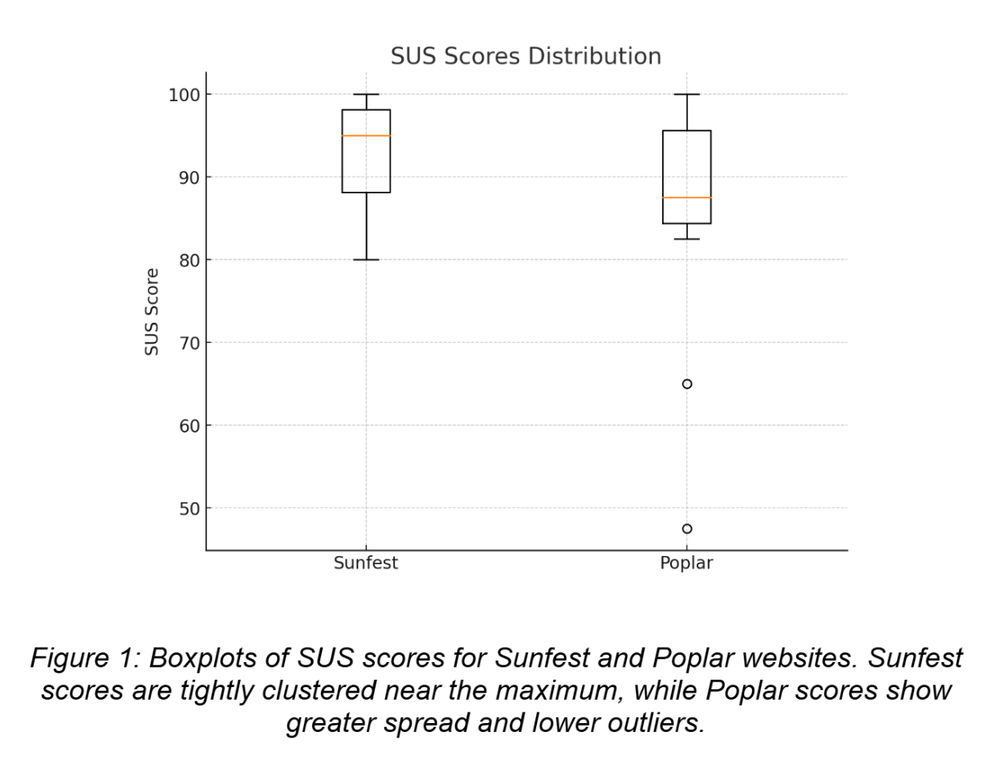
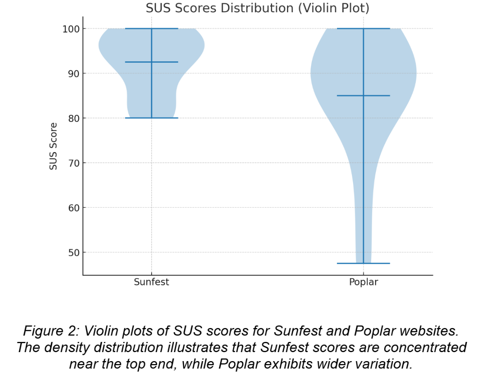
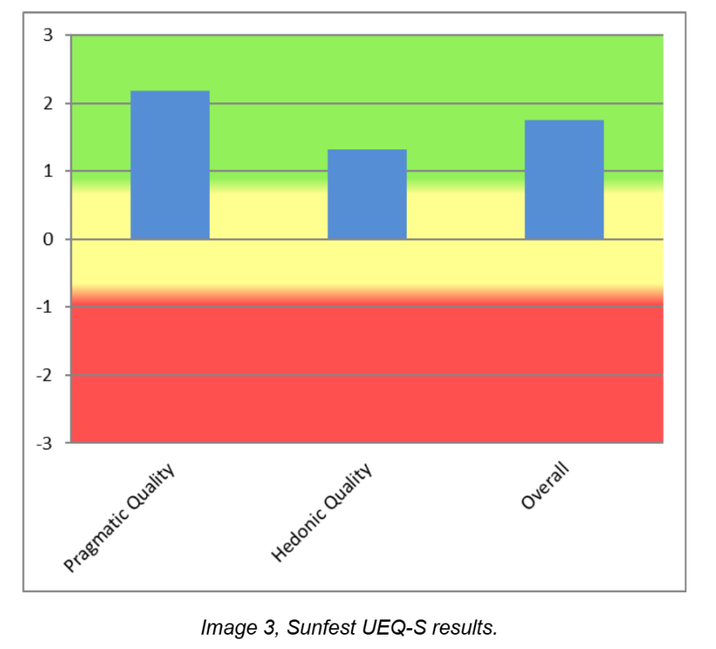
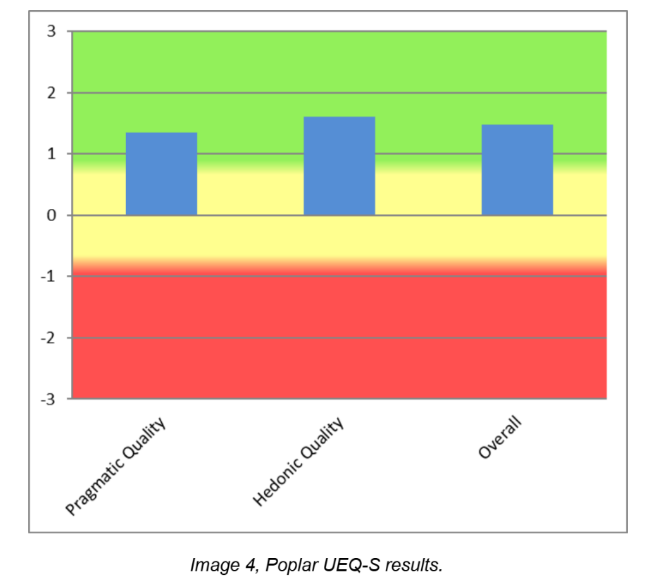
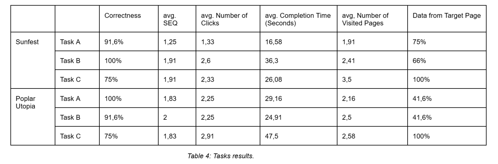

## Panoramica

Sunfest25 è il prototipo del sito di un nuovo festival di musica indie e pop che Michele Cazzaro e io abbiamo progettato in Figma durante la mia laurea magistrale in Human-Computer Interaction (in seguito l’ho anche [ricostruito come sito vero](/sunfest25/)). Finito il prototipo, volevamo capire se le nostre scelte di design reggevano davvero, così lo abbiamo messo a confronto diretto con un concorrente reale: il [sito di Poplar Utopia](https://poplarfestival.it/en/utopia).

Abbiamo condotto uno **studio within-subjects di usabilità e user experience con 12 partecipanti**. Ogni persona ha cercato lo stesso tipo di informazioni su entrambi i siti (un artista nella lineup, l’orario di un’esibizione nel programma, una risposta nelle FAQ) mentre misuravamo quanto bene ci riusciva e com’era l’esperienza.

- **Team:** Federico Manzoni (io) e Michele Cazzaro, come progetto universitario.
- **Metodi:** usability test basato su task, design within-subjects controbilanciato, questionari SEQ, SUS e UEQ-S, test di Mann–Whitney U e di Wilcoxon.
- **Risultato principale:** entrambi i siti hanno ottenuto punteggi SUS alti (Sunfest 92,5, Poplar 85,0) senza differenze statisticamente significative (p = 0,233). Sunfest è risultato più forte sulla qualità pragmatica e su una navigazione più diretta; Poplar sulla qualità edonica.

## Perché testare

Il sito di un festival ha un compito molto concreto: dire alle persone ciò che serve sapere per partecipare. Ci siamo concentrati sulle tre sezioni che riteniamo più importanti per questo: la **lineup** (chi suona), il **programma** (quando) e le **FAQ** (le regole).

L’obiettivo era confrontare il prototipo di Sunfest25 con il sito di un festival esistente proprio su quelle sezioni, guardando due lati dell’esperienza: l’**usabilità** (le persone trovano le informazioni in modo rapido e corretto?) e la **user experience** (che sensazione dà usare il sito?).

## Disegno dello studio

### Partecipanti

Abbiamo reclutato 12 partecipanti con un campionamento di convenienza, tra persone conosciute dal ricercatore, disponibili e interessate a partecipare. Tutti hanno dato il consenso informato prima di iniziare.

### Within-subjects e controbilanciato

Abbiamo scelto un **design within-subjects**: ogni partecipante ha usato entrambi i siti e completato tutti e sei i task (tre per sito). Con sole 12 persone, questo ci ha permesso un confronto diretto all’interno di ciascun partecipante, ha controllato le differenze individuali e ha aumentato la potenza statistica rispetto a dividere le persone in due gruppi.

Il rischio di questo design è che l’ordine dei task e dei sistemi influenzi i risultati per effetto di apprendimento, pratica o stanchezza. Per controllarlo abbiamo creato **sei condizioni d’ordine**: metà dei partecipanti iniziava da Sunfest e metà da Poplar Utopia, e all’interno di ogni gruppo i tre task ruotavano (a-b-c, b-c-a, c-a-b). I partecipanti venivano assegnati a una condizione nell’ordine in cui erano stati reclutati, così da distribuire le condizioni in modo uniforme.

### Task

Ogni task riguardava una delle tre sezioni chiave, con una domanda equivalente su ciascun sito:

- **Task A, lineup:** un certo artista si esibirà al festival?
- **Task B, programma:** a che ora si esibirà un certo artista?
- **Task C, FAQ:** una domanda pratica a cui risponde una delle FAQ.

Per il task sulle FAQ abbiamo scelto domande con **tre risposte possibili**, così da poter rispondere correttamente solo leggendo tutto il testo della FAQ. Su Sunfest, per esempio, la FAQ diceva: “For safety and comfort, pets are not allowed (with the exception of registered service animals).” La domanda era “Gli animali sono ammessi al festival?”, con le opzioni Sì, No e Solo gli animali di servizio (quella corretta).

### Svolgimento della sessione

Per semplificare la procedura e la raccolta dei dati, tutta la sessione si svolgeva all’interno di **un unico questionario** compilato man mano dai partecipanti:

1. Consenso informato e domande demografiche.
2. Tre task sul primo sito, ognuno seguito dalla Single Ease Question (SEQ).
3. 5–7 minuti di esplorazione libera dello stesso sito.
4. System Usability Scale (SUS) e versione breve dello User Experience Questionnaire (UEQ-S).
5. Gli stessi passaggi sul secondo sito: tre task con SEQ, esplorazione libera, SUS e UEQ-S.
6. Una domanda aperta facoltativa per altri commenti su entrambi i sistemi.

In media una sessione durava circa **25 minuti**.

### Cosa abbiamo misurato, e perché

Per ogni task abbiamo registrato **correttezza, tempo di completamento, numero di clic, numero di pagine visitate**, se la risposta arrivava dalla **pagina prevista** o da informazioni ridondanti in un’altra pagina, e la facilità percepita del task tramite la **SEQ**.

Abbiamo scelto **SUS** e **UEQ-S** perché sono brevi e affidabili: hanno mantenuto la sessione rapida, aiutando i partecipanti a restare coinvolti, e ci hanno comunque fornito dati raccolti con strumenti validati. Inoltre si completano a vicenda: la SUS si concentra sull’usabilità percepita (efficacia, efficienza e soddisfazione), mentre l’UEQ-S copre sia le qualità **pragmatiche** sia quelle **edoniche** (come stimolazione e novità). Entrambi sono strumenti standard nella ricerca HCI e nell’industria, quindi i punteggi si possono confrontare con benchmark e altri sistemi.

L’**esplorazione libera** prima dei questionari è stata una scelta precisa: permetteva ai partecipanti di conoscere ogni sito oltre i tre task, così che le loro valutazioni riflettessero un’impressione più completa e non solo le schermate dei task.

## Risultati

Con 12 partecipanti lo studio ha una potenza statistica troppo bassa per un’inferenza affidabile: abbiamo eseguito dei test inferenziali, ma leggiamo i risultati come **esplorativi e descrittivi**, cioè tendenze e non prove.

### Usabilità (SUS)

Entrambi i siti hanno raggiunto punteggi SUS alti. Sunfest ha ottenuto in media **92,5** (mediana 95,0) e Poplar Utopia **85,0** (mediana 87,5). Le valutazioni di Sunfest erano molto raccolte verso il massimo della scala, mentre quelle di Poplar erano più disperse e includevano alcuni punteggi decisamente più bassi.

Un test di Mann–Whitney U ha mostrato che la differenza **non è statisticamente significativa** al livello del 5% (p = 0,233), molto probabilmente a causa del campione ridotto e della variabilità dei punteggi di Poplar.

### User experience (UEQ-S)

- **Sunfest:** complessivo 1,750, qualità pragmatica 2,188, qualità edonica 1,313.
- **Poplar Utopia:** complessivo 1,479, qualità pragmatica 1,354, qualità edonica 1,604.

Sunfest è risultato avanti nel complesso e nettamente avanti sulla qualità pragmatica, mentre Poplar Utopia ha prevalso sulla qualità edonica.

### Prestazioni nei task

- **Task A, lineup.** Sunfest: 91,7% di risposte corrette, 16,58 s, 1,33 clic, 1,91 pagine, risposta trovata nella pagina prevista nel 75% dei casi (SEQ 1,25). Poplar: 100% corrette, 29,16 s, 2,25 clic, 2,16 pagine, pagina prevista nel 41,7% dei casi (SEQ 1,83).
- **Task B, programma.** Sunfest: 100% corrette, 36,3 s, 2,6 clic, 2,41 pagine, pagina prevista nel 66,7% dei casi (SEQ 1,91). Poplar: 91,7% corrette, 24,91 s, 2,25 clic, 2,5 pagine, pagina prevista nel 41,7% dei casi (SEQ 2,0).
- **Task C, FAQ.** Sunfest: 75% corrette, 26,08 s, 2,33 clic, 3,5 pagine, pagina prevista nel 100% dei casi (SEQ 1,91). Poplar: 75% corrette, 47,5 s, 2,91 clic, 2,58 pagine, pagina prevista nel 100% dei casi (SEQ 1,83).

### Facilità percepita (SEQ)

Poiché i dati della SEQ non rispettavano l’assunzione di normalità, abbiamo confrontato i due siti con **test dei ranghi con segno di Wilcoxon**. Non sono emerse differenze significative in nessuno dei tre task: le piccole variazioni andavano in una direzione in alcuni task e nell’altra in altri, senza un andamento coerente.

### Feedback aperto

La domanda aperta facoltativa ha raccolto solo **5 risposte**, troppo poche e incomplete per un’analisi qualitativa vera e propria, quindi non hanno aggiunto molto allo studio.

## Cosa dicono i dati

Nessuna delle differenze è statisticamente significativa, ma nel loro insieme i numeri vanno in una direzione coerente.

**Chiarezza contro emozione.** Sunfest ha ottenuto punteggi più alti nella SUS (7,5 punti di distacco) e nella qualità pragmatica dell’UEQ-S, mentre Poplar Utopia ha vinto sulla qualità edonica. Entrambi i punteggi SUS superano 80, un livello raggiunto solo dal 10% migliore dei siti web. Pensiamo che il divario di usabilità dipenda in parte da scelte visive e di contenuto: Poplar usa un tema molto scuro con sfondi nero puro e lunghi muri di testo, che rendono le informazioni più difficili da distinguere, mentre Sunfest usa colori chiari e pastello e divide i contenuti in parti più piccole e più facili da individuare. Il punteggio edonico più alto di Poplar, invece, riflette probabilmente la natura artistica del suo evento. Per un prototipo a cui mancavano ancora alcuni feedback per l’utente e alcune ottimizzazioni, quello di Sunfest è stato un buon risultato.

**Navigazione.** Sunfest ha mostrato comportamenti più coerenti tra i partecipanti. Nel task sulla lineup è stato più veloce e ha richiesto meno clic, e la risposta veniva trovata più spesso nella pagina prevista; la correttezza è stata molto alta sia sulla lineup sia sul programma (91,7% e 100%), e la bassa dispersione dei punteggi SUS mostra che i partecipanti erano d’accordo sulla sua usabilità. Questo fa pensare che la struttura più semplice abbia ridotto il carico cognitivo. Sunfest però non è stato più veloce ovunque: nel task sul programma i partecipanti sono stati più rapidi su Poplar (24,91 s contro 36,3 s).

Su Poplar Utopia la correttezza è rimasta alta, ma i partecipanti avevano spesso bisogno di più clic e più pagine, e sia nel task sulla lineup sia in quello sul programma hanno usato la pagina prevista solo nel 41,7% dei casi. Questo indica un punto debole nell’**architettura dell’informazione**: i contenuti ci sono, ma la pagina prevista non viene percepita come la via d’accesso più efficiente.

**Le FAQ sono difficili ovunque.** Il task C è stato il più difficile su entrambi i siti, con la correttezza scesa al 75% e più tempo ed esplorazione necessari. Le sezioni FAQ impongono un carico di lettura elevato e non corrispondono alla ricerca rapida di informazioni che le persone si aspettano. Strutture più facili da scorrere o formati alternativi, come una ricerca per parole chiave o suggerimenti contestuali, potrebbero aiutare.

## Limiti

- **Campione:** il campionamento di convenienza nella rete personale del ricercatore ha reso il gruppo demograficamente omogeneo, quindi non rappresenta il pubblico più ampio dei festival.
- **Dimensione del campione:** con N = 12 la potenza statistica era bassa, quindi l’assenza di differenze significative potrebbe dipendere dalla scarsa sensibilità più che da una reale equivalenza.
- **Contesto:** il laboratorio controllato ha mantenuto la procedura coerente, ma ha escluso le distrazioni, la fretta e l’uso da mobile tipici della ricerca di informazioni nella vita reale.
- **Effetto osservatore:** la presenza del ricercatore può aver causato bias di desiderabilità sociale o effetto Hawthorne.
- **Prototipo:** il prototipo Figma non era completamente interattivo né ottimizzato per diversi dispositivi, e questo può aver cambiato la percezione rispetto a un sito finito.

Nel complesso, questi limiti riducono la validità esterna ed ecologica dei risultati, che vanno quindi generalizzati con cautela agli scenari reali dei festival.

## Lezioni e prossimi passi

Se rifacessi questo studio:

- recluterei un **campione più ampio e vario**, per guadagnare potenza statistica e generalizzabilità;
- testerei su **dispositivi mobili** e in contesti più naturali, per esempio direttamente agli eventi, dove potrebbero emergere problemi di usabilità nascosti dal laboratorio;
- affiancherei alle metriche dei task dei **metodi qualitativi** come think-aloud e interviste, visto che la sola domanda aperta ci ha dato troppo poco da analizzare;
- farei **A/B test di design alternativi**, soprattutto per le FAQ.

La direzione più interessante per il design è unire i due punti di forza emersi: **la chiarezza pragmatica di Sunfest e il fascino edonico di Poplar**, per siti di festival facili da usare e allo stesso tempo coinvolgenti sul piano emotivo.
