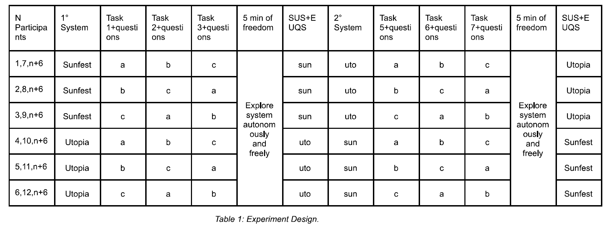
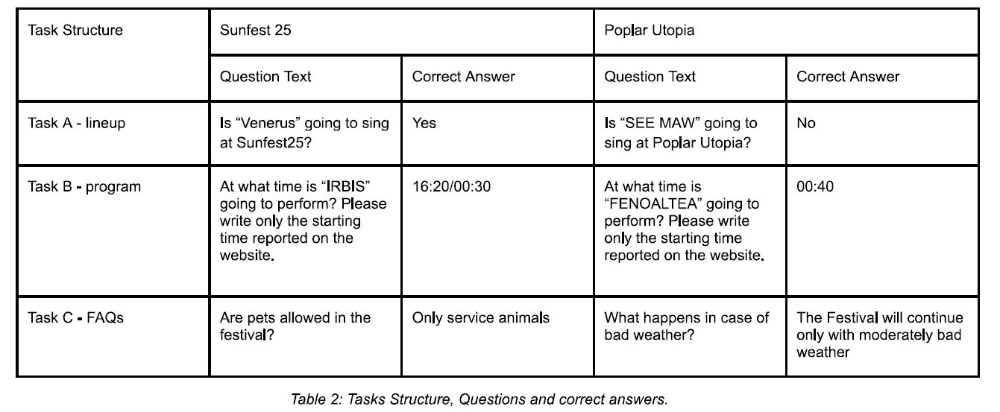
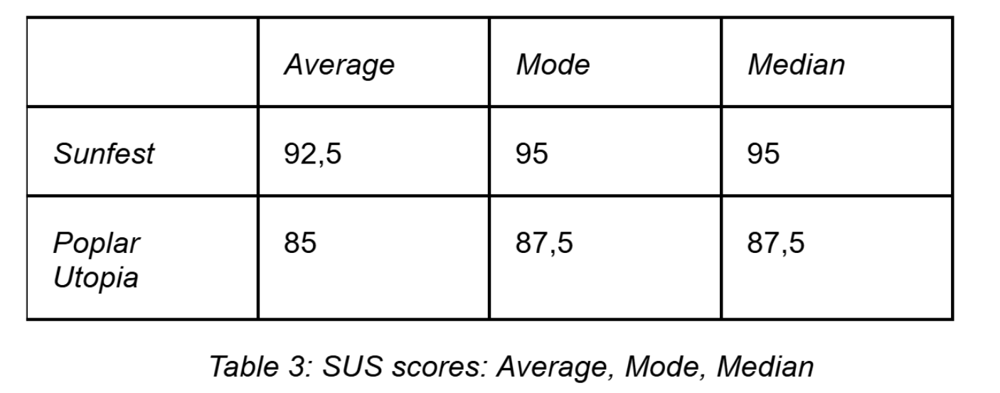
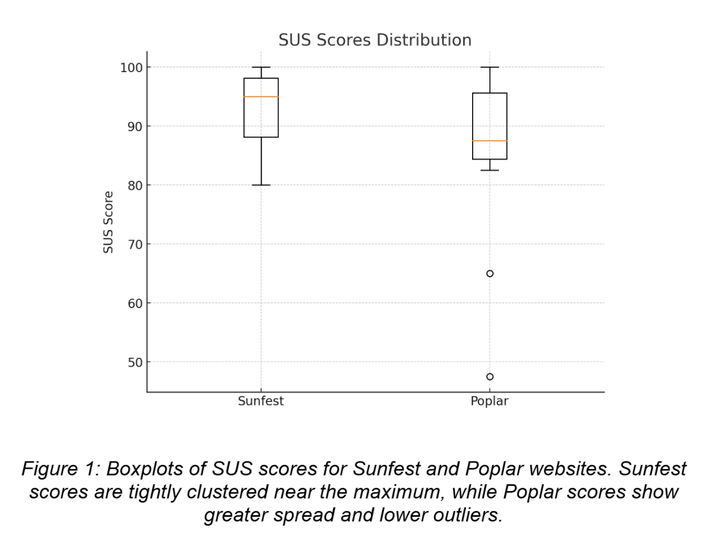
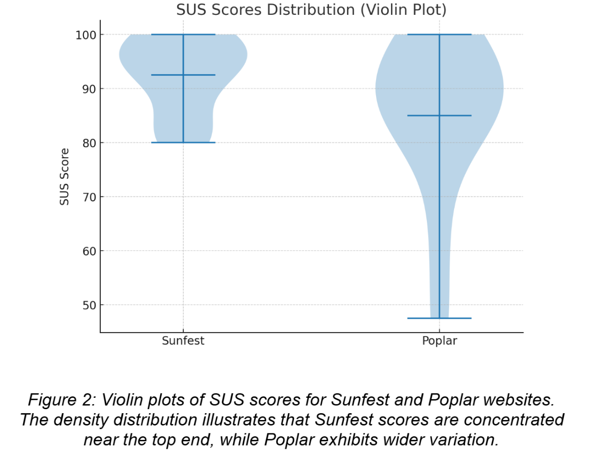
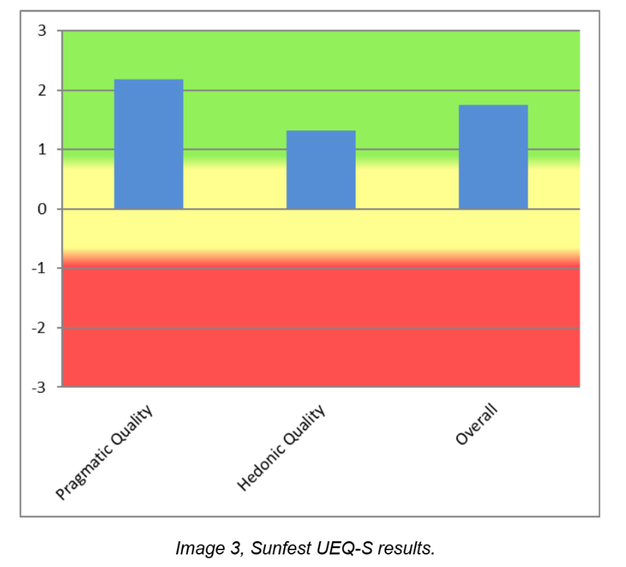
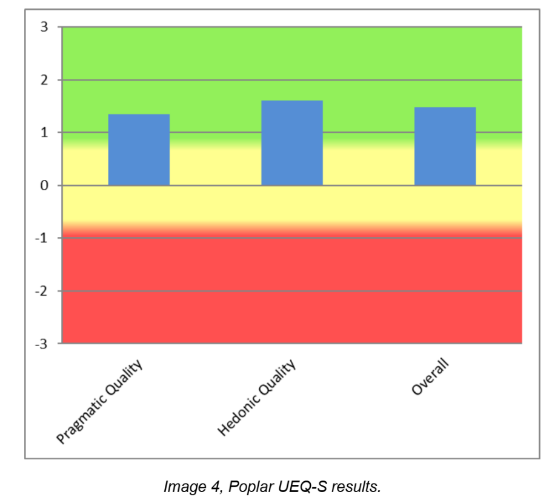
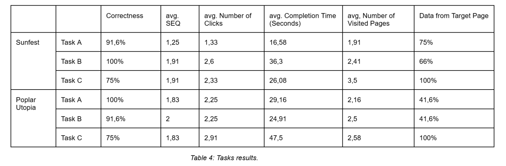

## Overview

Sunfest25 is the website prototype for a new indie and pop music festival that Michele Cazzaro and I designed in Figma during my Master’s in Human-Computer Interaction (I later [rebuilt it as a real website](/sunfest25/)). Once the prototype was finished, we wanted to know whether our design choices actually held up, so we put it head to head with a live competitor: the [Poplar Utopia website](https://poplarfestival.it/en/utopia).

We ran a **within-subjects usability and UX study with 12 participants**. Each person looked for the same kinds of information on both websites (an artist in the lineup, a performance time in the program, an answer in the FAQs) while we measured how well they did and how the experience felt.

- **Team:** Federico Manzoni (me) and Michele Cazzaro, as a university project.
- **Methods:** task-based usability testing, counterbalanced within-subjects design, SEQ, SUS and UEQ-S questionnaires, Mann–Whitney U and Wilcoxon tests.
- **Headline result:** both sites scored high on SUS (Sunfest 92.5, Poplar 85.0) with no statistically significant difference (p = 0.233). Sunfest was stronger on pragmatic quality and more direct navigation; Poplar was stronger on hedonic quality.

## Why we tested

A festival website has a very practical job: telling people what they need to know to attend. We focused on the three sections we consider the most important for that job: the **lineup** (who is playing), the **program** (when) and the **FAQs** (the rules).

Our goal was to compare the Sunfest25 prototype with an existing festival website on exactly those sections, looking at two sides of the experience: **usability** (can people find the information quickly and correctly?) and **user experience** (how does the site feel to use?).

## Study design

### Participants

We recruited 12 participants through convenience sampling, among people known to the researcher who were available and willing to take part. Everyone gave informed consent before starting.

### Within-subjects and counterbalanced

We chose a **within-subjects design**: every participant used both websites and completed all six tasks (three per site). With only 12 people, this gave us a direct comparison inside each participant, controlled for individual differences and increased statistical power compared with splitting people into two groups.

The risk of this design is that the order of tasks and systems can bias the results through learning, practice or fatigue. To control for it, we created **six order conditions**: half of the participants started with Sunfest and half with Poplar Utopia, and within each group the three tasks were rotated (a-b-c, b-c-a, c-a-b). Participants were assigned to a condition in the order they were recruited, so the conditions were spread evenly.

### Tasks

Each task targeted one of the three key sections, with an equivalent question on each website:

- **Task A, lineup:** is a specific artist going to perform at the festival?
- **Task B, program:** at what time is a specific artist going to perform?
- **Task C, FAQs:** a practical question answered by one of the FAQs.

For the FAQ task we picked questions with **three possible answers**, so that they could only be answered correctly by reading the whole FAQ text. On Sunfest, for example, the FAQ said: “For safety and comfort, pets are not allowed (with the exception of registered service animals).” The question was “Are pets allowed in the festival?”, with the options Yes, No and Only service animals (the correct one).

### Session flow

To keep the procedure and data collection simple, the whole session ran through **a single questionnaire** that participants filled in progressively:

1. Informed consent and demographic questions.
2. Three tasks on the first website, each followed by the Single Ease Question (SEQ).
3. 5–7 minutes of free exploration of the same website.
4. The System Usability Scale (SUS) and the short version of the User Experience Questionnaire (UEQ-S).
5. The same steps on the second website: three tasks with SEQ, free exploration, SUS and UEQ-S.
6. An optional open question for any other comments on both systems.

A session took about **25 minutes** on average.

### What we measured, and why

For every task we recorded **correctness, completion time, number of clicks, number of pages visited**, whether the answer came from the **expected page** or from redundant information somewhere else, and the perceived ease of the task through **SEQ**.

We chose **SUS** and **UEQ-S** because they are short and reliable: they kept the session quick, which helped participants stay engaged, and still gave us data from validated instruments. They also complement each other: SUS focuses on perceived usability (effectiveness, efficiency and satisfaction), while UEQ-S covers both **pragmatic** and **hedonic** qualities (such as stimulation and novelty). Both are standard instruments in HCI research and industry, so the scores can be compared with benchmarks and other systems.

The **free exploration** before the questionnaires was a deliberate choice: it let participants get to know each website beyond the three tasks, so their ratings reflected a more complete impression and not just the task screens.

## Results

With 12 participants the study has too little statistical power for reliable inference, so we ran inferential tests but read the results as **exploratory and descriptive**: trends, not proof.

### Usability (SUS)

Both websites reached high SUS scores. Sunfest averaged **92.5** (median 95.0) and Poplar Utopia **85.0** (median 87.5). Sunfest’s ratings were tightly clustered near the top of the scale, while Poplar’s were more spread out and included some notably lower scores.

A Mann–Whitney U test showed that the difference was **not statistically significant** at the 5% level (p = 0.233), most likely because of the small sample and the variability in Poplar’s scores.

### User experience (UEQ-S)

- **Sunfest:** overall 1.750, pragmatic quality 2.188, hedonic quality 1.313.
- **Poplar Utopia:** overall 1.479, pragmatic quality 1.354, hedonic quality 1.604.

Sunfest came out ahead overall and clearly ahead on pragmatic quality, while Poplar Utopia led on hedonic quality.

### Task performance

- **Task A, lineup.** Sunfest: 91.7% correct, 16.58 s, 1.33 clicks, 1.91 pages, answer found on the target page in 75% of cases (SEQ 1.25). Poplar: 100% correct, 29.16 s, 2.25 clicks, 2.16 pages, target page in 41.7% of cases (SEQ 1.83).
- **Task B, program.** Sunfest: 100% correct, 36.3 s, 2.6 clicks, 2.41 pages, target page in 66.7% of cases (SEQ 1.91). Poplar: 91.7% correct, 24.91 s, 2.25 clicks, 2.5 pages, target page in 41.7% of cases (SEQ 2.0).
- **Task C, FAQs.** Sunfest: 75% correct, 26.08 s, 2.33 clicks, 3.5 pages, target page in 100% of cases (SEQ 1.91). Poplar: 75% correct, 47.5 s, 2.91 clicks, 2.58 pages, target page in 100% of cases (SEQ 1.83).

### Perceived ease (SEQ)

Since the SEQ data did not meet normality assumptions, we compared the two websites with **Wilcoxon signed-rank tests**. There were no significant differences on any of the three tasks: small variations went one way on some tasks and the other way on others, without a consistent pattern.

### Open feedback

The optional open question collected only **5 answers**, too few and too incomplete for a proper qualitative analysis, so they did not add much to the study.

## What the data suggests

None of the differences is statistically significant, but together the numbers point in a consistent direction.

**Clarity versus emotion.** Sunfest scored higher on SUS (a 7.5-point gap) and on UEQ-S pragmatic quality, while Poplar Utopia won on hedonic quality. Both SUS scores are above 80, a level reached only by the top 10% of websites. We think the usability gap comes partly from visual and content choices: Poplar uses a very dark theme with pure black backgrounds and long walls of text, which make information harder to tell apart, while Sunfest uses light, pastel colours and splits its content into smaller pieces that are easier to spot. Poplar’s stronger hedonic score, on the other hand, probably reflects the artistic nature of its event. For a prototype that still lacked some user feedback and optimisation, Sunfest’s score was a good result.

**Navigation.** Sunfest showed more consistent behaviour across participants. On the lineup task it was faster and needed fewer clicks, and the answer was more often found on the intended page; correctness was very high on both lineup and program tasks (91.7% and 100%), and the narrow spread of SUS scores shows participants agreed on its usability. This suggests that the simpler structure reduced cognitive load. Sunfest was not faster everywhere, though: on the program task participants were quicker on Poplar (24.91 s vs 36.3 s).

On Poplar Utopia, correctness stayed high, but participants often needed more clicks and pages, and on both the lineup and program tasks they used the intended page only in 41.7% of cases. That points to an **information architecture** weakness: the content is there, but the intended page is not perceived as the most efficient way in.

**FAQs are hard everywhere.** Task C was the most difficult on both websites, with correctness dropping to 75% and more time and exploration needed. FAQ sections impose a heavy reading load and do not match the quick fact-finding people expect. More scannable structures or alternative formats, such as keyword-based search or contextual prompts, could help.

## Limitations

- **Sample:** convenience sampling from the researcher’s personal network made the group demographically homogeneous, so it does not represent the broader festival audience.
- **Sample size:** with N = 12 the statistical power was low, so the lack of significant differences may reflect low sensitivity rather than real equivalence.
- **Setting:** the controlled lab setting kept the procedure consistent but left out the distractions, time pressure and mobile use of real-world information seeking.
- **Observer effects:** the researcher’s presence may have caused social desirability bias or Hawthorne effects.
- **Prototype:** the Figma prototype lacked full interactivity and cross-device optimisation, which may have changed how people perceived it compared with a finished site.

Together, these limits reduce the external and ecological validity of the findings, so they should be generalised to real festival scenarios with caution.

## Learnings and next steps

If I ran this study again, I would:

- recruit a **larger and more diverse sample**, to gain statistical power and generalisability;
- test on **mobile devices** and in more natural contexts, for example on-site at events, where usability problems hidden by the lab setting could emerge;
- pair the task metrics with **qualitative methods** such as think-aloud and interviews, since the open question alone gave us too little to analyse;
- **A/B test alternative designs**, especially for the FAQs.

The most interesting direction for the design itself is to combine the two strengths we saw: **Sunfest’s pragmatic clarity with Poplar’s hedonic appeal**, for festival websites that are both easy to use and emotionally engaging.
