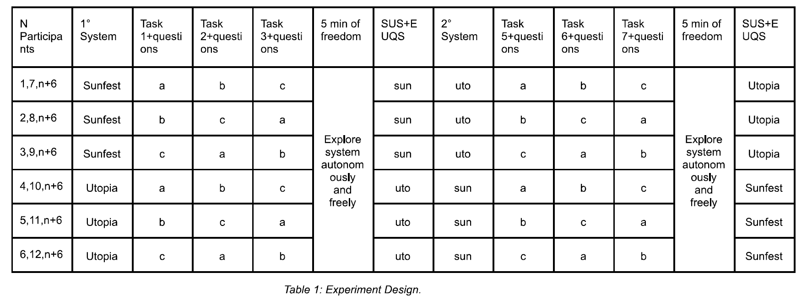
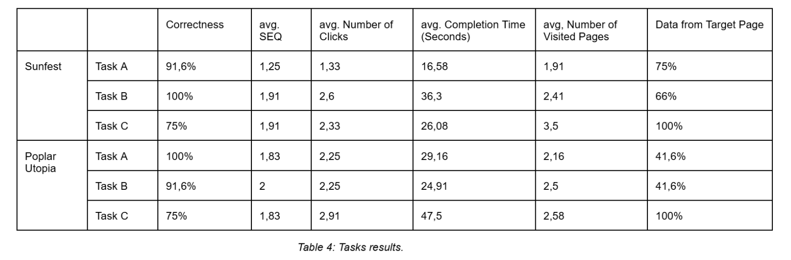

## Panoramica

- Studio di usabilità e user experience che confronta il nostro prototipo Figma di **Sunfest25** con il [sito di Poplar Utopia](https://poplarfestival.it/en/utopia).
- Progetto universitario della mia magistrale in HCI, con Michele Cazzaro; il prototipo è quello che abbiamo progettato per Sunfest ([guarda il sito realizzato](/sunfest25/)).
- 12 partecipanti, design within-subjects, SEQ + SUS + UEQ-S.
- In sintesi: SUS 92,5 (Sunfest) contro 85,0 (Poplar), differenza non significativa (p = 0,233); Sunfest più forte sulla qualità pragmatica, Poplar su quella edonica.

## Perché testare

- Il sito di un festival deve dire alle persone ciò che serve per partecipare: **lineup, programma, FAQ**.
- Obiettivo: capire se le nostre scelte di design reggevano il confronto con il sito di un festival esistente, sia sull’usabilità sia sulla user experience.

## Disegno dello studio

- **Partecipanti:** 12, campionamento di convenienza, consenso informato.
- **Within-subjects:** tutti hanno usato entrambi i siti → confronto diretto, differenze individuali controllate, più potenza con un campione piccolo.
- **Controbilanciamento:** 6 condizioni d’ordine (quale sito per primo × 3 ordini dei task a rotazione), assegnate in ordine di reclutamento, contro gli effetti di apprendimento e stanchezza.
- **Task:**
	- A, lineup → un certo artista si esibirà?
	- B, programma → a che ora si esibisce un certo artista?
	- C, FAQ → una domanda sulle regole con 3 risposte possibili, per obbligare a leggere tutta la FAQ.
- **Sessione (~25 min, un unico questionario progressivo):** consenso + dati demografici → 3 task con SEQ → 5–7 min di esplorazione libera → SUS + UEQ-S → lo stesso sul secondo sito → commenti facoltativi.
- **Perché SUS + UEQ-S:** brevi, affidabili, standard e confrontabili con benchmark; la SUS misura l’usabilità percepita, l’UEQ-S aggiunge le qualità pragmatiche ed edoniche.
- **Perché l’esplorazione libera:** perché le valutazioni riflettessero tutto il sito, non solo le schermate dei task.
- **Metriche dei task:** correttezza, tempo, clic, pagine visitate, risposta dalla pagina prevista o da altre pagine, SEQ.

## Risultati

- Campione piccolo → risultati **esplorativi**, da leggere come tendenze.
- **SUS:** Sunfest 92,5 (mediana 95,0), valori molto raccolti; Poplar 85,0 (mediana 87,5), più dispersi e con valori anomali bassi. Mann–Whitney U: non significativo.
- **UEQ-S:** Sunfest complessivo 1,750, pragmatica 2,188, edonica 1,313; Poplar complessivo 1,479, pragmatica 1,354, edonica 1,604.
- **Task A (lineup):** Sunfest 91,7% corrette, 16,6 s, 1,33 clic, 75% dalla pagina prevista; Poplar 100%, 29,2 s, 2,25 clic, 41,7% dalla pagina prevista.
- **Task B (programma):** Sunfest 100%, 36,3 s, 2,6 clic, 66,7% dalla pagina prevista; Poplar 91,7%, 24,9 s, 2,25 clic, 41,7% dalla pagina prevista.
- **Task C (FAQ):** entrambi 75% corrette e 100% dalla pagina prevista; Sunfest 26,1 s, Poplar 47,5 s.
- **SEQ:** test di Wilcoxon, nessuna differenza significativa in nessun task.
- **Feedback aperto:** solo 5 risposte, troppo poche per un’analisi.

## Cosa dicono i dati

- **Chiarezza contro emozione:** Sunfest è avanti su usabilità e qualità pragmatica, Poplar sulla qualità edonica (probabilmente per la sua identità artistica). Entrambi i punteggi SUS superano 80, il 10% migliore dei siti web.
- **Possibili cause:** il tema molto scuro e nero puro di Poplar con i suoi muri di testo, contro i colori chiari e pastello di Sunfest e i contenuti divisi in parti più piccole.
- **Navigazione:** Sunfest più coerente; la struttura più semplice ha probabilmente ridotto il carico cognitivo. Non più veloce ovunque: sul programma Poplar è stato più rapido.
- **Architettura dell’informazione di Poplar:** i contenuti ci sono, ma la pagina prevista è stata usata solo nel 41,7% dei casi nei task su lineup e programma.
- **FAQ difficili su entrambi:** molta lettura e ricerca lenta → renderle più facili da scorrere, o aggiungere ricerca per parole chiave o suggerimenti contestuali.

## Limiti

- Campione di convenienza, demograficamente omogeneo.
- N = 12 → bassa potenza; l’assenza di significatività può indicare scarsa sensibilità, non equivalenza.
- Laboratorio: niente distrazioni reali, fretta o uso da mobile.
- Presenza del ricercatore: possibile bias di desiderabilità sociale o effetto Hawthorne.
- Prototipo Figma non completamente interattivo né ottimizzato per diversi dispositivi.

## Lezioni e prossimi passi

- Campione più ampio e vario.
- Test su mobile e direttamente agli eventi.
- Metodi qualitativi (think-aloud, interviste) insieme alle metriche dei task.
- A/B test di design alternativi per le FAQ.
- Direzione di design: unire la chiarezza pragmatica di Sunfest al fascino edonico di Poplar.
