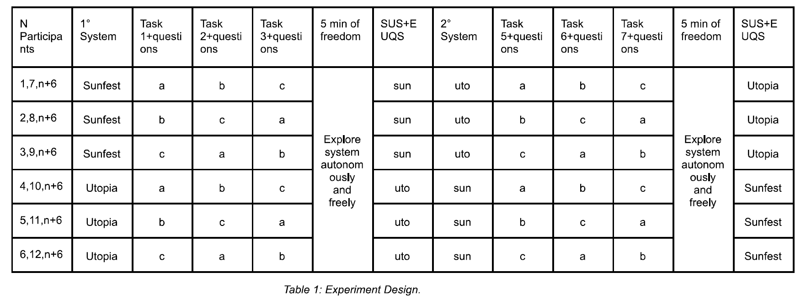
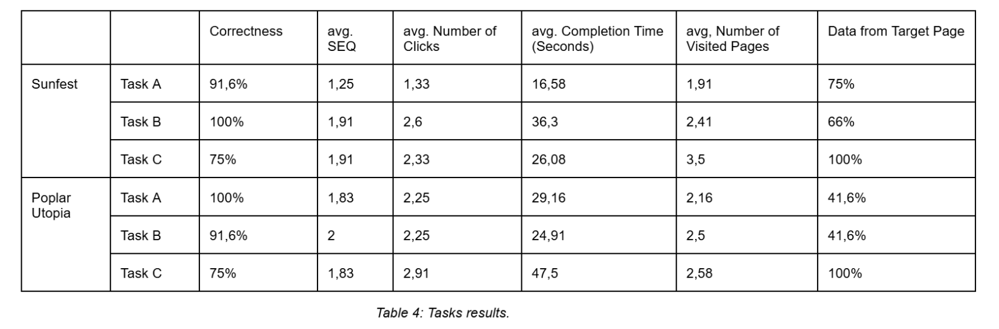

## Overview

- Usability and UX study comparing our **Sunfest25** Figma prototype with the live [Poplar Utopia website](https://poplarfestival.it/en/utopia).
- University project in my MSc in HCI, with Michele Cazzaro; the prototype is the one we designed for Sunfest ([see the built website](/sunfest25/)).
- 12 participants, within-subjects design, SEQ + SUS + UEQ-S.
- Headline: SUS 92.5 (Sunfest) vs 85.0 (Poplar), not significant (p = 0.233); Sunfest stronger on pragmatic quality, Poplar on hedonic quality.

## Why we tested

- A festival website must tell people what they need to attend: **lineup, program, FAQs**.
- Goal: check whether our design choices held up against an existing festival site, on both usability and user experience.

## Study design

- **Participants:** 12, convenience sampling, informed consent.
- **Within-subjects:** everyone used both sites → direct comparison, individual differences controlled, more power with a small sample.
- **Counterbalancing:** 6 order conditions (which site first × 3 rotated task orders), assigned in recruitment order, against learning and fatigue effects.
- **Tasks:**
	- A, lineup → is a given artist performing?
	- B, program → at what time does a given artist perform?
	- C, FAQs → a rules question with 3 possible answers, so the whole FAQ had to be read.
- **Session (~25 min, one progressive questionnaire):** consent + demographics → 3 tasks with SEQ → 5–7 min free exploration → SUS + UEQ-S → same on the second site → optional comments.
- **Why SUS + UEQ-S:** short, reliable, standard and benchmarkable; SUS covers perceived usability, UEQ-S adds pragmatic and hedonic qualities.
- **Why free exploration:** so ratings reflect the whole site, not just the task screens.
- **Task metrics:** correctness, time, clicks, pages visited, answer from the expected page or elsewhere, SEQ.

## Results

- Small sample → results are **exploratory**, read as trends.
- **SUS:** Sunfest 92.5 (median 95.0), tightly clustered; Poplar 85.0 (median 87.5), more spread and low outliers. Mann–Whitney U: not significant.
- **UEQ-S:** Sunfest overall 1.750, pragmatic 2.188, hedonic 1.313; Poplar overall 1.479, pragmatic 1.354, hedonic 1.604.
- **Task A (lineup):** Sunfest 91.7% correct, 16.6 s, 1.33 clicks, 75% from target page; Poplar 100%, 29.2 s, 2.25 clicks, 41.7% from target page.
- **Task B (program):** Sunfest 100%, 36.3 s, 2.6 clicks, 66.7% from target page; Poplar 91.7%, 24.9 s, 2.25 clicks, 41.7% from target page.
- **Task C (FAQs):** both 75% correct and 100% from target page; Sunfest 26.1 s, Poplar 47.5 s.
- **SEQ:** Wilcoxon signed-rank tests, no significant differences on any task.
- **Open feedback:** only 5 answers, too few to analyse.

## What the data suggests

- **Clarity vs emotion:** Sunfest leads on usability and pragmatic quality, Poplar on hedonic quality (likely its artistic identity). Both SUS scores are above 80, the top 10% of websites.
- **Likely reasons:** Poplar’s very dark, pure black theme and walls of text vs Sunfest’s light pastel colours and content split into smaller pieces.
- **Navigation:** Sunfest more consistent; simpler structure likely lowered cognitive load. Not faster everywhere: Poplar was quicker on the program task.
- **Poplar’s information architecture:** content is there, but the intended page was used only 41.7% of the time on lineup and program tasks.
- **FAQs are hard on both:** heavy reading, slow fact-finding → make them scannable, or add keyword search or contextual prompts.

## Limitations

- Convenience sample, demographically homogeneous.
- N = 12 → low power; no significance may mean low sensitivity, not equivalence.
- Lab setting: no real-world distractions, time pressure or mobile use.
- Researcher presence: possible social desirability bias or Hawthorne effects.
- Figma prototype: it worked, but it was not a real website, so the comparison with a live site has limits; no cross-device optimisation.

## Learnings and next steps

- Larger, more diverse sample.
- Test on mobile and on-site at events.
- Add qualitative methods (think-aloud, interviews) to the task metrics.
- A/B test alternative FAQ designs.
- Design direction: combine Sunfest’s pragmatic clarity with Poplar’s hedonic appeal.
