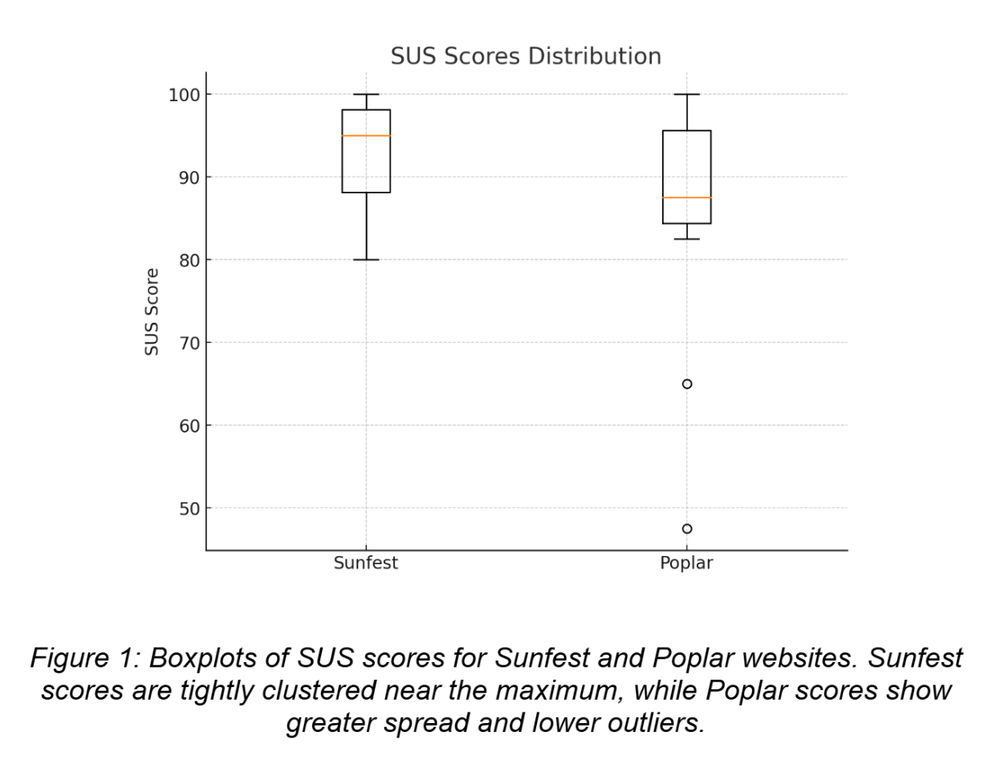

Dopo aver progettato con Michele Cazzaro il prototipo del sito del festival Sunfest25, volevamo capire se le nostre scelte di design reggevano, così lo abbiamo testato contro un concorrente reale, il [sito di Poplar Utopia](https://poplarfestival.it/en/utopia). Abbiamo condotto uno studio within-subjects di usabilità e user experience con 12 partecipanti: ognuno ha svolto tre task su ciascun sito (trovare un artista nella lineup, l’orario di un’esibizione nel programma e una risposta nelle FAQ), con ordini controbilanciati per limitare gli effetti di apprendimento. Abbiamo misurato correttezza, tempi, clic e pagine visitate, oltre alla SEQ dopo ogni task e a SUS e UEQ-S dopo ogni sito.

Entrambi i siti hanno ottenuto punteggi SUS alti (Sunfest 92,5, Poplar 85,0), con una differenza non statisticamente significativa dato il campione ridotto. Sunfest è risultato più forte sulla qualità pragmatica e ha offerto una navigazione più diretta e coerente, mentre Poplar ha prevalso sulla qualità edonica, anche se lì i partecipanti trovavano spesso le informazioni fuori dalla pagina prevista. Le FAQ sono state il task più difficile su entrambi i siti, segno che servono formati più facili da scorrere o dotati di ricerca. Con un campione piccolo e omogeneo, un contesto di laboratorio e un prototipo Figma, i risultati sono esplorativi, ma indicano una direzione chiara: unire la chiarezza di Sunfest al coinvolgimento emotivo di Poplar.

