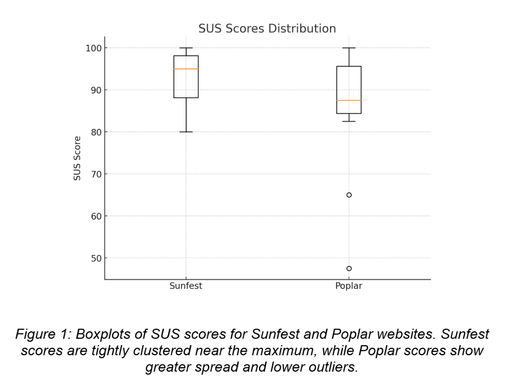

After designing the Sunfest25 festival website prototype with Michele Cazzaro, we wanted to see whether our design choices held up, so we tested it against a live competitor, the [Poplar Utopia website](https://poplarfestival.it/en/utopia). We ran a within-subjects usability and UX study with 12 participants: each completed three tasks on each site (finding an artist in the lineup, a performance time in the program and an answer in the FAQs), with counterbalanced orders to limit learning effects. We measured correctness, time, clicks and pages visited, plus SEQ after each task and SUS and UEQ-S after each site.

Both sites scored high on SUS (Sunfest 92.5, Poplar 85.0), a difference that was not statistically significant with our small sample. Sunfest was stronger on pragmatic quality and gave more consistent, direct navigation, while Poplar was stronger on hedonic quality, though participants there often found information away from the intended page. FAQs were the hardest task on both sites, which suggests they need more scannable or searchable formats. With a small, homogeneous sample, a lab setting and a Figma prototype, the results are exploratory, but they point to a clear direction: combining Sunfest’s clarity with Poplar’s emotional appeal.

