---
legend:
  "Il prototipo Sito live ↗": "Il prototipo"
---

## Panoramica

Sunfest25 è il sito di un nuovo festival di musica indie e pop a Rovereto. L’abbiamo progettato io e Michele Cazzaro per il corso di *Visual Design* della nostra laurea magistrale in *Human-Computer Interaction*, e ha ottenuto un voto finale di **30/30**.

La consegna era realizzare un **prototipo completamente funzionante** di un sito, simulando un processo di design completo: analisi dei competitor diretti e indiretti, interviste al cliente, user research e definizione delle personas, poi wireframe e mockup a bassa, media e alta fedeltà. Il corso ci chiedeva di bilanciare le esigenze degli stakeholder, le aspettative degli utenti e il contesto di mercato.

- **Team:** Michele Cazzaro e io. Abbiamo progettato il sito insieme e io ne ho prototipato più della metà in Figma; palette, tipografia e componenti UI descritti qui sotto sono lavoro mio.
- **Strumento:** Figma, per wireframe, mockup e prototipo interattivo.
- **In seguito:** ho ricostruito il design ad alta fedeltà in codice, quindi oggi esiste anche come [sito live](/sunfest25/).

## Il cliente e la richiesta

Il nostro cliente (fittizio) erano due giovani amici con un’idea ambiziosa: un festival tutto nuovo che unisse **musica, comunità e sostenibilità**.

Il festival sarebbe entrato nel settore italiano della musica e degli eventi dal vivo, un mercato molto competitivo in cui i format immersivi ed ecosostenibili sono sempre più richiesti.

- **Target:** 18–40 anni, a proprio agio con la tecnologia, socievoli, in cerca di esperienze culturali uniche.
- **Concept del festival:** un festival indie e pop nel Bosco della Città, un parco boscoso sopra Rovereto.
- **Posizionamento:** innovativo, attento all’ambiente e orientato alla comunità, con una forte presenza digitale e collaborazioni con le realtà locali.

Il cliente chiedeva un sito **moderno, coinvolgente e minimalista** che comunicasse:

- la lineup e il programma;
- la location e le informazioni sull’alloggio;
- il legame del festival con la natura.

**Obiettivo:** una piattaforma che crei entusiasmo, rafforzi la comunità e renda semplice organizzarsi per il festival.

## Analisi dei competitor

Abbiamo analizzato due competitor diretti e due indiretti, per capire cosa potesse imparare da loro un nuovo festival.

### Competitor diretti

- **Poplar Festival (Trento):** atmosfera rilassata, un pubblico di studenti molto affezionato e una lineup ben bilanciata. I punti di forza sono lo spirito di comunità e la location; il modello non profit e il limitato potenziale di crescita ne frenano la scalabilità.
- **Nameless Music Festival (Lecco):** il più grande evento EDM in Italia, con un’esperienza premium e grandi nomi internazionali. Costi alti, problemi di accessibilità e rigidità di genere mostrano quanto conti restare fedeli alle aspettative del pubblico.

**Insight:** la coerenza conta più di tutto. Lineup, design e comunicazione devono essere in linea con il target, altrimenti il festival smette di sembrare autentico.

### Competitor indiretti

- **Spotify:** il benchmark per personalizzazione e UX fluida, anche se i loop algoritmici rischiano di limitare la scoperta di nuova musica.
- **Wired Next Fest:** mostra come gli eventi culturali funzionino con esperienze concentrate, gratuite e trainate dal brand, ma anche quanto sia difficile farle crescere e adattarle.

**Insight:** un nuovo festival deve essere autentico e distinguersi per un motivo preciso. C’è spazio per quelli che puntano su generi poco rappresentati e su esperienze di comunità.

## Personas

Dato che il cliente era fittizio, anche la user research era simulata: partendo da una ricerca e un’analisi di mercato simulate, abbiamo definito tre personas che hanno guidato le nostre scelte di design.

### L’esploratrice social

Giulia, di Milano, sogna una fuga estiva in cui musica, amici e momenti da condividere sui social si incontrano. La frustrano i siti macchinosi, i sistemi di biglietteria confusi e la mancanza di modi semplici per condividere le informazioni online. Vuole un sito facile da usare e bello da vedere, che la aiuti a organizzarsi con gli amici, scoprire nuovi artisti e vivere esperienze che valga la pena condividere.

### L’organizzatore pragmatico

Marco, di Verona, affronta i festival puntando all’efficienza. Lo mettono in difficoltà gli orari poco chiari, le informazioni logistiche mancanti e i cambi dell’ultimo minuto. Per lui l’organizzazione viene prima di tutto: un sito chiaro e affidabile che gli faccia organizzare tutto senza stress, lo aiuti negli spostamenti e nel coordinarsi con il gruppo, e gli permetta di godersi la musica senza caos.

### La creativa consapevole

Lara, di Rovereto, cerca ispirazione e autenticità negli eventi locali e sostenibili. Si sente frustrata quando i valori ecologici non vengono comunicati chiaramente, o quando i festival sembrano troppo commerciali e affollati. Vuole sostenere la cultura locale, conoscere persone affini e godersi un festival ben organizzato che metta insieme musica, natura e creatività.

## Value proposition

***Un’esperienza musicale indimenticabile nella natura***

Un festival indie e pop di più giorni nei boschi vicino a Rovereto, in Trentino. Con artisti italiani e internazionali, natura selvaggia e un impegno concreto per la sostenibilità, Sunfest non è solo musica: è evasione, comunità e avventura.

Cosa lo rende unico:

- **Musica e natura:** live in un contesto naturale, lontano dal caos della città.
- **Lineup indie e pop curata:** un mix equilibrato di nuovi talenti indie e nomi pop affermati.
- **Sostenibile ed ecologico:** pratiche green, riduzione dei rifiuti e collaborazioni locali.
- **Oltre la musica:** installazioni artistiche, workshop, spazi benessere e attività all’aperto.
- **Spirito di comunità:** un’esperienza collettiva pensata per connettere le persone e condividere momenti indimenticabili.

## Architettura dell’informazione e navigazione

Il sito ha una **struttura a due livelli**, pensata per essere chiara e scorrevole:

- **Homepage:** il punto d’ingresso, con sette card visive che riassumono le sezioni principali e vi rimandano.
- **Sezioni principali:**
	- *Line-up:* profili degli artisti, dettagli della lineup e link diretto al programma.
	- *Program:* programma giorno per giorno, con link a lineup e location.
	- *Location:* mappa del festival, stand e attività; link a programma, FAQ e alloggi.
	- *Accommodation:* opzioni di alloggio in zona, con link a location e FAQ.
	- *FAQs:* informazioni pratiche, con link rapidi ad alloggi, location e programma.
	- *Voluntary:* i contatti degli organizzatori e un form per entrare nel gruppo dei volontari.
	- *About Us:* la storia dei fondatori (raggiungibile solo dal footer).

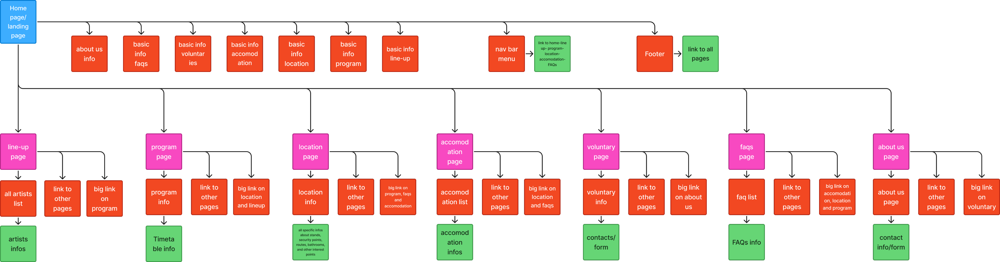

Prima di passare all’alta fedeltà, ogni pagina è stata abbozzata come wireframe a bassa fedeltà, per metterci d’accordo su contenuti e ordine prima di pensare all’aspetto visivo:

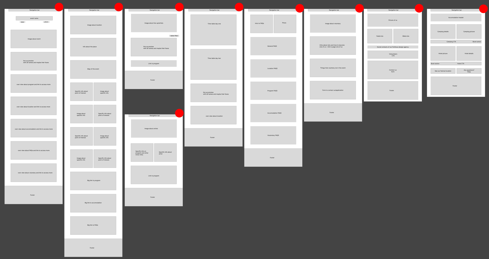

Tre sistemi di navigazione lavorano insieme:

- **Barra in alto:** sempre visibile, con i link a lineup, programma, location, alloggi e FAQ.
- **Collegamenti tra pagine:** card tematiche e pulsanti contestuali collegano i contenuti correlati.
- **Footer:** mappa completa del sito, contatti, social e il payoff del festival, “Embrace Nature, Party Hard.”

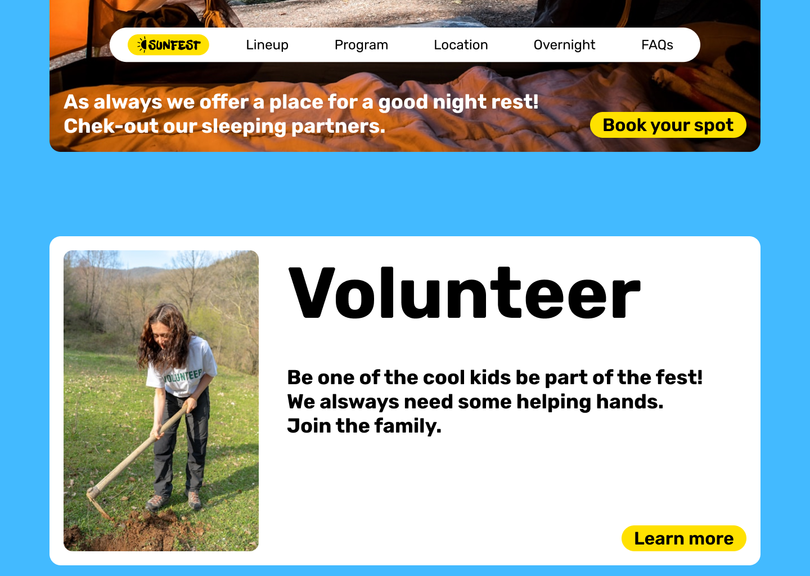

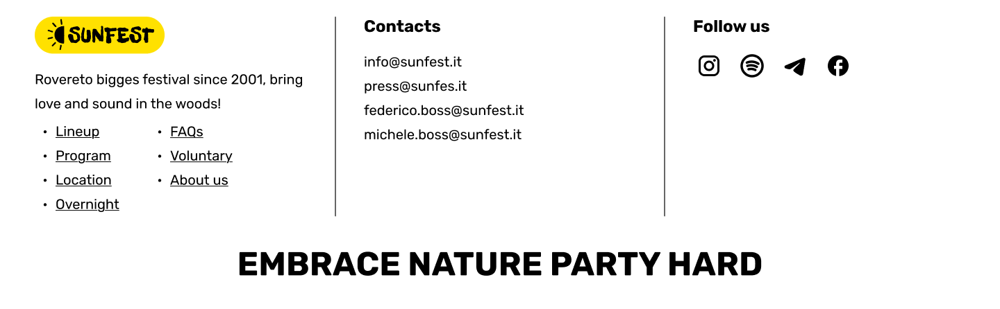

## Palette e tipografia

### Palette di colori

Volevo un’identità visiva organica come il festival. Il Bosco della Città è un parco con zone di bosco fitto e radure piene di fiori, e proprio quell’ambiente è diventato il punto di partenza.

Ho usato come moodboard naturale la foto di un prato in fiore: ne ho estratto i colori di base e li ho rifiniti in una **palette pastello** armoniosa. La palette doveva tenere insieme le due anime del festival: energica, ma radicata nella natura.

- **Azzurro cielo e blu notte:** la libertà del giorno e l’energia della notte.
- **Verde pino:** un richiamo ai boschi tutt’intorno.
- **Lilla, arancione e celeste:** ispirati ai fiori di campo, per note giocose ed espressive.
- **Marrone terra:** radici, suolo e legame con il territorio.
- **Giallo sole:** il colore simbolo del festival, legato al suo nome, Sunfest.
- **Bianco e nero:** riservati alla tipografia e alla UI funzionale, per leggibilità e contrasto.

**Scelta:** ogni sezione del sito ha un colore di sfondo dominante preso dalla palette. Così le pagine sono riconoscibili e l’utente sa sempre dove si trova. In più la navigazione resta leggera e in linea con i valori del festival: natura, positività e comunità.

### Tipografia

Ho scelto un **sistema a due font** con ruoli ben distinti, per dare carattere al sito e mantenerlo leggibile.

- **Freckle Face** per logo, titoli (190px) e testi dei pulsanti (24px). Le sue forme giocose, quasi disegnate a mano, evocano la spontaneità di un festival estivo. Proprio perché ha una personalità così forte, l’ho limitato a questi pochi punti.
- **Rubik** come font principale: pulito e facile da leggere su ogni dispositivo, quindi l’ho usato per testi, descrizioni e navigazione.

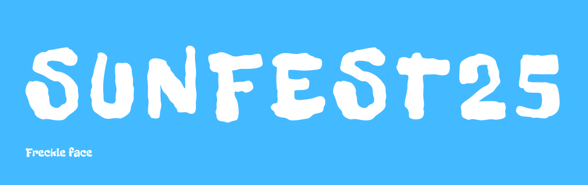

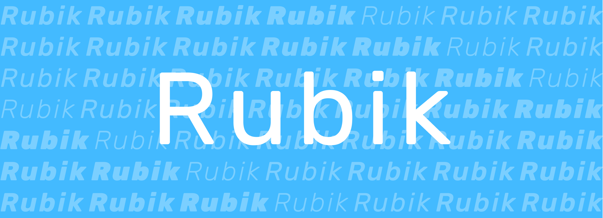

Questa combinazione dà al sito due voci: Freckle Face attira l’attenzione, Rubik spiega.

## Componenti UI

I componenti UI seguono la stessa idea: giocosi, ma chiari.

### Pulsanti

I pulsanti funzionano anche da segnali visivi: fanno capire dove porta un clic. Ho progettato **quattro tipi di pulsante**, ognuno con almeno due stati (default e hover) per dare un senso di feedback nel prototipo. Nell’immagine qui sotto, partendo dall’alto a sinistra: pulsanti a icona, pulsanti della barra in alto, pulsanti “normali” e i “big button” usati in fondo a ogni pagina.

- In hover usano **colori e icone contestuali** che anticipano la destinazione.
- Queste piccole animazioni servono a rendere la navigazione più intuitiva e a ridurre il carico cognitivo.

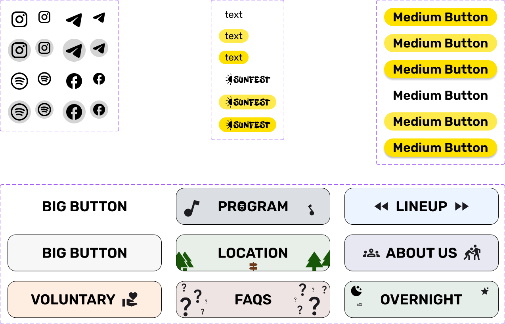

### Overlay

Tre overlay gestiscono le interazioni legate al contesto:

- i dettagli dell’artista, che si aprono al clic;
- il form per i volontari, accessibile senza perdere il contesto della pagina;
- un messaggio di ringraziamento dopo l’invio del form.

**Perché gli overlay:** tengono l’utente sulla pagina in cui si trovava, invece di mandarlo in sottopagine separate.

### Card

Le card sono l’elemento base del design system: contenitori modulari che possono cambiare aspetto mantenendo la stessa struttura.

- Le **card degli artisti** mostrano nomi e immagini e si possono scorrere.
- Le **card delle FAQ** si aprono e si chiudono, così anche tante informazioni restano facili da consultare.
- Le **card informative** danno una panoramica rapida e hanno sempre un link di navigazione.

Usare le card ovunque ha dato ritmo al sito: ogni sezione ha un aspetto diverso, ma funzionano tutte allo stesso modo.

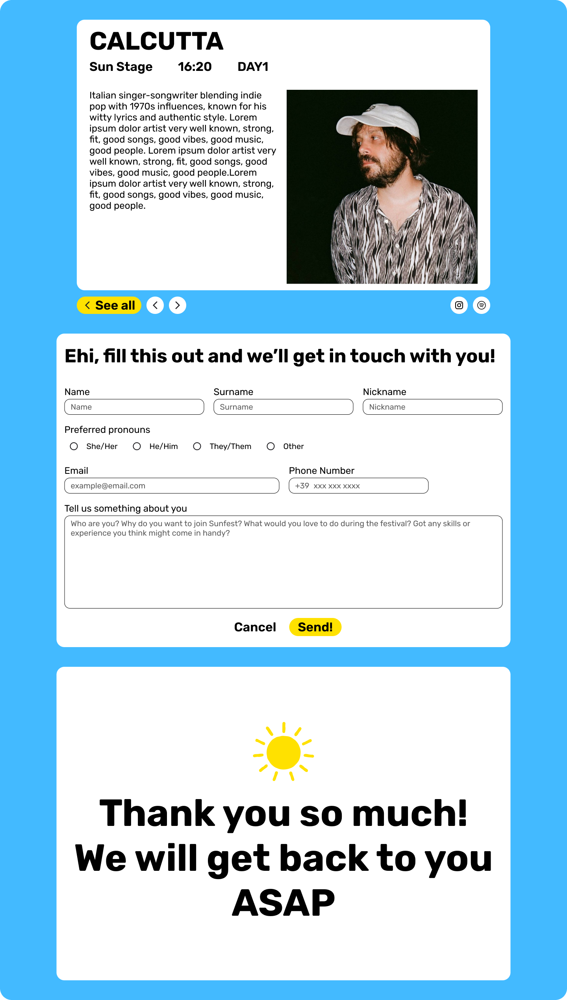
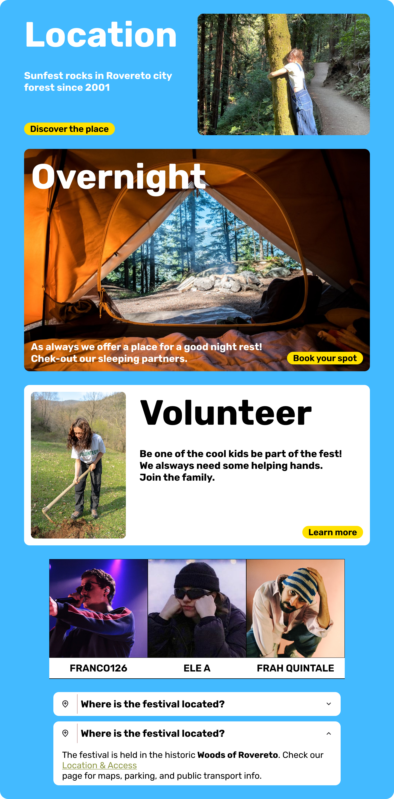

## Il prototipo <a class="heading-chip" href="/sunfest25/">Sito live ↗</a>

Il risultato è un **prototipo Figma completamente funzionante**. Nel progetto Figma trovi anche i mockup a bassa e media fedeltà.

- [Apri il file del progetto Figma](https://www.figma.com/design/sW5x8acKNC5OfuF2UhqMhs/Sunfest25?node-id=0-1&t=ESi4uiTpNxywADT3-1)
- [Prova il prototipo](https://www.figma.com/proto/sW5x8acKNC5OfuF2UhqMhs/Sunfest25?node-id=426-10150&t=ESi4uiTpNxywADT3-1&starting-point-node-id=426%3A10150&scaling=scale-down-width&content-scaling=fixed) (premi “z” per adattarlo allo schermo)

**Ora è anche un sito vero:** in seguito ho ricostruito in codice il design ad alta fedeltà, quindi puoi [navigare Sunfest25 come sito live](/sunfest25/). Funziona anche da telefono: l’overlay della lineup, il cambio di giorno nel programma e le FAQ sono tutti interattivi.

## Cosa è venuto dopo

Volevamo un sito abbastanza giocoso da creare entusiasmo e comunità e abbastanza chiaro da rendere facile organizzarsi, senza perdere di vista i valori ecologici del festival.

Per verificare se funzionasse, abbiamo poi condotto uno **studio di usabilità che confronta Sunfest25 con il sito di Poplar Utopia** (12 partecipanti, within-subjects). Sunfest ha ottenuto un punteggio SUS più alto (92,5 contro 85, una differenza non statisticamente significativa con questo campione) e una qualità pragmatica migliore, mentre Poplar ha ottenuto risultati migliori sulla qualità edonica. Su entrambi i siti i partecipanti hanno avuto difficoltà con le FAQ, e questo indica un prossimo passo chiaro: una sezione FAQ più facile da scorrere o con una ricerca. Lo studio completo è nel case study correlato qui sotto.

## Galleria del prototipo

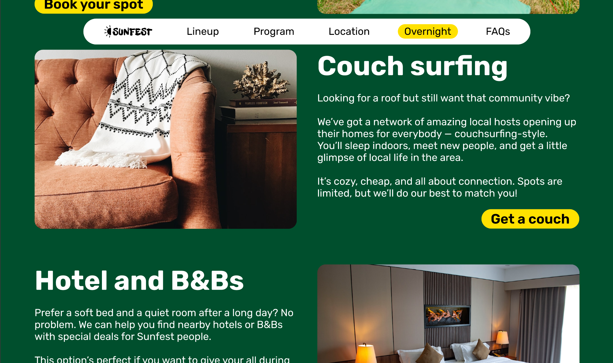
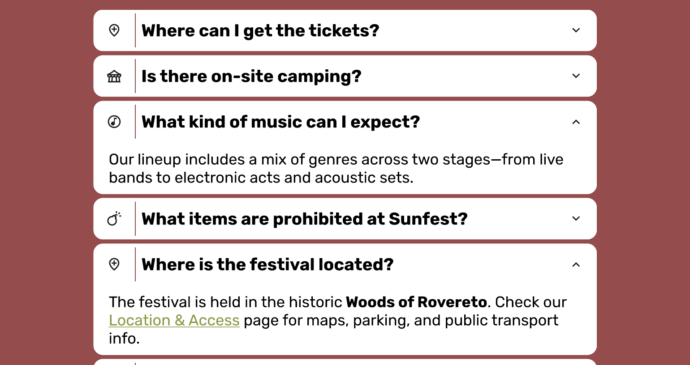
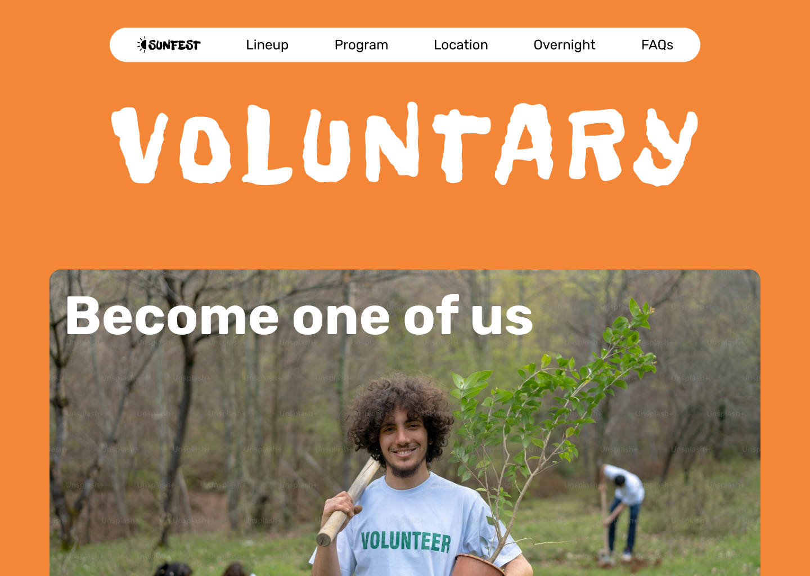
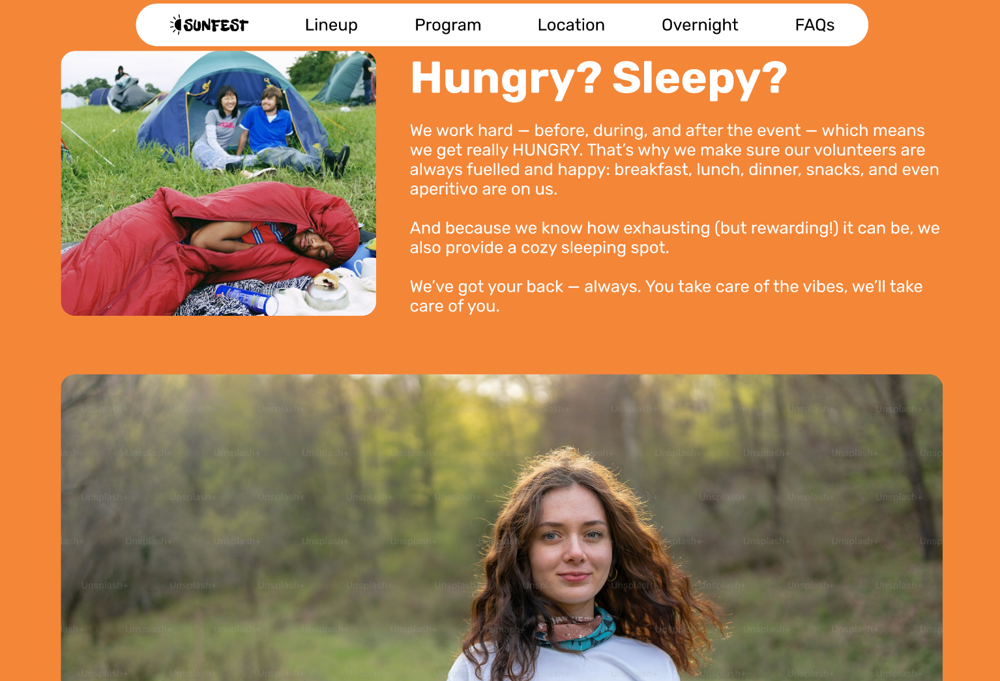

