---
legend:
  "The prototype Live website ↗": "The prototype"
---

## Overview

Sunfest25 is the website of a new indie and pop music festival in Rovereto, Italy. Michele Cazzaro and I designed it for the *Visual Design* course of our Master’s in *Human-Computer Interaction*, and it received a final grade of **30/30**.

The assignment was to deliver a **fully functioning prototype** of a website by simulating a complete design process: direct and indirect competitor analysis, client interviews, user research and persona development, then wireframes and mockups at low, medium and high fidelity. The course pushed us to balance stakeholder needs, user expectations and market context.

- **Team:** Michele Cazzaro and me. We co-designed the site and I prototyped more than half of it in Figma; the colour palette, typography and UI components described below are my work.
- **Tool:** Figma, for wireframes, mockups and the interactive prototype.
- **Afterwards:** I rebuilt the high-fidelity design in code, so it now also exists as a [live website](/sunfest25/).

## The client and the brief

Our (fictional) client was a duo of young friends with a bold idea: a brand-new festival that blends **music, community and sustainability**.

The festival would enter the Italian music and live events sector, a highly competitive market where immersive and eco-friendly formats are increasingly in demand.

- **Target audience:** 18–40 years old, tech-savvy, social, looking for unique cultural experiences.
- **Festival concept:** an indie and pop festival in the Bosco della Città, a wooded park above Rovereto.
- **Positioning:** innovative, environmentally conscious and community-driven, with a strong digital presence and collaborations with local businesses.

The client asked for a **modern, engaging and minimalist** website that communicates:

- the lineup and the program;
- the location and accommodation details;
- the festival’s connection to nature.

**Goal:** a platform that generates excitement, strengthens the community and makes it easy to plan the festival.

## Competitor analysis

We looked at two direct and two indirect competitors to understand what a new festival could learn from them.

### Direct competitors

- **Poplar Festival (Trento):** relaxed vibe, strong student following and a well-balanced lineup. Its community spirit and location are its strengths; its nonprofit model and limited growth potential restrict scalability.
- **Nameless Music Festival (Lecco):** Italy’s largest EDM event, with a premium experience and major international acts. High costs, accessibility issues and genre rigidity show how important it is to stay true to audience expectations.

**Insight:** consistency matters most. Lineup, design and communication all have to fit the target audience, or the festival stops feeling authentic.

### Indirect competitors

- **Spotify:** the benchmark for personalization and smooth UX, though algorithmic loops can limit discovery.
- **Wired Next Fest:** shows how cultural events succeed with concentrated, free, brand-driven experiences, and the challenges of scaling and adapting them.

**Insight:** a new festival has to be authentic and different for a reason. There is room for ones that focus on underrepresented genres and community-based experiences.

## Personas

Since the client was fictional, the user research was simulated too: based on mock research and a mock market analysis, we defined three personas that guided our design decisions.

### The social explorer

Giulia, from Milan, dreams of a summer escape where music, friends and social media moments come together. She is frustrated by clunky websites, confusing ticketing and the lack of easy ways to share details online. She wants a site that is easy to use and nice to look at, and that helps her plan with friends, discover new artists and capture experiences worth sharing.

### The pragmatic planner

Marco, from Verona, approaches festivals with efficiency in mind. His pain points are unclear schedules, missing logistical information and last-minute changes. He values organization above all: a clear, reliable website that makes planning stress-free, supports travel and group coordination, and lets him enjoy the music without chaos.

### The mindful creative

Lara, from Rovereto, looks for inspiration and authenticity in local, sustainable events. She gets frustrated when eco-friendly values aren’t communicated clearly, or when festivals feel over-commercialized and crowded. She wants to support local culture, connect with like-minded people and enjoy a well-organized festival that brings together music, nature and creativity.

## Value proposition

***An unforgettable music experience in nature***

A multi-day indie and pop festival in the woods near Rovereto, Trentino. With Italian and international artists, wild nature and a concrete commitment to sustainability, Sunfest is not just about music: it’s about escape, community and adventure.

What makes it unique:

- **Music & nature:** live sets in a natural setting, far from the chaos of the city.
- **Curated indie & pop lineup:** a balanced mix of new indie talent and established pop names.
- **Sustainable & eco-friendly:** green practices, waste reduction and local collaborations.
- **Beyond the music:** art installations, workshops, wellness spaces and outdoor activities.
- **Community vibe:** a collective experience designed to connect people and share unforgettable moments.

## Information architecture and navigation

The website follows a **two-layer structure**, designed for clarity and flow:

- **Homepage:** the entry point, with seven visual cards that summarize and link to the main sections.
- **Main sections:**
	- *Line-up:* artist profiles, lineup details and a direct link to the program.
	- *Program:* day-by-day schedule, with links to the lineup and the location.
	- *Location:* festival map, stands and activities; links to program, FAQs and accommodation.
	- *Accommodation:* local stay options, with links to location and FAQs.
	- *FAQs:* practical info, with quick links to accommodation, location and program.
	- *Voluntary:* the organizers’ details and a form to join the volunteer group.
	- *About Us:* the founders’ story (reachable from the footer only).

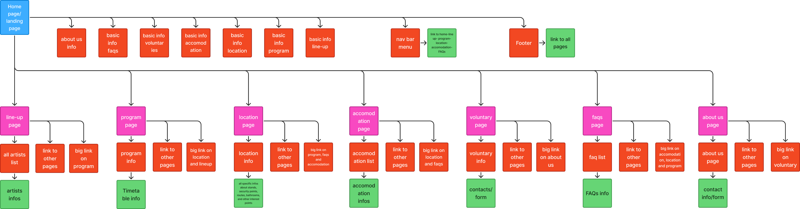

Before moving to high fidelity, every page was sketched as a low-fidelity wireframe, to agree on content and order before thinking about visuals:

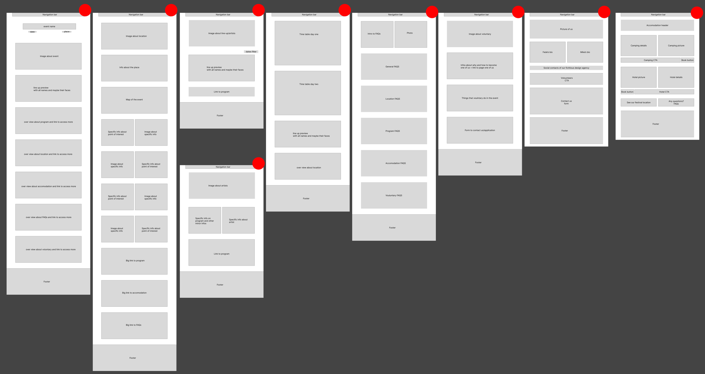

Three navigation systems work together:

- **Top bar:** always visible, with links to lineup, program, location, accommodation and FAQs.
- **Page-to-page links:** thematic cards and contextual buttons connect related content.
- **Footer:** full sitemap, contact info, social links and the festival payoff, “Embrace Nature, Party Hard.”

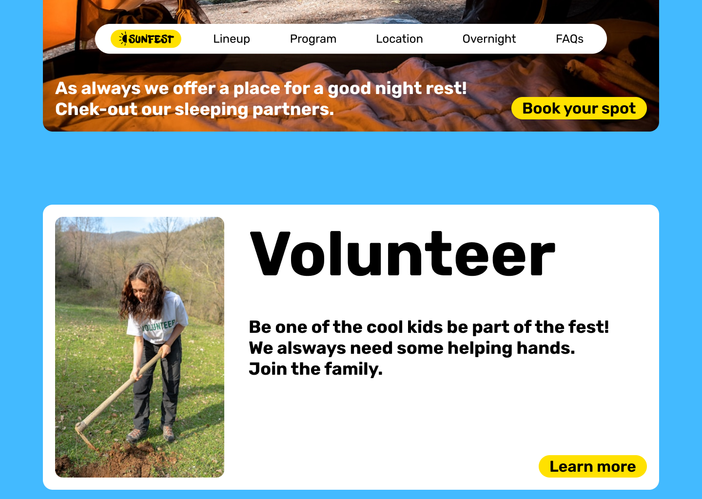

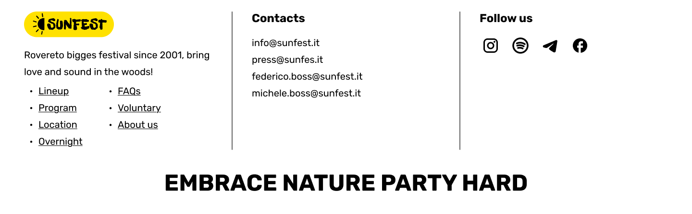

## Palette and typography

### Colour palette

I wanted the visual identity to feel as organic as the festival itself. The Bosco della Città is a wooded park with both dense forest and flower-filled clearings, so that setting became the starting point.

I used a photograph of a meadow in bloom as a natural moodboard: I extracted the base colours from it and refined them into a harmonized **pastel palette**. The palette had to hold both sides of the festival: energetic, but rooted in nature.

- **Sky blue and night blue:** daytime freedom and night-time energy.
- **Pine green:** a nod to the surrounding woods.
- **Lilac, orange and light blue:** inspired by wildflowers, for playful, expressive notes.
- **Earthy brown:** roots, soil and connection to the land.
- **Sun yellow:** the festival’s symbolic colour, tied to its name, Sunfest.
- **Black and white:** reserved for typography and functional UI, for readability and contrast.

**Decision:** each section of the website has one dominant background colour from the palette. This makes pages distinct and gives users a sense of where they are. It also keeps browsing light and fits the festival’s values: nature, positivity and community.

### Typography

I chose a **two-font system** with very distinct roles, to give the site character and keep it readable.

- **Freckle Face** for the logo, titles (190px) and button labels (24px). Its playful, almost hand-drawn shapes evoke the spontaneity of a summer festival. Because its personality is so strong, I limited it to these few places.
- **Rubik** as the main font: clean and easy to read across devices, so I used it for body text, descriptions and navigation.

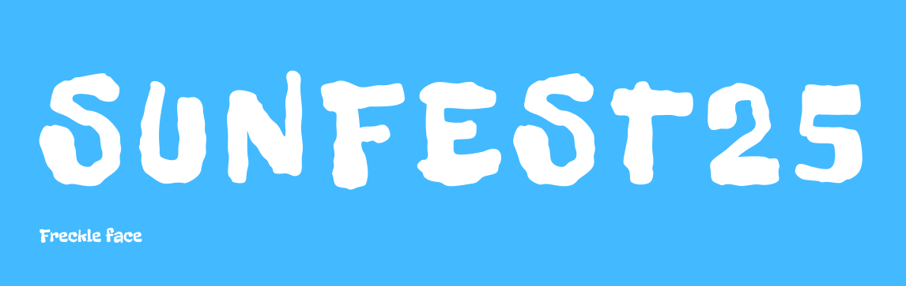

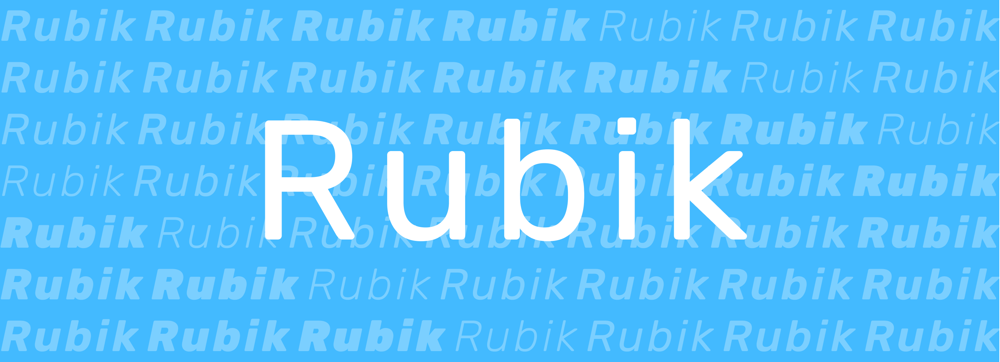

The pairing gives the site two voices: Freckle Face gets attention, Rubik does the explaining.

## UI components

The UI components follow the same idea: playful, but clear.

### Buttons

Buttons also work as visual cues for where a click will take you. I designed **four button types**, each with at least two states (default and hover) to give a sense of feedback in the prototype. In the image below, from the top left: icon buttons, top bar buttons, “normal” buttons and the “big buttons” used at the bottom of each page.

- On hover, they use **contextual colours and icons** that hint at the next destination.
- These small animations are meant to make navigation more intuitive and reduce cognitive load.

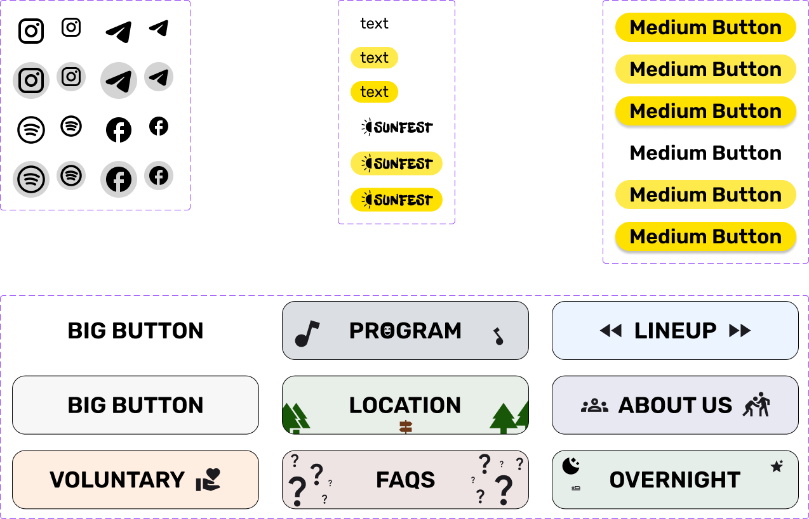

### Overlays

Three overlays handle context-sensitive interactions:

- artist details, opened on click;
- the volunteer form, reachable without losing the page context;
- a “thank you” message after the form is submitted.

**Why overlays:** they keep users on the page they were on instead of sending them to separate subpages.

### Cards

Cards are the main building block of the design system: modular containers that can look different while keeping the same structure.

- **Artist cards** show names and images and can be scrolled through.
- **FAQ cards** open and close, so a lot of information stays digestible.
- **Information cards** give quick overviews and always come with navigation links.

Using cards everywhere gave the website a rhythm: each section looks different, but they all work in the same way.

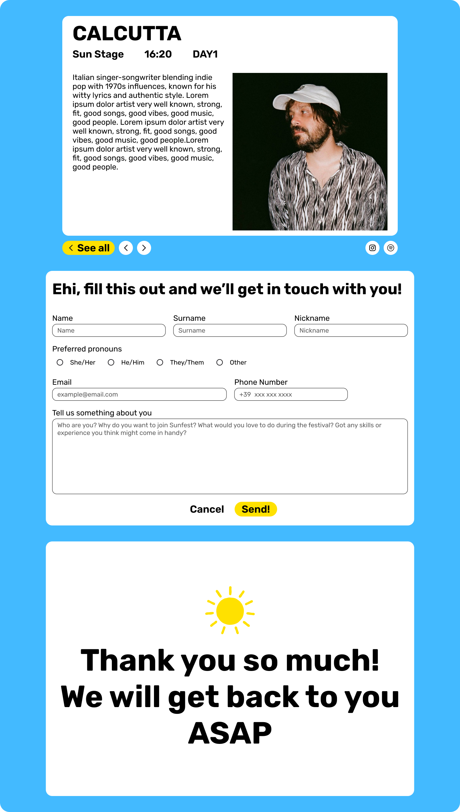
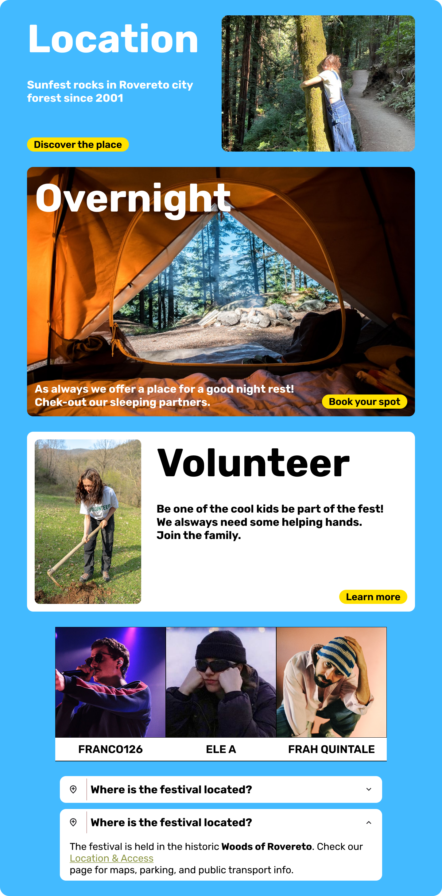

## The prototype <a class="heading-chip" href="/sunfest25/">Live website ↗</a>

The result is a **fully functioning Figma prototype**. In the Figma project you can also find the low and medium-fidelity mockups.

- [Open the Figma project file](https://www.figma.com/design/sW5x8acKNC5OfuF2UhqMhs/Sunfest25?node-id=0-1&t=ESi4uiTpNxywADT3-1)
- [Try the prototype](https://www.figma.com/proto/sW5x8acKNC5OfuF2UhqMhs/Sunfest25?node-id=426-10150&t=ESi4uiTpNxywADT3-1&starting-point-node-id=426%3A10150&scaling=scale-down-width&content-scaling=fixed) (press “z” to fit your screen)

**Now also a real website:** I later rebuilt the high-fidelity design in code, so you can [browse Sunfest25 as a live website](/sunfest25/). It works on phones too: the lineup overlay, the day switch in the program and the FAQs are all interactive.

## What came next

We wanted the site to be playful enough to build excitement and community, and clear enough to make planning easy, while staying true to the festival’s eco-conscious values.

To check whether it worked, we then ran a **usability study comparing Sunfest25 with the Poplar Utopia website** (12 participants, within-subjects). Sunfest scored higher on SUS (92.5 vs. 85, a difference that was not statistically significant with this sample) and on pragmatic quality, while Poplar scored higher on hedonic quality. Participants struggled with the FAQs on both sites, which points to a clear next step: a more scannable or searchable FAQ section. The full study is in the related case study below.

## Prototype gallery

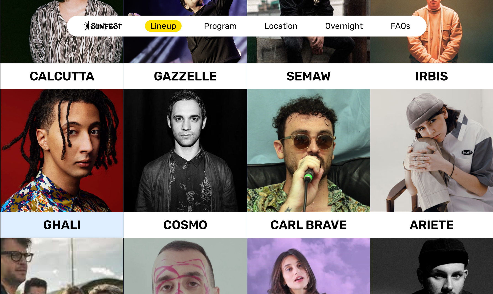

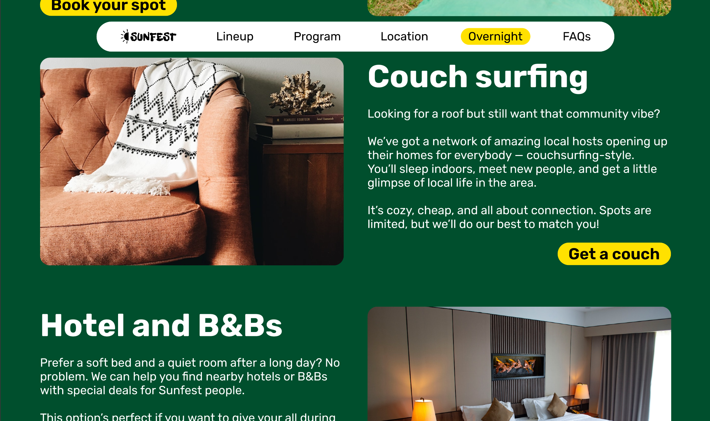
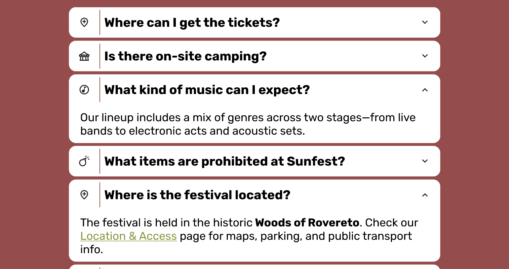
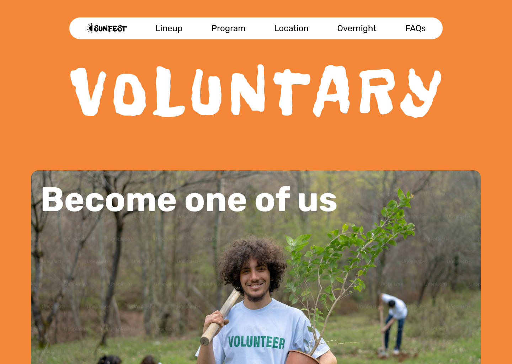
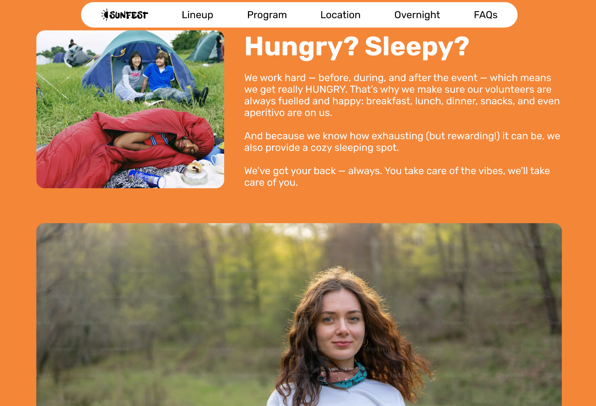

