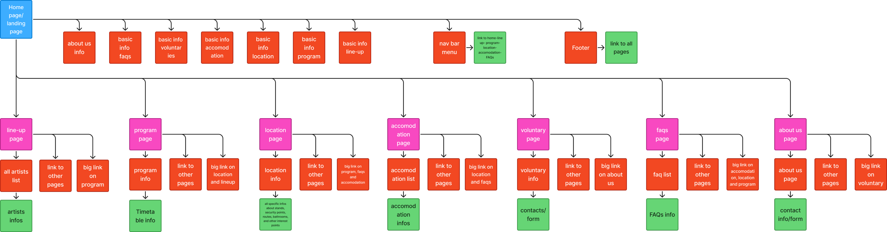
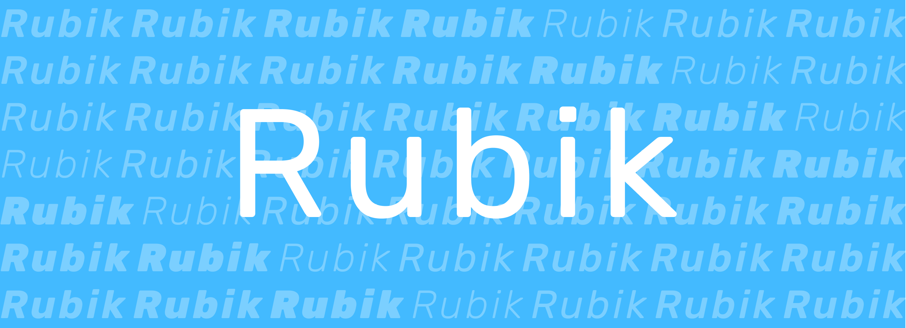
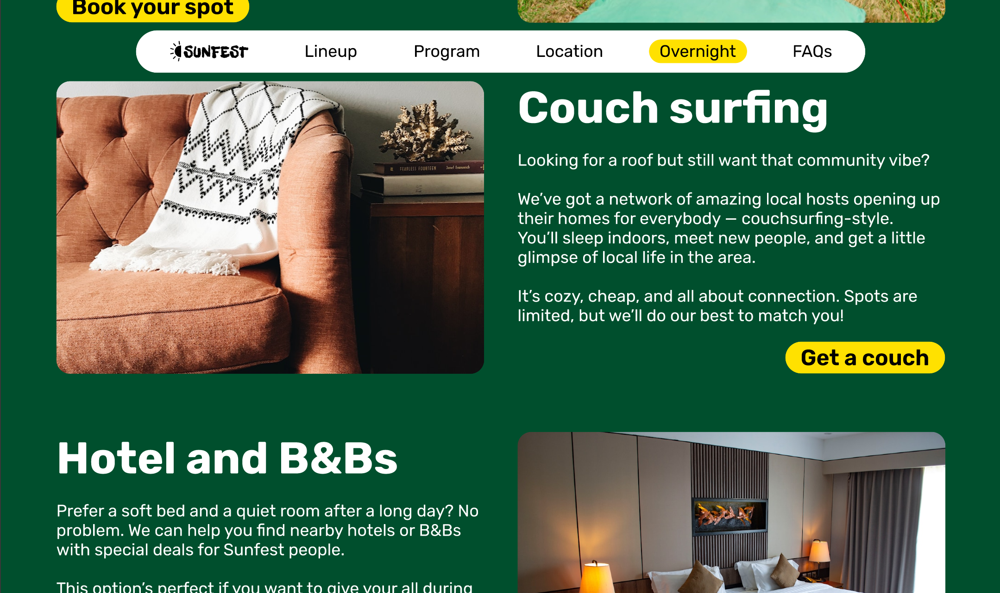
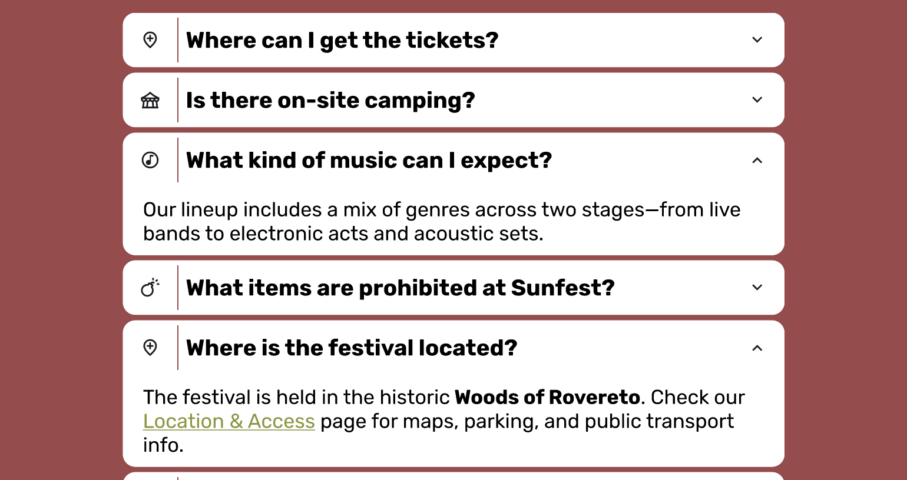
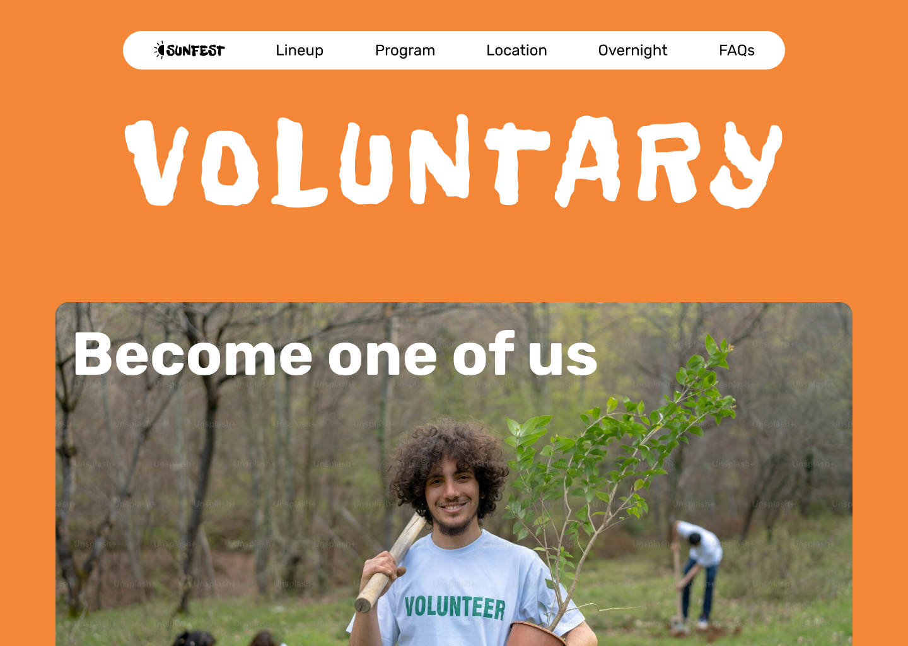
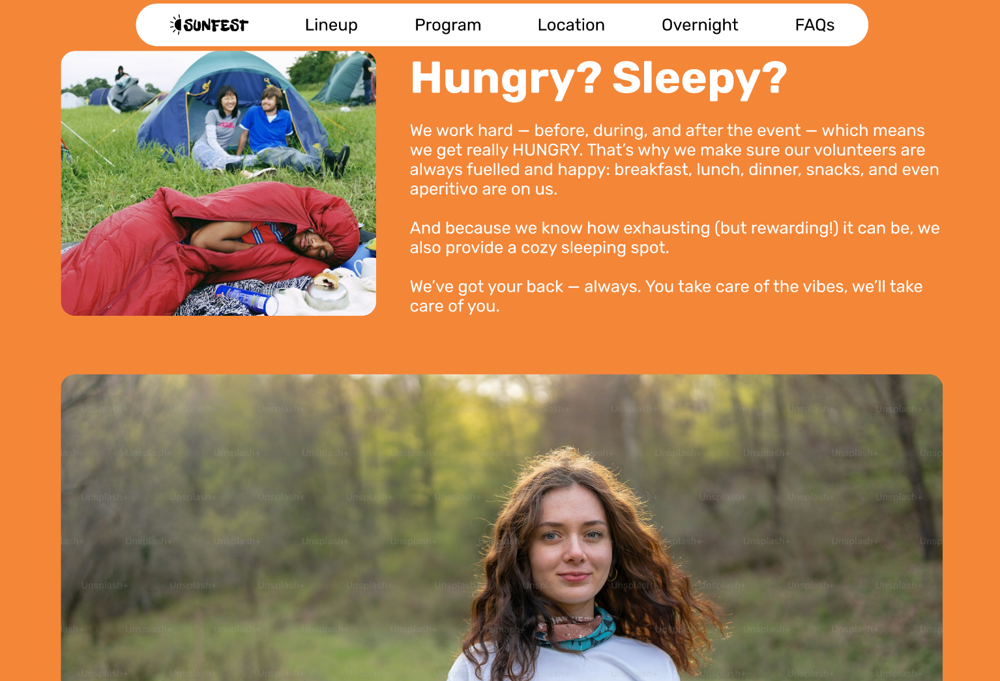

---
legend:
  "Il prototipo Sito live ↗": "Il prototipo"
---

## Panoramica

- **Cosa:** sito e prototipo Figma completamente funzionante di Sunfest25, un nuovo festival di musica indie e pop nel Bosco della Città di Rovereto.
- **Contesto:** corso di *Visual Design*, laurea magistrale in Human-Computer Interaction.
- **Team:** Michele Cazzaro e io; abbiamo progettato il sito insieme, io ne ho prototipato più della metà in Figma, e palette, tipografia e componenti UI sono lavoro mio.
- **Processo:** analisi dei competitor, ricerca simulata su cliente e utenti, personas, wireframe e mockup a bassa → media → alta fedeltà.
- **Risultato:** voto finale **30/30**; in seguito ricostruito in codice come [sito live](/sunfest25/).

## Il cliente e la richiesta

- **Cliente (fittizio):** due giovani fondatori che vogliono un festival che unisca musica, comunità e sostenibilità.
- **Target:** 18–40 anni, socievoli, a proprio agio con la tecnologia, in cerca di esperienze culturali all’aperto fuori dal comune.
- **Richiesta:** un sito moderno, coinvolgente e minimalista che comunichi lineup, programma, location, alloggi e valori ecologici.
- **Obiettivo:** creare entusiasmo, rafforzare la comunità, rendere semplice organizzarsi.

## Analisi dei competitor

- **Poplar Festival (Trento):** forte spirito di comunità, scalabilità limitata.
- **Nameless Music Festival (Lecco):** EDM premium con grandi nomi, ma costoso e rigido.
- **Indiretti:** Spotify (personalizzazione), Wired Next Fest (richiamo culturale trainato dal brand).
- **Insight:** un festival deve restare autentico e coerente con il suo pubblico; c’è spazio per festival basati su comunità e generi poco rappresentati.

## Personas

Tre personas, basate su una ricerca e un’analisi di mercato simulate:

- **Giulia, l’esploratrice social:** vuole organizzarsi facilmente con gli amici e vivere momenti da condividere.
- **Marco, l’organizzatore pragmatico:** cerca orari chiari, informazioni affidabili e logistica semplice.
- **Lara, la creativa consapevole:** cerca autenticità, valori ecologici e comunità locale.

## Value proposition

***“Un’esperienza musicale indimenticabile nella natura.”***

- Musica e natura intrecciate in un parco nel bosco.
- Lineup indie e pop che bilancia nomi nuovi e affermati.
- Pratiche ecologiche e collaborazioni locali.
- Oltre la musica: workshop, arte, benessere, attività all’aperto.
- Un’atmosfera che mette la comunità al primo posto.

## Architettura dell’informazione e navigazione

- **Due livelli:** homepage → 7 sezioni principali (Line-up, Program, Location, Accommodation, FAQs, Voluntary, About Us).
- **Prima i wireframe a bassa fedeltà,** per decidere contenuti e ordine prima dell’aspetto visivo.
- **Tre sistemi di navigazione:**
	- barra in alto sempre visibile per le sezioni principali;
	- card e pulsanti contestuali per muoversi tra le pagine;
	- footer con mappa del sito, contatti, social e il payoff “Embrace Nature, Party Hard.”

## Palette e tipografia

- **Palette:** toni pastello estratti dalla foto di un prato in fiore, più bianco e nero per testi e UI funzionale.
- **Un colore dominante per sezione,** così le pagine sono riconoscibili e l’utente si orienta.
- **Freckle Face:** font d’accento giocoso, limitato a logo, titoli e testi dei pulsanti.
- **Rubik:** font pulito e versatile per testi e navigazione.

## Componenti UI

- **Pulsanti:** 4 tipi, ognuno con stato default e hover; colori e icone contestuali anticipano la destinazione.
- **Overlay:** dettagli dell’artista, form per i volontari e messaggio di ringraziamento, per tenere l’utente nel flusso principale invece di mandarlo in sottopagine.
- **Card:** un sistema modulare per artisti, FAQ (aperte/chiuse) e informazioni, che dà al sito un ritmo coerente.

## Il prototipo <a class="heading-chip" href="/sunfest25/">Sito live ↗</a>

- [File del progetto Figma](https://www.figma.com/design/sW5x8acKNC5OfuF2UhqMhs/Sunfest25?node-id=0-1&t=ESi4uiTpNxywADT3-1), con anche i mockup a bassa e media fedeltà.
- [Prototipo interattivo](https://www.figma.com/proto/sW5x8acKNC5OfuF2UhqMhs/Sunfest25?node-id=426-10150&t=ESi4uiTpNxywADT3-1&starting-point-node-id=426%3A10150&scaling=scale-down-width&content-scaling=fixed) (premi “z” per adattarlo allo schermo).
- **Ora è anche un sito vero:** in seguito ho ricostruito in codice il design ad alta fedeltà, quindi puoi [navigare Sunfest25 come sito live](/sunfest25/). Funziona anche da telefono: l’overlay della lineup, il cambio di giorno nel programma e le FAQ sono tutti interattivi.

## Cosa è venuto dopo

- Il design prova a essere giocoso e chiaro allo stesso tempo, in linea con i valori ecologici del festival.
- **Studio di usabilità successivo** a confronto con il sito di Poplar Utopia (12 partecipanti): Sunfest ha ottenuto un punteggio SUS più alto (92,5 contro 85, differenza non statisticamente significativa) e una qualità pragmatica migliore; Poplar è andato meglio sulla qualità edonica.
- **Prossimo passo:** su entrambi i siti i partecipanti hanno avuto difficoltà con le FAQ, quindi la sezione FAQ andrebbe resa più facile da scorrere o dotata di ricerca. Lo studio completo è nel case study correlato qui sotto.

## Galleria del prototipo

