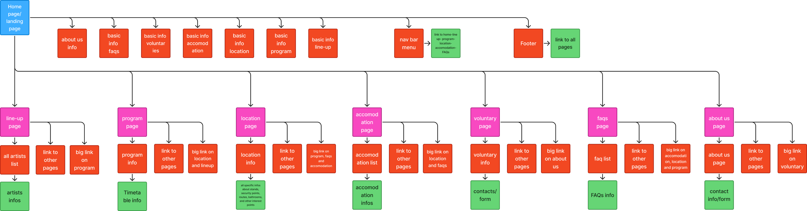
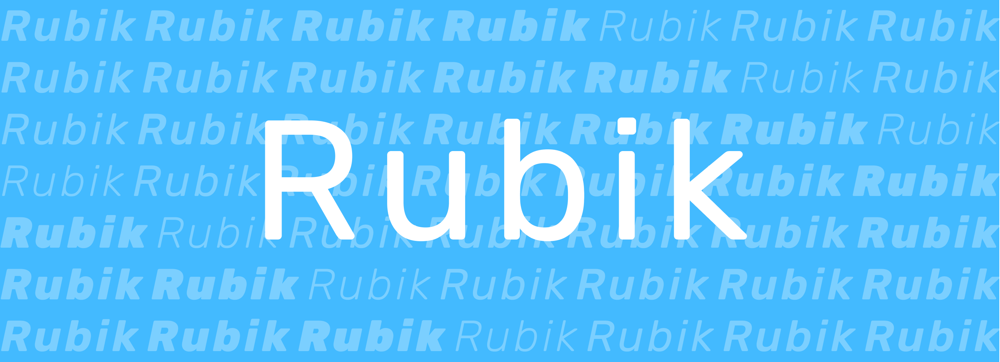
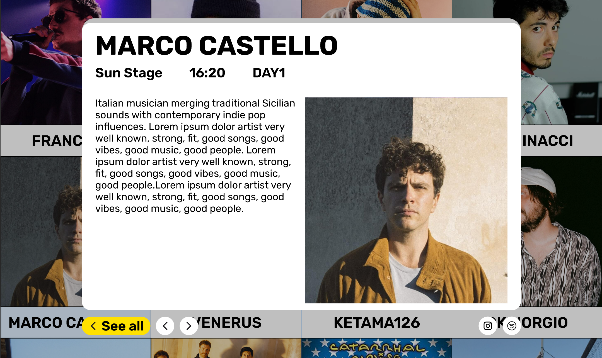
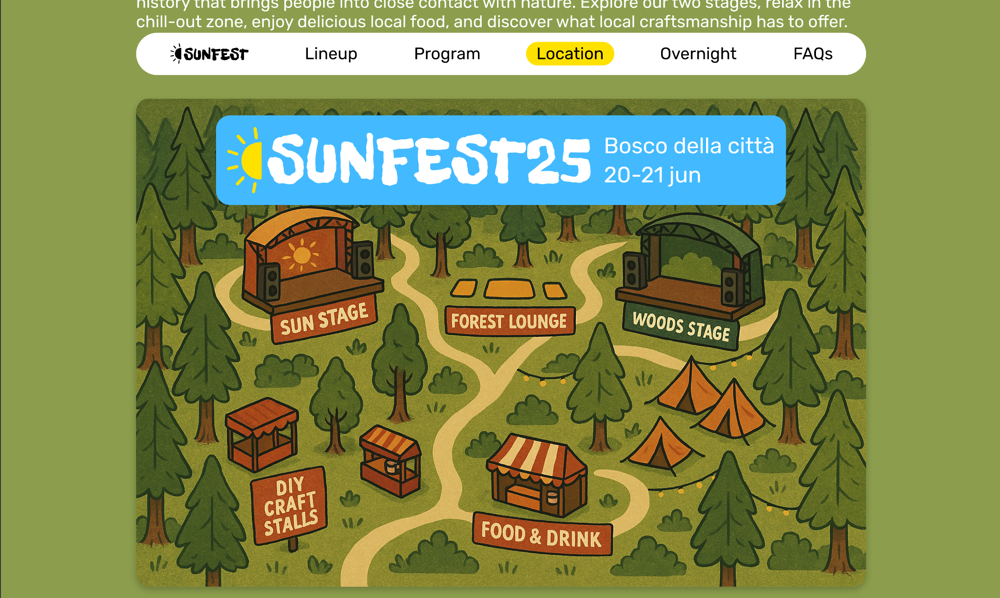
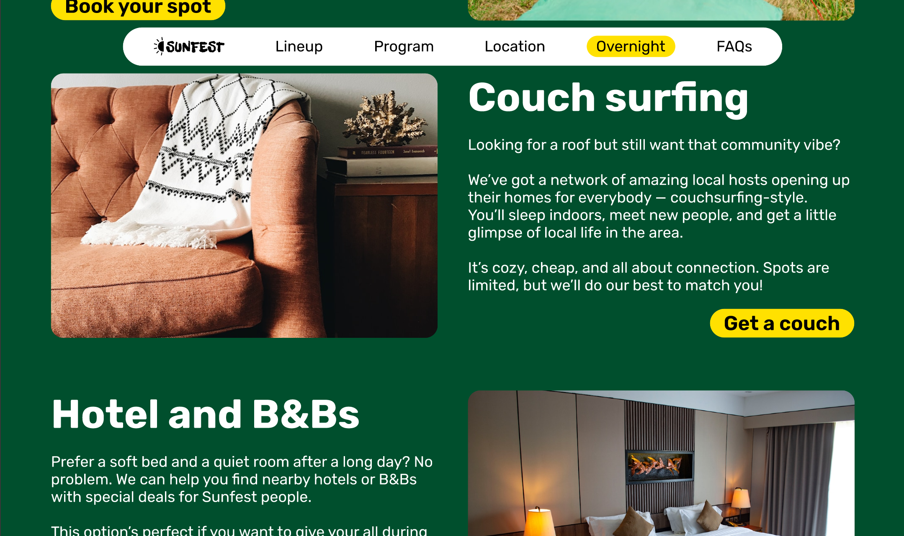
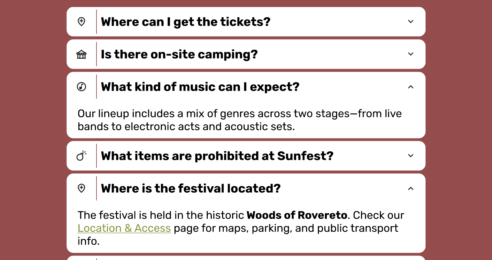
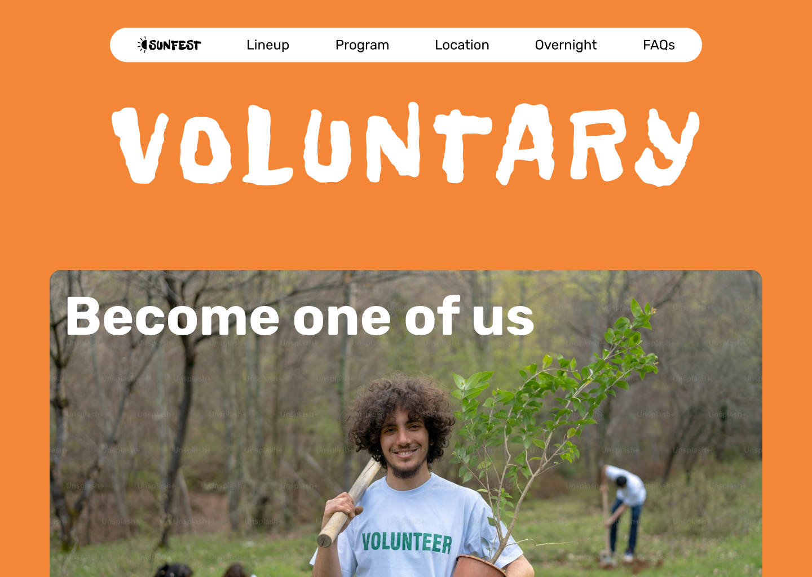
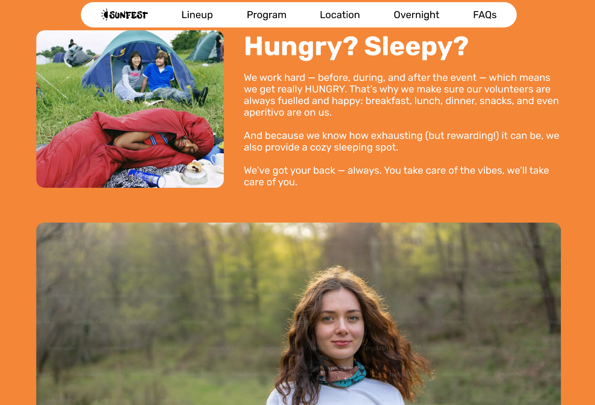

---
legend:
  "The prototype Live website ↗": "The prototype"
---

## Overview

- **What:** website and fully functioning Figma prototype for Sunfest25, a new indie and pop music festival in Rovereto’s Bosco della Città.
- **Context:** *Visual Design* course, Master’s in Human-Computer Interaction.
- **Team:** Michele Cazzaro and me; we co-designed the site, I prototyped more than half of it in Figma, and the palette, typography and UI components are my work.
- **Process:** competitor analysis, simulated client and user research, personas, low → medium → high-fidelity wireframes and mockups.
- **Result:** final grade **30/30**; later rebuilt in code as a [live website](/sunfest25/).

## The client and the brief

- **Client (fictional):** two young founders who want a festival that mixes music, community and sustainability.
- **Target audience:** 18–40 years old, social, tech-savvy, looking for unique outdoor cultural experiences.
- **Brief:** a modern, engaging and minimalist website that communicates lineup, program, location, accommodation and eco-values.
- **Goal:** generate excitement, strengthen community, make planning easy.

## Competitor analysis

- **Poplar Festival (Trento):** strong community vibe, limited scalability.
- **Nameless Music Festival (Lecco):** premium EDM with big acts, but costly and rigid.
- **Indirect:** Spotify (personalization), Wired Next Fest (brand-driven cultural appeal).
- **Insight:** a festival has to stay authentic and consistent with its audience; there is room for festivals built on community and underrepresented genres.

## Personas

Three personas, based on mock research and a mock market analysis:

- **Giulia, the social explorer:** wants easy planning with friends and moments worth sharing.
- **Marco, the pragmatic planner:** values clear schedules, reliable info and easy logistics.
- **Lara, the mindful creative:** looks for authenticity, eco-values and local community.

## Value proposition

***“An unforgettable music experience in nature.”***

- Music and nature intertwined in a wooded park.
- Indie and pop lineup balancing new and established acts.
- Eco-friendly practices and local collaborations.
- Beyond music: workshops, art, wellness, outdoor activities.
- A community-first atmosphere.

## Information architecture and navigation

- **Two layers:** homepage → 7 main sections (Line-up, Program, Location, Accommodation, FAQs, Voluntary, About Us).
- **Low-fidelity wireframes first,** to agree on content and order before visuals.
- **Three navigation systems:**
	- always-visible top bar for the main sections;
	- cards and contextual buttons for cross-navigation;
	- footer with sitemap, contacts, socials and the payoff “Embrace Nature, Party Hard.”

## Palette and typography

- **Palette:** pastel tones extracted from a photo of a blooming meadow, plus black and white for text and functional UI.
- **One dominant colour per section,** so pages feel distinct and users stay oriented.
- **Freckle Face:** playful accent font, limited to logo, titles and button labels.
- **Rubik:** clean, versatile font for body text and navigation.

## UI components

- **Buttons:** 4 types, each with default and hover states; contextual colours and icons hint at the next destination.
- **Overlays:** artist details, volunteer form and thank-you message, to keep users in the main flow instead of sending them to subpages.
- **Cards:** a modular system for artists, FAQs (open/closed) and information, giving the site a consistent rhythm.

## The prototype <a class="heading-chip" href="/sunfest25/">Live website ↗</a>

- [Figma project file](https://www.figma.com/design/sW5x8acKNC5OfuF2UhqMhs/Sunfest25?node-id=0-1&t=ESi4uiTpNxywADT3-1), including low and medium-fidelity mockups.
- [Interactive prototype](https://www.figma.com/proto/sW5x8acKNC5OfuF2UhqMhs/Sunfest25?node-id=426-10150&t=ESi4uiTpNxywADT3-1&starting-point-node-id=426%3A10150&scaling=scale-down-width&content-scaling=fixed) (press “z” to fit your screen).
- **Now also a real website:** I later rebuilt the high-fidelity design in code, so you can [browse Sunfest25 as a live website](/sunfest25/). It works on phones too: the lineup overlay, the day switch in the program and the FAQs are all interactive.

## What came next

- The design tries to be playful and clear at the same time, in line with the festival’s eco-conscious values.
- **Follow-up usability study** vs. the Poplar Utopia website (12 participants): Sunfest scored higher on SUS (92.5 vs. 85, not statistically significant) and on pragmatic quality; Poplar scored higher on hedonic quality.
- **Next step:** participants struggled with the FAQs on both sites, so the FAQ section should become more scannable or searchable. Full study in the related case study below.

## Prototype gallery

