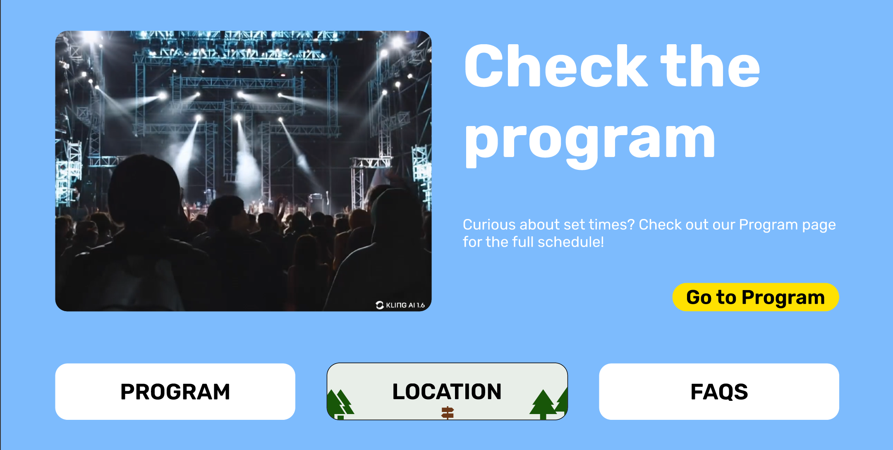
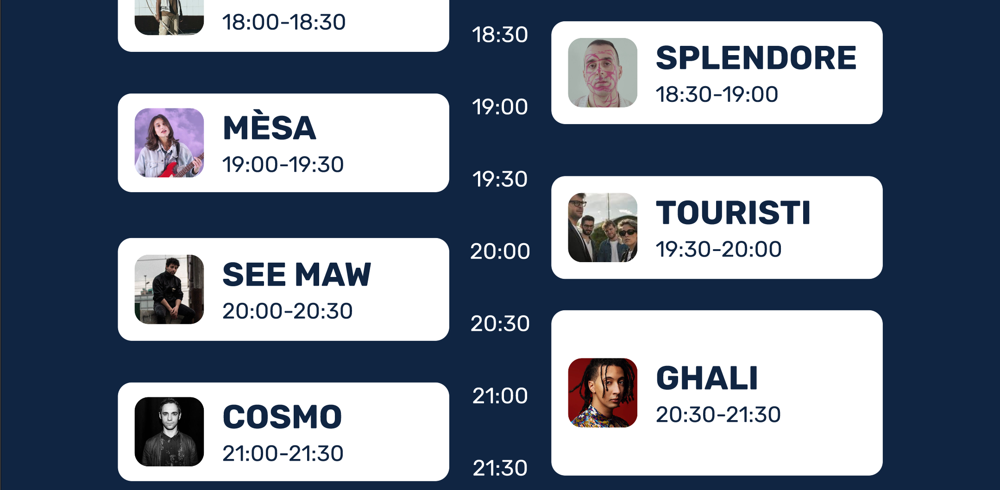
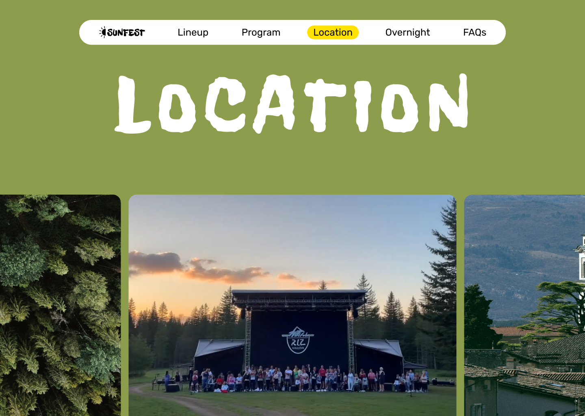

Sunfest25 is the website Michele Cazzaro and I designed for a new (fictional) indie and pop music festival in Rovereto’s woods, as the final project of the *Visual Design* course in our Master’s in HCI. We simulated a full design process, from competitor analysis and personas to low, medium and high-fidelity wireframes and mockups, and delivered a fully functioning Figma prototype that earned a **30/30**.

Competitor analysis and three personas showed that authenticity and clarity mattered most. That led to a two-layer, card-based structure with three navigation systems: a top bar, contextual buttons and a footer linking every section. For the visual identity, I built a pastel palette from a photo of a blooming meadow, giving each section its own dominant colour, and paired the playful Freckle Face for titles with the readable Rubik for body text. I also designed the buttons, cards and overlays that keep users in the flow. You can [try the prototype](https://www.figma.com/proto/sW5x8acKNC5OfuF2UhqMhs/Sunfest25?node-id=426-10150&t=ESi4uiTpNxywADT3-1&starting-point-node-id=426%3A10150&scaling=scale-down-width&content-scaling=fixed), open the [full Figma project](https://www.figma.com/design/sW5x8acKNC5OfuF2UhqMhs/Sunfest25?node-id=0-1&t=ESi4uiTpNxywADT3-1) or [visit the Sunfest25 website](/sunfest25/), which I later rebuilt in code. A follow-up usability study against the Poplar Utopia website gave Sunfest a SUS score of 92.5 (Poplar: 85) and pointed to the FAQs as the next thing to improve: see the related case study below.

## Prototype gallery

